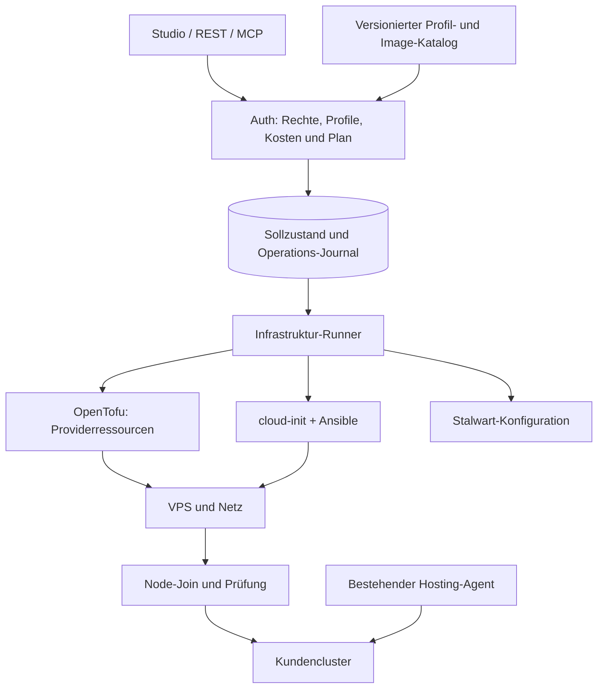

# Webdock IaC: Architektur- und Umsetzungsplan

> **For agentic workers:** Bei einer später beauftragten Umsetzung `superpowers:executing-plans` verwenden. Die Etappen haben eigene Abnahmekriterien; aus diesem Plan folgt keine Freigabe für Bestellungen, Produktionsänderungen oder Datenmigrationen.

**Goal:** VPS nach Webdock-Profil bestellen, reproduzierbar konfigurieren und als geprüften Cluster-Node oder eigenständigen Dienst betreiben; freigegebene Container-Images und Stalwart nach demselben Lebenszyklus verwalten.

**Architecture:** Studio/Auth verwalten Berechtigungen, gewünschten Zustand, Kostenrahmen und Aufträge. Ein eigener Infrastruktur-Runner führt versionierte OpenTofu-, cloud-init- und Ansible-Bausteine aus. Der vorhandene Hosting-Agent bleibt für Kunden-Workloads zuständig; Stalwart bekommt einen gesonderten Dienstvertrag.

**Tech Stack:** Bestehendes TypeScript/pg/Better-Auth-System, vorhandener Python-Hosting-Agent; neu OpenTofu, cloud-init, Ansible und ein kleiner Python-Infrastruktur-Runner. OCI-Images nach Digest; Stalwart-Server und CLI als gemeinsam geprüfte Versionen.

**Spec:** Zielbild und Architekturentscheidungen sind in den Abschnitten 1–8 dieses Plans enthalten. Dieser übergreifende Plan legt Reihenfolge, Schnittstellen und Abnahme fest; die einzelnen Etappen werden vor ihrer Umsetzung anhand des dann aktuellen Codes konkretisiert.

**Stand:** 12.10.2026. Planungsentwurf auf Basis von Commit `73733b0` und dem vorhandenen, umfangreich geänderten Arbeitsverzeichnis. Keine Infrastruktur wurde für die Planung verändert oder live geprüft.

## 1. Ausgangspunkt und Leitplanken

Der gewünschte Ablauf: Ein Operator wählt beispielsweise „Cluster um einen Worker erweitern“, einen erlaubten VPS-Tarif und ein Profil. Webdock zeigt Kosten und Änderungen, bestellt nach Freigabe genau eine Maschine, richtet sie ein und gibt ihre nutzbaren Ressourcen erst nach erfolgreicher Prüfung frei. Ein weiterer Ablauf installiert einen fest definierten Dienst wie Stalwart auf einem geeigneten Host.

Die vorhandene Grundlage ist brauchbar:

- `apps/auth/src/lib/hosting/`: Mandantengrenzen, Cluster, Ressourcenreservierungen, verschlüsselte App-Konfiguration und dauerhaftes Operations-Journal.
- `packages/hosting-contracts/src/index.ts`: typisierte Befehle, unveränderliche Image-Digests, gewünschte und beobachtete App-Revisionen.
- `apps/hosting-agent/`: ausgehende Agentenverbindung, eingeschränkter Kubernetes-Executor und getrennte privilegierte Speicherhilfe.
- Aktueller Clusterentwurf: drei gemeinsam genutzte Contabo-Nodes; Kunden erhalten Container-Kontingente. Lokaler Speicher und Cluster-Agent hängen derzeit laut Betriebsdokumentation an node02.
- Webdock Mail: bestehender turboSMTP-Pfad; Relaykit-Ausbau ist geplant. Stalwart/Postfächer sind eine zusätzliche Produktfähigkeit, noch keine vorhandene Integration.

### Global Constraints

- Gemeinsamer Kundencluster bleibt der Standard. Eine VPS-Bestellung erweitert zunächst Plattformkapazität; sie bedeutet keine automatische Vermietung eines VPS an einen Kunden.
- Kundeneigene Cluster bleiben möglich, aber Node-Provisionierung ist eine gesonderte Berechtigung und setzt Zugang zum passenden Providerkonto sowie Cluster voraus. Vorhandenes BYOK-Workload-RBAC reicht dafür nicht.
- Contabo zuerst; kein Hetzner-Umbau und keine gleichzeitige Implementierung mehrerer Provider.
- HA, Longhorn, N+1-Reserve, automatischer Failover und automatische Kunden-Backups bleiben außerhalb der ersten Etappen. Der Plan benennt dafür spätere Betriebsstufen.
- Bestehende 20-Prozent-Kapazitätsreserve und lokale Speicherbindungen erhalten. Ein neuer Worker erhöht nicht automatisch die Kapazität für lokal gebundene Apps.
- Keine Neuinstallation bestehender VPS beim Übernehmen in die Verwaltung. Erst inventarisieren/importieren, dann einen Plan ohne Änderungen nachweisen.
- Bestehende Tenant-IDs, Snowflake-IDs, SSO, Audit und Studio-Bridge weiterverwenden. Keine zweite Authentifizierung oder Queue-Plattform.
- Keine beliebigen Shell-Kommandos, Ansible-Playbooks, Terraform-Module, Dockerfiles oder Kubernetes-Manifeste aus Kundeneingaben ausführen.
- Keine Cloudflare-Integration in dieser Etappe. DNS-Pläne erzeugen und bestehende Records prüfen; DNS-Schreibadapter bleiben ein separat wählbarer Ausbau.
- Das öffentliche Repo enthält generische Profile und Testdaten. Reale Kundenbelegung, Secrets, Mailboxlisten, State- und Plan-Dateien bleiben privat.
- Bestehende fremde Änderungen nicht überschreiben oder beiläufig committen. Umsetzung in isoliertem Checkout; vor Next.js-Code die installierten Framework-Guides lesen.

## 2. Werkzeugentscheidung und Zuständigkeit

| Ansatz | Nutzen | Nachteil | Einordnung |
| --- | --- | --- | --- |
| OpenTofu + cloud-init + Ansible unter Webdock-Steuerung | Providerzustand, Erststart und laufende Hostkonfiguration sind klar getrennt; importierbar und prüfbar | Drei kleine Werkzeuge müssen versioniert betrieben werden | Empfehlung |
| Provider-API + eigene Shellskripte für alles | Kurzer Einstieg | Drift, Import, Wiederaufnahme und Updates werden zu Eigenentwicklung | Nur begrenzter Adapter für nachgewiesene Providerlücken |
| Cluster API/Crossplane und zusätzlicher GitOps-Controller | Umfangreiche deklarative Infrastruktursteuerung | Hoher Einführungsaufwand und zusätzliche Controller neben Webdock | Bei heutiger Größe zurückstellen |

**Ein zuständiger Schreiber pro Ressource:** OpenTofu besitzt unterstützte Providerressourcen; Ansible besitzt Host-Konfiguration; Webdock besitzt Kunden-Workloads; ein Stalwart-Adapter besitzt die freigegebenen Mail-Konfigurationsobjekte. Kein zweiter Controller verändert dieselben Objekte unabhängig.

Contabo veröffentlicht einen eigenen Terraform-Provider. Seine konkrete OpenTofu-Kompatibilität, Import-, Änderungs- und Kündigungssemantik müssen in Etappe 0 geprüft werden. Für ein nicht unterstütztes Objekt wird entweder ein abgegrenzter Provider-API-Schritt verwendet oder ein expliziter manueller Schritt angezeigt; keine verdeckte Doppelverwaltung. [Contabo-Provider](https://github.com/contabo/terraform-provider-contabo)

### Zustandsquellen

| Inhalt | Maßgebliche Quelle |
| --- | --- |
| Profile, Modulcode, Versionsbindungen, Image-Rezepte | Git, konkrete Commit-ID und signiertes Release-Artefakt |
| Kundenzuordnung, freigegebene Parameter und gewünschte Revision | Webdock-Datenbank |
| Zuordnung deklarierter Providerressource zur tatsächlichen Instanz | OpenTofu-State; Webdock speichert die verifizierte Referenz |
| Tatsächlicher Zustand und verfügbare Kapazität | Frische Provider-/Node-/Dienstbeobachtung |
| Zugangsdaten, Schlüssel und Mail-Passwörter | Privater Secret-Speicher; öffentlich nur zweckgebundene Referenzen |

Kein Git-Commit pro Mailbox und kein konkurrierendes Sollzustands-YAML neben jeder Studio-Einstellung. Exportierbare, bereinigte Manifeste dienen der Nachvollziehbarkeit; aktive Änderungen laufen durch denselben Dienst.

## 3. Profile und Katalog

Ein **Blueprint** beschreibt erlaubte Parameter, Anforderungen, Ressourcen, Prüfungen, Updateverhalten und Datenhaltung. Jede veröffentlichte Version ist unveränderlich. Eine Instanz bindet eine exakte Version; ein neues Release aktualisiert bestehende Instanzen erst durch einen eigenen Änderungsauftrag.

| Profil | Zweck | Wesentliche Parameter |
| --- | --- | --- |
| `host.linux` | Webdock-Basiskonfiguration eines neuen oder importierten Hosts | unterstütztes OS-Image, Region, SSH-Zugang, Netz, Wartungsfenster |
| `node.k3s-worker` | Zusätzlicher Rechenknoten | Cluster-ID, kompatible k3s-Version, Node-Pool, Labels, zulässige Ressourcen |
| `node.k3s-server` | Neuer Control-Plane-Knoten | Datastore/Quorum, Servermitgliedschaft, Zertifikate; separate spätere Etappe |
| `app.http-node24` | Node.js-Webanwendung | Runtime-Image, App-Image, HTTP-Port, Probe, CPU/RAM, Speicher |
| `app.http-python` | Python-Webanwendung | geprüfte Python-Version, App-Image, Probe, CPU/RAM |
| `app.static` | Statische Website | geprüfter unprivilegierter Webserver und statische Artefakte |
| `app.worker` | Bot/Background-Worker | Prozess-/Anwendungsprobe, kein öffentlicher HTTP-Zwang; zusätzliche Executor-Fähigkeit |
| `service.stalwart` | Postfächer und Mailprotokolle | Host, Edition, Server-/CLI-Digest, Endpunkte, Speicher, Versandroute |

Nicht alle Profile werden sofort freigeschaltet: erster Pfad `host.linux` → `node.k3s-worker`; danach HTTP-Images und Mailpilot. Worker ohne HTTP benötigen ein eigenes, getestetes Capability-Update im heutigen HTTP-zentrierten Executor.

Schemafelder: `id`, `version`, `kind`, `parametersSchema`, `requiredCapabilities`, `resourceDefaults`, `secretSlots`, `ports`, `healthChecks`, `dataPolicy`, `upgradePolicy`, `artifactDigest`. Preise kommen aus einem zeitgebundenen Tarifangebot, nicht aus einem unveränderlichen Profil.

**Drei unterschiedliche Image-Arten:** VPS-OS-Image für den Host; OCI-Runtime-Image als Grundlage eines App-Builds; fertig deploybares Service-/App-Image mit Konfiguration. Ein nacktes Node-Image ist noch keine funktionierende Kundenanwendung.

## 4. VPS bestellen und Node hinzufügen

### Benutzerablauf

1. **Auswählen:** Zielcluster, Providerkonto, Region, Tarif, Profilversion, Hostname und Anzahl. Anfangs nur Operatoren; spätere Kundenausführung benötigt eigene Grenzen.
2. **Planen:** Änderungen, Einrichtungs-/laufende Kosten, Währung, Steuerdarstellung, Mindestlaufzeit, nächste Abrechnung und Netz-/IP-Zusatzkosten anzeigen. Bei unbekannten Kosten keinen verbindlichen Bestellknopf anbieten.
3. **Freigeben:** Plan-Hash an Profilversion, Eingaben, Tarifangebot, Ablaufdatum, aktuelle Rechte und Kostenobergrenze binden. Preis- oder Zieländerung erzeugt einen neuen Plan.
4. **Bestellen:** Genau eine logische Ressource je Auftrag/Node-Slot reservieren; API-Annahme und Providerreferenz dauerhaft festhalten. Erst dann weitere Schritte.
5. **Bootstrap:** cloud-init legt minimale Benutzer-, SSH-, Netz- und Runner-Voraussetzungen an. Ansible konfiguriert Updates, Zeitsynchronisation, Firewall, Registry-Vertrauen, k3s und Logging.
6. **Beitreten:** Neuer Worker startet mit Quarantäne-Taint. Vertrauenswürdigen Clusterendpunkt und kurzlebigen, auf Agenten beschränkten Join-Zugang verwenden.
7. **Prüfen:** Provideridentität, OS/k3s-Version, private Verbindung, Node-Ready, CNI/DNS, echte Namespace-Isolation, Image-Pull, Ressourcenreserve und gegebenenfalls Speicherpfad prüfen.
8. **Aktivieren:** Quarantäne erst nach erfolgreicher Abnahme aufheben; beobachtete Kapazität neu berechnen und begrenzt freigeben. „VM läuft“ ist noch kein fertiger Cluster-Node.

Contabo unterstützt cloud-init über `userData`. Request-/Trace-IDs der API werden nicht ohne dokumentierten Nachweis als Schutz vor doppelten Bestellungen behandelt. [Contabo API](https://api.contabo.com/)

Private-Netz-Zuweisung vor jeder Ausführung auf tatsächliche Instanzfähigkeit prüfen. Beim vorhandenen Bestand dokumentiert das Repo eine potenziell destruktive Aktivierungsgrenze. Eine neue IaC-Verwaltung darf daraus keinen automatischen Reinstall ableiten. [Contabo Private Networking](https://docs.contabo.com/docs/network-services/private-networking/)

### Wiederaufnahme und Fehler

Fachliche Phasen: `planned → approved → ordering → provisioning → bootstrapping → joining → verifying → ready`. Der bestehende Operation-Status bleibt `queued/running/succeeded/failed/needs-reconciliation`; die Phase ergänzt ihn, statt eine widersprüchliche zweite Queue zu erzeugen.

- Derselbe Request und derselbe logische Node dürfen auch bei parallelen Aufrufen unterschiedlicher Operatoren nur eine Bestellung erzeugen: Idempotenz plus eindeutige Ressourcenidentität und Sperre.
- Timeout nach Bestellung: `needs-reconciliation`, Providerinventar abgleichen; niemals blind erneut bestellen. Verwaiste, weiterhin kostenpflichtige Ressourcen bleiben sichtbar.
- Bootstrap-Fehler: vorhandene Instanz behalten und an einem belegten Checkpoint fortsetzen; kein Reinstall als Standard-Reparatur.
- Runnerabbruch: keine zweite schreibende Ausführung allein wegen abgelaufener Lease. Erst alten Prozess beenden oder dessen Ende beweisen; unklare Provideraktionen abgleichen.
- Abbruch nach Bestellung ist keine Kündigung. „Stoppen“, „aus Cluster entfernen“, „Vertrag kündigen“ und „Daten löschen“ sind getrennte Vorgänge mit beobachtetem Ergebnis.
- Kunde/Projekt deaktiviert: keine automatische VPS-Kündigung und keine Datenlöschung.

### Besonderheiten des bestehenden Agents

`hosting_agent.cluster_id` ist heute eindeutig; Enrollment verweigert einen zweiten aktiven Cluster-Agenten. Ein neuer k3s-Worker erhält deshalb **keine Kopie** der vorhandenen `connection.json` und löst kein erneutes Cluster-Enrollment aus. Der bestehende Agent beobachtet den hinzugefügten Node. Der Infrastruktur-Runner hat eine eigene, eng begrenzte Identität; ein künftig mehrinstanzfähiger Cluster-Agent bleibt eine gesonderte HA-Aufgabe.

Für k3s den vorgesehenen sicheren Agenten-/Bootstrap-Tokenpfad einsetzen; den mächtigen Server-Token nicht als allgemeines cloud-init-Secret verteilen. Tokens und SSH-Hostidentität beim konkreten Join prüfen. [K3s-Tokenmodell](https://docs.k3s.io/cli/token)

## 5. Runner, State und Berechtigungen

Ein langlebiger Python-Runner verwendet vorhandene Betriebsmuster, jedoch eigene Identität und eigenen Prozess. Er führt ausschließlich signierte, versionierte Profile aus. Einstieg als Operator-CLI auf einem freigegebenen Managementhost; danach derselbe Ausführungscode als systemd-Dienst. Kein neuer VPS nur für den Runner als MVP-Voraussetzung. Bei Ausfall dieses Hosts pausiert Provisionierung; laufende Kunden-Apps bleiben unabhängig.

Die bisherige Hosting-Queue beansprucht allgemein Clusteroperationen und hat eine 180-Sekunden-Lease. **Vor** dem ersten Infrastrukturauftrag wird die Auswahl explizit nach `executor_kind` getrennt: `workload`, `infrastructure`, `mail`. Bestehende Aufträge werden `workload`; zusätzliche Aktions-Allowlisten verhindern, dass der alte Agent neue Operationen übernimmt. Ein Infrastruktur-Claim braucht Provider-/Instanz-/State-Ziel und darf nicht von einer bereits existierenden App oder Projektreservierung abhängen.

Lange Jobs bekommen Heartbeats, Deadlines, Generationen und pro Ziel eine Sperre. Schritte dokumentieren Eingabehash, Start/Ende, Provider-ID, Ergebnis und redigierte Diagnosen. Nach Leaseverlust beendet der Runner seine Unterprozesse; ein Nachfolger gleicht den externen Zustand ab, bevor er erneut schreibt. Eine DB-Generation allein kann einen schon laufenden Providerrequest nicht zurückholen.

**OpenTofu-State:** Vorgeschlagen ist eine separate IaC-Datenbank im vorhandenen PostgreSQL-Betrieb mit eigenem DB-Login, nicht die Auth-Runtime-Verbindung. Das native `pg`-Backend besitzt State-Locking; direkte Verbindung wegen Sitzungssperren, getrennte State-Grenzen je Providerkonto/Cluster und Berechtigungsbereich. Eine Workspace-Bezeichnung allein ist keine Mandantenisolierung. Versionierte verschlüsselte State-/Plan-Artefakte und separat wiederherstellbare Schlüssel gehören zur Infrastrukturverwaltung. [pg-Backend](https://opentofu.org/docs/language/settings/backends/pg/), [State-Verschlüsselung](https://opentofu.org/docs/language/state/encryption/)

Die zusätzliche Datenbank wird hier nur vorgeschlagen. Vor Einrichtung Speicher-/Betriebskosten, Lock-Verhalten und Wiederherstellung prüfen. Das Backend benötigt eine gemeinsame Sequenz im eigenen Datenbank-`public`-Schema; dafür keine breiten Rechte auf bestehende App-Schemas vergeben. Genau eine festgelegte OpenTofu-Version pro Backend verwenden.

Secrets nur zur Ausführung abrufen, in kurzlebige geschützte Dateien/Umgebung injizieren und redigieren. Providerkonten bleiben beim Infrastruktur-Runner, niemals auf Kunden-Nodes oder beim Workload-Agenten. In cloud-init stehen höchstens einmalige, kurzlebige Enrollment-Zugänge; sie sind nach erfolgreichem Bootstrap ungültig. Geheimnisse bleiben auch aus Logs, Image-Layern, Git und gewöhnlichen Planansichten heraus.

Drift zunächst anzeigen: `in_sync`, `drifted`, `unknown`. Fehlende Erreichbarkeit ist kein Beweis für Löschung. Sichere Reparaturen später gezielt erlauben; Reinstall, Ersatz einer Datenplatte, Kündigung und Mailbox-Purge benötigen eigene Pläne. Bei Kündigungen sowohl tatsächlichen Ressourcenzustand als auch Vertrags-/Abrechnungsstatus prüfen.

## 6. Vordefinierte Container-Images

**MVP:** Node 24 HTTP, Python HTTP und statischer Webserver. Stalwart zunächst als geprüftes Upstream-Image, kein eigener Fork. Postgres/Redis und weitere zustandsbehaftete Services bekommen später eigene Profile mit Daten- und Upgradevertrag.

Pipeline: Quellstand/Upstream-Digest auswählen → auf erlaubtem EU-Builder bauen oder geprüft spiegeln → Software-Inventar/SBOM und Schwachstellenprüfung → Verhalten testen → signieren → in freigegebene Registry veröffentlichen → Katalogversion freigeben. Registry und Builder erst nach Standort-/Zugangsprüfung real anbinden; keine angebliche EU-Garantie für beliebige Upstream-Downloads ableiten.

- Basis-Digest, unterstützte Architektur, Build-Werkzeuge und Abhängigkeiten festhalten; Tags sind lesbare Namen, deployed wird nach Digest.
- Runtime-Test mit nicht-root Benutzer, read-only Root-FS, definiertem Schreibpfad, korrektem Signal-/Shutdown-Verhalten und Ressourcenlimits.
- App-Builds und Runtime-Images trennen. Den geplanten Git-Deployment-Pfad wiederverwenden, keine zweite allgemeine Buildplattform entwickeln.
- Keine Zugangsdaten oder Kundendaten in Image-Layern; nur freigegebene Referenzen und Build-Secrets mit begrenztem Lebenszyklus.
- Registry-Zugriff/Signaturprüfung als neue Agent-Capability ausrollen. Heute ist der Managed-Pfad auf gecachte Digests begrenzt; ein Katalogeintrag allein hebt diese Grenze nicht auf.
- Status `candidate`, `approved`, `deprecated`, `blocked`; ein Sicherheitsproblem sperrt neue Deployments und erzeugt nachvollziehbare Updatepläne für betroffene Apps.
- Rückkehr zum vorherigen App-Image nur bei kompatiblen Daten. Image-Rollback ersetzt keine Datenbankmigration oder Datenwiederherstellung.

Eigene goldene VPS-Images/Packer erst ergänzen, wenn gemessene Bootstrapzeiten es rechtfertigen. Zuerst Provider-OS-Image plus cloud-init/Ansible. Spätere VM-Images enthalten weder SSH-Hostschlüssel, machine-id, Clusterzugehörigkeit noch aktive Enrollment-Zugänge.

## 7. Stalwart als IaC-Dienst

### Produkt- und Betriebsmodell

Stalwart ergänzt echte Postfächer, eingehende Mail, IMAP/JMAP und authentifizierte Submission. Webdock Mail/Relaykit und Auth-Mails behalten ihren bestehenden Versandpfad. Für ausgehende Postfachmail wird zunächst der vorhandene Relay-Anbieter als Vorschlag geprüft: erst nach Bestätigung von Kontozuordnung, erlaubtem Nutzungstyp, Limits und vollständiger Testzustellung aktivieren.

Empfehlung für den ersten Pilot: **eine Organisation, eine isolierte Stalwart-Instanz auf einem ausdrücklich gewählten Mail-Host**, eindeutiger Mailhostname und persistenter Speicher. Der Zielhost kann später über das VPS-Profil bestellt werden. Ein dedizierter Mail-VPS ist für feste IP, Mailports und getrennte App-Wartung die bevorzugte Produktionsvariante; die Bestellung ist eine eigene Kostenentscheidung. Kubernetes-Mailbetrieb bleibt eine spätere Variante, nicht Voraussetzung des Piloten.

Stalwart nicht in das aktuelle generische HTTP-App-Profil pressen: dieses modelliert einen HTTP-Port oberhalb 1023 und eine HTTP-Probe. Mail benötigt mehrere Protokolle, andere Netzprüfungen und einen eigenen Datenlebenszyklus. Hostkonfiguration/Containerstart übernimmt das Plattform-Serviceprofil mit geprüften minimalen Rechten.

| Mandantenmodell | Eignung | Konsequenz |
| --- | --- | --- |
| Isolierte Community-Instanz je Organisation | Pilot bzw. wenige getrennte Kunden | Eigene Daten/Secrets und sauber zugeteilte Endpunkte/IPs; mehr Betriebsaufwand |
| Gemeinsame Enterprise-Instanz mit nativen Tenants | Späterer wirtschaftlicher Mehrkundenbetrieb | Lizenz/Kostenentscheidung und Isolationstests vor Freigabe |

Native Tenants sind laut aktueller Stalwart-Dokumentation Enterprise-Funktion. Eine gemeinsame Community-Instanz mit mehreren Domains wird deshalb nicht als gleichwertige native Tenant-Isolation verkauft. [Stalwart Tenants](https://www.stalw.art/docs/auth/authorization/tenants/)

### Deklarative Konfiguration

Aktuelle Stalwart-Dokumentation beschreibt einen kleinen `config.json`-Bootstrap und weitere Konfiguration über Management-JMAP/CLI. Server- und CLI-Version gemeinsam pinnen; kein altes TOML-Modell ungeprüft übernehmen. [Deklarative Stalwart-Deployments](https://www.stalw.art/docs/configuration/declarative-deployments/)

Webdock erzeugt begrenzte `upsert`-/Singleton-Update-Pläne für Listener, Domains, Konten, Aliase, Quoten und freigegebene Policies. `stalwart-cli apply` liefert Maschinenresultate; `snapshot` dient dem Konfigurationsabgleich. Dessen Dry-run prüft Struktur, aber keinen vollständigen Live-Diff. Deshalb aktuellen Zustand separat lesen, fremde Objekte ausschließen und erwartete Änderungen vor Ausführung vergleichen. `reconcile` mit impliziten Löschungen ist im normalen Tenantpfad verboten. [Apply-Vertrag](https://stalw.art/docs/management/cli/apply/), [Konfigurationsexport](https://stalw.art/docs/management/cli/snapshot/)

Accounts, Passwörter und private Schlüssel werden nicht im öffentlichen Git abgelegt. Webdock bleibt die Zuordnungsinstanz für Kunde/Domain/Mailbox; eine E-Mail-Adresse allein ist kein Identitätsnachweis. Bootstrap-Adminzugänge nach Einrichtung entfernen; dauerhafte Verwaltung intern und mit engsten verfügbaren Rechten.

### Inhalt des Mail-Profils und Abnahme

| Bereich | Geplante Umsetzung und Prüfung |
| --- | --- |
| Erreichbarkeit | Feste IPv4/geeignete IPv6, Hostname, eingehender Port 25 tatsächlich erreichbar; Submission 465/587, IMAPS 993, HTTPS/JMAP nach Bedarf; übrige Protokolle geschlossen |
| Netz/Identität | PTR beim IP-Provider, passende A/AAAA-Einträge, korrekter SMTP-Name; IPv6 erst bei vollständig funktionierendem Pfad veröffentlichen |
| DNS | Eigentumsnachweis, MX, SPF mit bestehenden Sendern zusammenführen, DKIM je Domain/Route, DMARC stufenweise; kein zweiter SPF-Record und kein ungeprüfter MX-Wechsel |
| TLS | Zertifikatsausstellung und Erneuerung für alle tatsächlichen Endpunkte prüfen; Submission/IMAP verlangen geschützte Anmeldung |
| Missbrauchsschutz | Kein offenes Relay, Absenderrechte prüfen, Anmeldung/Versand begrenzen, Quoten und Spamregeln; Mailqueue und Fehlerbehandlung testen |
| Daten | Explizites persistentes Volume, Kapazitäts-/Mailboxquoten, ausreichend freier Platz, getrennte Suspendierung und endgültige Löschung |
| Produktzugriff | Mailbox/Alias anlegen, Passwort/Clientzugang erneuern, Quote ändern, suspendieren; Rollenprüfung in Webdock und im Dienst |
| Updates | Testinstanz aktualisieren, Migration/Kompatibilität prüfen, Wartungsfenster und belegte Rückkehrstrategie; kein blindes Downgrade über migrierte Daten |

DNS-Automation ist für den ersten Ablauf nicht erforderlich: generierten Recordplan manuell anwenden und anschließend prüfen. MTA-STS/TLS-RPT, komfortable Autokonfiguration und Webmail sind anschließende, eigene Arbeitspakete.

**Datenwiederherstellung:** Ein Konfigurationsexport enthält nicht automatisch Nachrichten, Blobs, Suchdaten und ausstehende Mailqueue. Vor produktiven Kundenpostfächern muss eine komplette Wiederherstellung inklusive Schlüsselmaterial auf einem leeren Ziel gelingen. Vorgeschlagene Mindest-Betriebsziele sind RPO ≤ 24 Stunden und RTO ≤ 4 Stunden, zunächst zu messen und keine SLA-Zusage. Automatische Mail-Backups werden als eigene spätere Etappe geplant; solange die bisherige Zurückstellung gilt, bleibt der neue Maildienst im Pilotstatus mit synthetischen Daten.

## 8. Webdock-Datenmodell und Oberflächen

Neue Konzepte bewusst klein halten:

- `infra_provider_connection`: Eigentümer, verifizierte Providerkonto-ID, erlaubte Regionen/Tarife, Secret-Referenz und Kostenlimits. Derselbe reale Account darf nicht durch andere Credentials unbemerkt einem fremden Kunden zugeordnet werden.
- `infra_resource`: logische ID, Typ, Profil/Version, gewünschte Revision, beobachtete Revision, Provider-/Cluster-/Node-Referenzen, Betriebs- und Vertragszustand.
- `infra_plan`: normalisierte Eingaben, Plan-Hash, Basisrevision, Angebot/Kosten, Ablaufzeit, Berechtigungsumfang und Freigabenachweis.
- `infra_step`: Operation, Reihenfolge, Checkpoint, Versuch, Ergebnisnachweis. Bestehendes `hosting_operation` bleibt der übergeordnete Auftrag.
- `image_release`: Profilversion, Digest, Architektur, Herkunft, Prüfergebnisse und Freigabestatus.
- `mail_service`/`mailbox_binding`: Zuordnung von Kunde, Dienst, Domain und externer Mailbox-ID; Kontingente getrennt von App-Speicher und transaktionalen Versandkontingenten.

Öffentliche Aktionen: `infra.plan`, `infra.apply`, `infra.get`, `infra.reconcile`, `infra.cancel`; später separate `infra.retire`/`infra.purge`. `apply` akzeptiert nur gespeicherte Plan-ID plus Hash und Idempotenzschlüssel; keinerlei ausführbaren Quelltext. Beim Ausführen Rechte, Quote, Preisgültigkeit und Basisrevision erneut prüfen.

Studio erweitert die vorhandene Clusterseite um „Node hinzufügen“, Status/Schritte, Drift und Wartung. Im App-Dialog erscheinen freigegebene Templates. Postfächer bekommen einen eigenen Bereich neben dem bestehenden Versandprodukt. REST und MCP verwenden dieselben Dienste; Kostenfreigaben lassen sich nicht durch einen alternativen API-Pfad umgehen.

## 9. Lieferetappen

Jede Etappe ist separat abnehmbar. Reihenfolge: **0 → 1 → 2 → 3 → 4** für Clustererweiterung; danach **5** für Images und **6 → 7** für Mail. Etappe 8 ist spätere Betriebsreife.

| Etappe | Ergebnis | Nachweis, bevor sie als fertig gilt |
| --- | --- | --- |
| 0: Provider-/Versionsverträge | Contabo-Supportmatrix, passende OS/k3s-Versionen, Stalwart Server/CLI, Runner-/State-Ziel | Import, Update, Ersetzen, Vertragsende und Kostenquellen dokumentiert; unbekannte Fähigkeiten blockiert |
| 1: Profile, Pläne und Operations-Routing | Typisierte Profile, Kosten-/Änderungsplan, getrennte Executor-Zuständigkeit | Fremdtenant, veralteter Plan, Preisänderung, doppelter Node und alter Agent werden korrekt abgefangen |
| 2: Host-Provisionierung | Wiederholbares `host.linux` mit cloud-init/Ansible | Leere Test-VM reproduzierbar eingerichtet; zweiter Lauf ohne unerwartete Änderungen; unterbrochener Lauf fortsetzbar |
| 3: Cluster-Node | Geprüfter Worker aus bestehender/importierter VM | Join/Quarantäne/Isolation/Registry/Drain funktionieren; Agentidentität unverändert; Kapazität erst nach Prüfung erhöht |
| 4: Bestellung und Studio | Vollständiger Operatorablauf vom freigegebenen Tarif bis zum fertigen Node | Kontrollierter Bestelltest im freigegebenen Kostenrahmen; verlorene Antwort erzeugt keinen zweiten VPS; Vertragsstatus sichtbar |
| 5: Image-Katalog | Drei geprüfte HTTP-Templates und Registry-Capability | Builds/Signaturen/Runtimegrenzen nachgewiesen, gesperrte Images abgewiesen, bestehende Apps unverändert |
| 6: Stalwart-Pilot | Eine isolierte Organisation mit deklarativen Domains, Mailboxen und Aliasen | Wiederholte Konfiguration erzeugt keine Duplikate; Protokoll-/Quota-/Relay-/DNS-Tests bestehen |
| 7: Mail als Kundenprodukt | Gewähltes Mandantenmodell, Wiederherstellung und kontrollierter Cutover | Fremdkundenzugriff ausgeschlossen, Restore auf leerem Ziel bewiesen, Testzustellung und Rückfallpfad dokumentiert |
| 8: Laufender Betrieb | Geplante Updates, Wartung/Drift, weitere Provider und optional HA | Messbare Upgrade-/Recovery-Ergebnisse; eigene Freigabe für zuvor zurückgestellte Betriebsfunktionen |

### Geplante Dateien und Arbeitspakete

Alle nachfolgend als neu bezeichneten Pfade sind Zielstruktur, keine behauptete vorhandene Implementierung.

**0 – Verträge:** Neu `docs/architecture/iac-provider-capabilities.md`, `infra/iac/versions.json`. Providerfähigkeit für Preise, Bestellung, cloud-init, Private Network, Import, Resize, Reinstall, PTR, Kündigung und Bestandsabgleich erfassen. Der aktuelle Auftrag braucht hierfür keine echten Bestelltests.

**1 – Steuerung:** Neu `packages/hosting-contracts/src/infrastructure.ts`, `apps/auth/src/lib/infrastructure/{profiles,plans,resources,operations,schema}.ts`, `apps/auth/scripts/migrate-infrastructure.ts`. Gezielt ändern: `hosting/{service,operations,agent-api}.ts`, Shared-Contract-Exports und bestehende Bridge. Neue Regressionen in `apps/auth/tests/infrastructure.test.ts`; Migrationen nur explizit ausführen.

**2 – Ausführung:** Neu `apps/infra-runner/{runner,steps,artifacts}.py`, eigene systemd-Unit, `infra/iac/cloud-init/host.yaml.tftpl`, `infra/iac/ansible/{inventory.py,host.yml}`, Rollen unter `roles/{baseline,k3s_worker,stalwart}/`. Python-Standardbibliothek plus gepinnte externe Werkzeuge; keine allgemeine Pluginplattform. Runner enthält nur feste Dispatch-Zweige für freigegebene Schritttypen.

**3 – Node-Lebenszyklus:** Neu `apps/auth/src/lib/infrastructure/nodes.ts`, `infra/iac/ansible/node.yml`; gezielt vorhandene `hosting/{clusters,allowances}.ts` und Observer-Prüfungen ergänzen. Testet besonders lokale PV-Bindung, Agenten-Einzigartigkeit und das Verhalten bei nicht erfolgreichem Drain. Control-Plane-Mitgliedschaft bleibt ein eigenes späteres Profil.

**4 – Provider und UI:** Neu `infra/iac/tofu/modules/contabo-node/{main,variables,outputs}.tf`, `apps/auth/src/lib/infrastructure/contabo.ts`, `apps/admin/src/lib/infrastructure.ts`, `apps/admin/src/components/infrastructure/`. Bestehende Cluster- und Operationsseiten erweitern; keine zweite Operator-Konsole. Provideradapter liest Fähigkeiten/Kosten und führt nur ausdrücklich abgegrenzte, vom Modul nicht besessene Operationen aus.

**5 – Images:** Neu `infra/images/{node24-http,python-http,static}/`, `infra/catalog/`, `apps/auth/src/lib/infrastructure/images.ts` und ein CI-Workflow für den gewählten EU-Builder. Bestehende App-Verträge, Registry-Zugriff und `apps/hosting-agent/executor.py` gezielt um freigegebene Digests/Capabilities erweitern. Keine ungeprüfte Übernahme fremder Dockerfiles.

**6–7 – Mail:** Neu `infra/services/stalwart/`, `apps/auth/src/lib/mailboxes/{service,stalwart,schema}.ts`, `apps/auth/tests/mailboxes.test.ts` und Studio-Unterseiten bei `tenants/[customerID]/mailboxes/`. Vorhandene Domain-/DNS-Prüfungen wiederverwenden; bestehende turboSMTP-Sendefunktionen nicht ersetzen. Gemeinsame Domainclaims zwischen Versand und Postfachprodukt bewusst erlauben, sofern sie demselben Eigentümer gehören und DNS-Routen kompatibel sind.

**8 – Betrieb:** Neu `docs/runbooks/{iac-runner-recovery,node-maintenance,stalwart-recovery}.md`, Drift-/Wartungsjobs in den zuständigen Diensten. Ein Node-Drain erzwingt keinen Verlust lokaler Daten: ohne gültigen Migrationsweg bleibt er blockiert. Automatische Reparaturen werden pro Profil und Aktion eingeschränkt.

### Arbeitscheckliste pro Etappe

- [ ] Bestehende Aufrufer, Datenmodell, lokale Änderungen und relevante installierte Dokumentation prüfen.
- [ ] Die oben benannten Fehlerfälle als konkrete Regressionen zuerst festhalten und mit realistischen Fixtures reproduzieren.
- [ ] Kleinste vollständige Implementierung einschließlich API/Bridge/Runner/Beobachtung liefern.
- [ ] Lokale Wegwerf-DB/Test-VM verwenden; keine Produktivdaten als Testfixture.
- [ ] Resultat am beobachteten Zustand prüfen, nicht nur am Exitcode eines Tools.
- [ ] Betriebsnachweis mit Versionen, Ziel, Messungen und verbleibenden Grenzen ablegen; erst dann nächste Etappe freigeben.

## 10. Review Focus und Abnahmefälle

| Fehlerfall | Erwartung | Etappe |
| --- | --- | --- |
| Provider hat bestellt, Antwort/DB-Write geht verloren | Eine Rechnung/ein VPS; unklare Zuordnung sperrt Wiederholung bis zum Abgleich | 1, 4 |
| Runner stirbt oder Lease geht während eines Apply verloren | Kein konkurrierender Nachfolger; Fremdzustand vor Fortsetzung prüfen | 1, 2 |
| Neuer Worker versucht Cluster-Agentenrollment oder Tokenkopie | Abgewiesen; bestehender Agent/Zähler bleibt gültig | 3 |
| Neuer Node hat CPU, aber App-Daten liegen auf anderem Node | Keine erfundene zusätzliche stateful Kapazität; Drain schützt Daten | 3 |
| Mail-Plan umfasst fremde Domains oder fehlende Einträge | Keine Übernahme/implizite Löschung; Tenantgrenze hält | 6, 7 |

Weitere gezielte Fälle: bestehende SSH-Hostidentität wechselt; Cloud-init läuft nur teilweise; Signatur/Architektur eines Images stimmt nicht; Registry fehlt; Providerpreis ändert sich nach Planfreigabe; ein Kunde verliert Rechte während eines Jobs; Port 25 ist gesperrt; Mailvolume ist voll; Zertifikat läuft ab; Submission versucht fremden Absender; Restore enthält Konfiguration, aber keine Nachrichten. Jeweils sichtbarer Fehler und keine erfolgreiche Ready-Meldung ohne Funktionsnachweis.

Geplante Prüfwerkzeuge: `tofu fmt -check`, `tofu validate`, ein geprüftes gespeichertes `tofu plan`, Ansible-Syntaxprüfung und unterstützter Check-Mode, Python-Runner-/Agenttests, bestehende Auth-/Studio-Tests und Typechecks. Ansible-Check-Mode ist nur eine Simulation und ersetzt keine zweite echte Anwendung auf der Test-VM. [Ansible Check-Mode](https://docs.ansible.com/projects/ansible/latest/playbook_guide/playbooks_checkmode.html)

## 11. Priorität und Aufwand

**Erster sinnvoller Meilenstein:** Eine bereits vorhandene, explizit freigegebene leere Test-VM mit `host.linux` und `node.k3s-worker` reproduzierbar aufnehmen. Damit werden Host-/Clusterlogik und Wiederaufnahme geprüft, bevor ein Bestellknopf reale Kosten erzeugen kann. Anschließend den Bestellpfad davorschalten.

Grobe Schätzung für eine mit Webdock vertraute Person, einschließlich fokussierter Tests/Review und ohne externe Wartezeiten:

| Paket | Größenordnung |
| --- | --- |
| Providerprüfung, Planmodell, Runner/State und erster Node-Pfad | 8–13 Entwicklungstage |
| Bestellung, Kostenschutz und integrierte Studio-Bedienung | 4–7 Entwicklungstage |
| Image-Katalog und erste geprüfte Releases | 3–5 Entwicklungstage |
| Stalwart-Pilot | 4–7 Entwicklungstage |
| Kundenfähiger Mailbetrieb, Wiederherstellung und Cutover | weitere 5–9 Entwicklungstage |

Das sind Planungsgrößen, keine Lieferzusage. Providerlücken, DNS-/SMTP-Freigaben, Lizenzwahl und bestehende lokale Entwicklungsarbeiten können den Aufwand verändern. HA und allgemeines Kunden-VPS-Reselling sind darin nicht enthalten.

Vor dem jeweiligen Ausbau zu entscheiden: freigegebener Bestellkostenrahmen und Tarif; realer Registry-/Builderstandort; Mailhost/IP und Relay-Vertrag; Community pro Organisation versus Enterprise-Tenants; Aktivierung der Mail-Backups. Diese Entscheidungen blockieren den vorliegenden Architekturplan nicht.

Für spätere Auth-/Studio-Deployments wird die Vercel CLI empfohlen (`npm i -g vercel`), damit Umgebungswerte, Deployments und Logs über die vorgesehenen Werkzeuge verwaltet werden können. Ihre Installation ist kein Bestandteil dieser Planung.

## 12. Lokale Referenzen und Prüfgrenzen

- [Aktueller Shared-Cluster-Vertrag](../../architecture/shared-container-cluster.md)
- [Zurückgestellter HA-Ausbau](../../architecture/cluster-ha-todo.md)
- [Hosting-Control-Plane und historischer Fortschritt](../../architecture/hosting-control-plane.md)
- [Bestehender Mailbetrieb](../../architecture/platform-mail.md)
- [Relaykit-Zielentwurf](../specs/2026-10-12-webdock-mail-relaykit-design.md)
- [Geplanter Git-Deployment-Pfad](../specs/2026-10-10-git-deployments-design.md)

Geprüft wurden lokale Architektur/Codepfade und die im Text verlinkten offiziellen Dokumentationen. Nicht geprüft wurden Live-Providerkonten, aktuelle konkrete Tarife, produktive Node-/Mailzustände und reale Zustellbarkeit. `RTK.md` aus den mitgegebenen Anweisungen war im Workspace und den durchsuchten lokalen Pfaden nicht auffindbar. Bestehende Dokumente enthalten historische Statusstände; die neueren expliziten Scope-Updates haben Vorrang.
