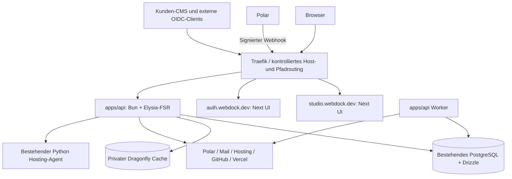

# Webdock API-Rewrite: Architekturplan und Übergabe an den Planungsagenten

> **For agentic workers:** Für die spätere Implementierung `superpowers:executing-plans` oder nach ausdrücklich gewählter Delegation `superpowers:subagent-driven-development` verwenden. Dieser Auftrag erstellt die Recherche und Planung; er startet keinen Rewrite.

**Goal:** Sämtliche Geschäfts-, Auth-, Integrations- und Hintergrundlogik aus Webdock Studio und Auth in eine selbst gehostete API verschieben; Studio und Auth werden reine Oberflächen mit schmalem HTTP-Transport.

**Architecture:** Ein modularer Bun/Elysia-Monolith in `apps/api`, Routen mit `deadlinecode/elysia-fsr`, PostgreSQL über Drizzle v1, eigener privater Dragonfly-Cache. API und Worker sind zwei Prozesse aus demselben Image. Bestehende Identitäten, OIDC-Verträge, SQL-Schutzregeln und Kundenleistungen bleiben erhalten.

**Tech Stack:** Bun `1.4.3`, Elysia `1.4.30`, Elysia-FSR `0.1.0`, Drizzle ORM/Kit `1.0.0-rc.4`, Better Auth plus Plugins `1.7.7`, PostgreSQL, Dragonfly `2.0.2`, Traefik, bestehende Next-Frontends. Exakte Versionsvorschläge nach Recherche vom 13.10.2026; vor Installation Registry/Kompatibilität erneut prüfen und dann exakt pinnen.

**Spec:** Die Architekturentscheidungen dieses Dokuments und [Polar-Spezifikation](#file-02-polar-design-md). [Polar-Arbeitspakete](#file-03-polar-implementation-plan-md) sind ein abhängiger eigener Abschnitt, nicht bereits vorhandene Implementierung.

## 1. Verbindliche Vorgaben und abgegrenzte Annahmen

Vom Nutzer vorgegeben:

- Gesamtes Backend von `apps/admin` (Studio) und `apps/auth` nach `api.webdock.dev`, selbst gehostet, nicht mehr auf Vercel.
- Studio und Auth als Frontends.
- Zum Start Elysia-FSR: <https://github.com/deadlinecode/elysia-fsr>.
- Drizzle v1 und ein eigener Dragonfly-Cache.
- Webdock führt Produktkatalog/Leistungsumfang; Polar führt Zahlung/Abozustand. Operator-Settings für Token, Webhook und Betrieb gehören dazu.
- Ein eigenständiger API-Rewrite-Planungsagent soll mit diesem Material weiterarbeiten. Ein Secret Gist wird als Übergabe erstellt.
- `api.webdock.dev` hat derzeit **keinen genutzten API-Dienst**; bestehender DNS-Eintrag zeigt auf `178.104.141.95`.

Vorschläge dieses Plans, nicht bereits erfolgte Änderungen:

- Die bestehende PostgreSQL-Datenbank zunächst weiterverwenden. Backend umziehen bedeutet nicht automatisch Datenbank, Blob-Speicher und Kunden-CMS gleichzeitig umziehen.
- Reine UI-Darstellung kann zunächst auf Next/Vercel bleiben. Das Hosting der Frontends ist nicht mit der Verlagerung des Backends gleichgesetzt. Keine Umstellung auf eine neue SPA-Bibliothek erforderlich.
- Den aktuellen Traefik-Server als ersten API-Host prüfen. Ein Container-Deployment dort ist der kleinste Weg, sofern CPU/RAM, Isolation, Backups und Wartung ausreichend sind. Die Prüfung ist noch nicht erfolgt; keine verfügbare Kapazität behaupten.
- Ein API-Prozess, ein Worker, eine Dragonfly-Instanz zum Start. Das ist keine HA-Zusage. Replikate erst nach Last-/Ausfallmessung und ohne instanzlokale Autorisierungszustände.
- Keine parallele fachliche Neuentwicklung sämtlicher Bestandsfunktionen. Funktion für Funktion übernehmen, Frameworkbindung entfernen, Verhalten nachweisen, alten Writer abschalten.

## 2. Ergebnis der Stack-Recherche

| Baustein | Befund | Planentscheidung |
|---|---|---|
| Bun | GitHub Latest `bun-v1.4.3`, 10.10.2026 | Runtime exakt pinnen; vorhandene Node-Abhängigkeiten unter Bun testen |
| Elysia | npm Latest `1.4.30` | Stabile 1.4-Linie, keine automatische 2.0-Beta |
| Elysia-FSR | npm `0.1.0`; Repository-HEAD `43e33e0c27e66d0cc70b172c3b99f3f02c3d0db0` | Nutzerwunsch übernehmen, aber vorgeschaltete Routing-/Build-Abnahme |
| Drizzle v1 | npm `rc` = `1.0.0-rc.4`; `latest` ORM weiterhin `0.45.4`, Kit `0.31.11` | v1 bewusst als Release Candidate planen; beide Pakete gleich pinnen, kein `@latest` |
| Better Auth | Bereits im Repo `1.7.7`, entspricht npm Latest | Keine gleichzeitige Auth-Versionsmigration; Adapterkompatibilität separat beweisen |
| Dragonfly | GitHub Latest `v2.0.2`, 07.10.2026 | Privater Cache, bewusst begrenztes RAM, Ausfall darf keine fachliche Korrektheit ändern |
| Polar SDK | npm `1.0.2`, API `2026-10` | Bun-Kompatibilität und signierte Webhooks testen; keine fließenden API-Verträge |

**Bewertung:** Die Kombination ist plausibel und passt zur gewünschten Betriebsgrenze. Der wesentliche Aufwand ist die verlustfreie Übernahme der heutigen Berechtigungen, Payload-Hooks und SQL-Regeln. Ein neuer Router allein löst diese Migration nicht.

### FSR: konkret beobachtete Punkte

Gelesen: README, `src/router.ts`, `src/scan.ts` und Paketmanifest am oben genannten Commit.

- Routenverzeichnis wird relativ zu `Bun.main` aufgelöst. Expliziten absoluten Pfad aus `import.meta.url` verwenden; nicht von wechselndem Working Directory abhängen.
- Routen werden dynamisch von Dateien geladen. Das Produktionsimage muss diese Dateien enthalten. Kein Single-Binary-Build, der das Verzeichnis versehentlich entfernt.
- Fehlt das Verzeichnis, wird es angelegt. In Produktion muss ein fehlendes Verzeichnis stattdessen vor FSR zum Startabbruch führen.
- Importfehler werden als Scanfehler erfasst; FSR baut aus dem übrigen Baum weiter. Ein fehlender Guard darf daher nicht nur eine Logzeile erzeugen. Eigener kleiner Preflight lädt alle vorgesehenen Routenmodule, prüft Default-Export und Elysia-Instanz und lässt bei Fehlern den Prozess vor `listen()` scheitern.
- Typgenerierung schreibt standardmäßig eine Datei. In CI generieren und überprüfen; im schreibgeschützten Produktionsimage `types: false`.
- Ghost-Gruppen sind Routingkomposition, kein ausreichender Beleg für Zugriffsschutz. Jede geschützte Route braucht einen negativen Autorisierungstest.
- Paket verlangt Elysia `^1.4.28` und Prettier `^3.8.3` als Peers. Genau eine Elysia-Version im API-Paket auflösen; doppelte Klasseninstanzen können `instanceof`-Prüfungen beeinflussen.

Nachtrag 13.10.2026: Die [vertiefte FSR-Prüfung](#file-04-elysia-fsr-review-md) hat die Upstream-Tests und zusätzliche Reproduktionen auch unter Bun 1.4.3/Elysia 1.4.30 ausgeführt. Belegt sind insbesondere ein ungeschützter Handler bei defektem Ghost-Guard, stille Routenkollisionen und übergangene `.well-known`-Dateien. Autorisierung wird deshalb statisch außerhalb automatisch geladener Ghost-Controller installiert. Das ist noch keine Last-/Produktionsabnahme.

## 3. Zielaufteilung



**API enthält:** Better Auth, OIDC, Passkeys/MFA, Rollen, Mandanten, Einladungen, Operator-Kundenansicht, Registry, Pläne/Angebote, Billing, Mail, Storage-Messung, Hosting-Control-Plane, Provider-OAuth, CMS-/Canvas-/Shop-/Kalender-Bridges, MCP, Lifecycle/Deletion, Audit und Jobs.

**Studio/Auth enthalten:** Seiten, Layouts, Formulare, Übersetzung und API-Client. SSR/Server-Actions dürfen HTTP-Daten für die Oberfläche laden/weiterreichen. Sie haben keine SQL-Verbindung, Geschäftsentscheidung, Better-Auth-Serverinstanz, Payload-Local-API, Provider- oder Verschlüsselungsschlüssel. UI-Validierung verbessert die Bedienung; verbindliche Prüfung bleibt in der API.

**Bleibt außerhalb des Rewrites:** Python-Agent/Executor auf Hostingnodes, kundeneigene Payload-CMS-Runtimes und deren Inhalte, öffentliche Kundenwebsites, Datenbank- und Blob-Providerwechsel. Ihre Schnittstellen sind jedoch Bestandteil der Regressionstests.

## 4. Wichtigste Migrationsgrenze: Auth-Host bleibt stabil

Backend nach API verschieben heißt **nicht**, den OIDC-Issuer oder die Passkey-Domain umzubenennen.

Heute:

- `BETTER_AUTH_URL=https://auth.webdock.dev`, `basePath=/api/auth`.
- Issuer wird von Kunden-CMS, Studio, MCP und Operator-Dashboards verwendet.
- Host-only-Cookie mit `__Host-webdock-auth`-Präfix, `Secure`, `HttpOnly`, `Path=/`, `SameSite=Lax`.
- Passkey-RP-ID ist `auth.webdock.dev`.
- Auth-Cookiecache ist abgeschaltet; aktuelle DB-Sitzungen und Rollen werden erneut geprüft.

Diese Verträge bleiben erhalten. Requests an Auth-Backendpfade landen durch Reverse-Proxy-/Ingress-Routing beim selbst gehosteten API-Prozess. Login-/Accountseiten landen beim Auth-Frontend. Ein Browserredirect auf den API-Host würde Cookies/RP-ID/CSRF unnötig verändern und ist nicht vorgesehen.

| Öffentliche Route | Ziel im Endzustand |
|---|---|
| `auth.webdock.dev/api/auth/*` | API-Better-Auth-Handler, gleicher Basepath und Issuer |
| Auth `/.well-known/openid-configuration` | API, gleiche publizierte Metadaten |
| Auth `/.well-known/oauth-authorization-server/api/auth` | API, gleiche OAuth-Metadaten |
| Auth Login, Account, MFA, Consent, Einladung | Auth-Frontend; API für sämtliche Daten/Aktionen |
| `api.webdock.dev/v1/*` | Versionierte Geschäfts-API |
| `api.webdock.dev/webhooks/polar` | Live-Billing-Eingang |
| `api.webdock.dev/webhooks/polar/sandbox` | Getrennte Sandbox-Verarbeitung |
| Studio `/api/sso/login`, `/callback`, `/logout` | API-eigenes Portal-/OIDC-Modul unter bestehendem öffentlichen Callback-Host |
| Studio `/api/mcp` und zugehöriges `/.well-known/oauth-protected-resource/api/mcp` | API-Transportalias, bestehende Audience bleibt während Migration gültig |
| Studio GitHub-/Vercel-Callbacks und Vercel-Eventroute | API-Integrationsmodul mit bestehenden Callback-URLs |
| Auth Hosting-Agent-/Bridgepfade | Explizite API-Aliasse, Agentcredentials/Protokoll bleiben |
| Alte Cronpfade | Nach bestätigter Übernahme deaktivieren; Jobs laufen self-hosted |

**Transport bei Frontends auf Vercel:** Entweder kontrollierter Ingress vor beiden UI-Origins oder exakt begrenzte deklarative Proxy-Rewrites für Backendpfade. Kein API-Business-Code auf Vercel. Der nächste Agent muss eine Variante anhand der realen UI-Origins auswählen und `Host`, `Origin`, `X-Forwarded-*`, `Set-Cookie`, Streaming und CSRF end-to-end testen. Ein Origin darf nicht wieder auf denselben öffentlichen Host zeigen und eine Proxy-Schleife bilden. Wenn ein Vercel-Origin keine saubere dauerhafte Proxykonfiguration erlaubt, UI-Container ebenfalls hinter Traefik bereitstellen; das ist eine Hostingentscheidung, kein Frontend-Rewrite.

API-Port nur intern erreichbar. Ingress überschreibt Forwarded-Header; API akzeptiert sie nur aus dem definierten Proxynetz. Die heutige Auth-IP-Konfiguration `x-vercel-forwarded-for` muss gezielt ersetzt werden, sonst wären Rate-Limits nach dem Umzug falsch oder fälschbar. Keine `.webdock.dev`-weiten Auth-Cookies einführen.

Für Studio Browseraufrufe vorzugsweise gleicher Origin `/api/portal/*` als API-Transport verwenden. SSR reicht ausschließlich die benötigten eigenen Sessioncookies an die API weiter. Dort läuft die echte Sessionprüfung. OIDC-Tokens nicht in Local Storage verschieben. Die bestehende verschlüsselte Studio-Session zunächst kompatibel lesen; ein späterer Wechsel auf serverseitig gespeicherte Portal-Sessions ist ein eigenes migrationsgetestetes Arbeitspaket.

## 5. Bestandsinventar, das der nächste Agent vollständig aufnehmen muss

Die folgende Karte ist anhand des lokalen Repositories geprüft. Ein tiefer Aufrufgraph und die produktive Releasezuordnung sind noch Teil von Phase 0.

| Bereich | Bestehende Hauptquellen | Zielmodul |
|---|---|---|
| Auth/OIDC/MFA/Passkeys | `apps/auth/src/lib/auth.ts`, `authorization.ts`, `passkeys.ts`, `cookie-policy.ts`, `operator-oidc.ts`, `mcp.ts` | `apps/api/src/modules/auth/` |
| Mandanten/Einladungen/Claims | `tenants.ts`, `tenant-policy.ts`, `tenant-schema.ts`, `access-management.ts`, `tenant-preview*.ts` | `modules/tenants/`, `modules/access/` |
| Studio-SSO | `apps/admin/src/lib/sso.ts`, `sso-routes.ts`, `server.ts`, `packages/payload-sso/src/index.ts` | `modules/portal/`; CMS-Paket bleibt kompatibel |
| Registry/Payload | `apps/admin/src/cms/collections.ts`, `payload.config.ts`, `lib/registry*.ts`, `lib/actions.ts` | `modules/registry/` + Drizzle-Schema |
| Pläne/Angebote | `apps/auth/src/lib/plans.ts`, Auth-/Studio-Angebotsseiten | `modules/plans/` |
| Plattform/Secrets | `platform.ts`, `storage-usage.ts` und Studio-Wrappers | `modules/platform/`, `modules/secrets/` |
| Mail | `tenant-mail.ts`, `mail-domains.ts`, `mail-keys.ts`, `mail-tracking.ts`, `turbo*.ts` | `modules/mail/` |
| Hosting/BYOK | `apps/auth/src/lib/hosting/**`, `apps/admin/src/lib/hosting-*.ts`, `packages/hosting-contracts` | `modules/hosting/`; gemeinsamer Vertrag bleibt |
| GitHub/Vercel | `apps/admin/src/lib/github*.ts`, `vercel*.ts`, entsprechende API-Routen | `modules/integrations/` |
| CMS/Canvas/Shop/Kalender | `cms-modules.ts`, `canvas-bridge.ts`, `studio-shop.ts`, `demo-bridges.ts`, `packages/cms-ui`, `page-builder`, `lead-bookings` | `modules/cms-bridge/`; Site-Inhalte verbleiben in Site-CMS |
| MCP/Registry-API | `mcp-server.ts`, `mcp-auth.ts`, `hosting-mcp.ts`, `registry-api.ts` | `modules/mcp/` |
| Löschung/Lifecycle | `apps/auth/src/lib/lifecycle.ts`, `apps/admin/src/lib/project-deletion*.ts` | `modules/lifecycle/` |
| Periodische Arbeit | Storage-Cron, Hosting-Polling/Operationen, neue Billingjobs | `apps/api/src/worker.ts`, fachliche Jobhandler |

Auch `.well-known` mit `rg --files --hidden` inventarisieren; normale Dateilisten übersehen diese Pfade leicht. Bei der Stichprobe existieren 57 Testdateien unter Auth/Admin. Das ist keine Aussage, dass alle aktuell bestehen.

### Payload im Studio ist ein echter Backendanteil

`apps/admin/src/payload.config.ts` verwaltet `users`, `customers`, `projects`, `cms-instances`, `audit` in `webdock_admin`. `server.ts` lädt Payload direkt. Collections enthalten nicht nur Felddefinitionen: Hooks verbieten zum Beispiel Kundenarchivierung mit aktiven Projekten und Projektarchivierung mit aktivem CMS; außerdem Ownership, IDs und Audit.

Diese Regeln müssen als API-Servicecode und DB-Constraints erhalten bleiben. Nicht einfach Payload-Tabellen mit generischem CRUD freigeben. Studio `/system` und allgemeine Payload-REST-Routen nach Funktionsparität entfernen/deaktivieren; falls eine bisher nur dort vorhandene Operatorfunktion gebraucht wird, vorher im normalen Studio ergänzen. Der Payload-Backendteil der **Kunden-CMS** wird nicht entfernt.

## 6. Drizzle- und PostgreSQL-Strategie

Drizzle v1 ist zum Recherchezeitpunkt ein RC. Nutzerwunsch berücksichtigen, aber `drizzle-orm@1.0.0-rc.4` und `drizzle-kit@1.0.0-rc.4` exakt pinnen. Keine Behauptung, dass v1 bereits Stable ist. Vor Produktionsfreigabe RC-Bugs und Better-Auth-Adapterkompatibilität mit den echten Schemas prüfen.

Zum Einstieg Drizzle mit vorhandenem `pg`-Treiber; nicht gleichzeitig Runtime, ORM und PostgreSQL-Treiber austauschen. Auth zunächst mit dem bereits funktionierenden `pg.Pool` unter Bun portieren, dann im eigenen getesteten Schritt auf den zu `1.7.7` passenden Drizzle-Adapter wechseln. Ziel bleibt Drizzle auch für Auth. Ein nicht bestandener Adaptertest wird offen als Freigabeblocker dokumentiert, nicht als abgeschlossene Migration bezeichnet.

Vorgehen:

1. Strukturellen Dump ohne Kundendaten erstellen; `webdock_auth`, `webdock_admin` und tatsächlich benötigte Relations-/Migrationstabellen aufnehmen. Reale Daten nur in autorisiertem gesichertem Prüfkontext verwenden.
2. Baseline mit `drizzle-kit pull` in isoliertem Arbeitsverzeichnis und gegen Testkopie erzeugen; per `pgSchema` auf bestehende Namen abbilden. Keine produktive `push`-Operation.
3. Snowflake-IDs als Strings, bestehende Defaultfunktionen, Suchpfade, Foreign Keys, Unique-Constraints, Grants, Trigger, Funktionen, Advisory Locks und Owner-Schutzregeln gesondert erfassen. Introspection ist kein Nachweis, dass all diese Objekte korrekt übernommen wurden.
4. Neue Tabellen/Änderungen nur über reviewte additive SQL-Migrationen, separaten Migrator-DB-User und Migration-Lock. API-Start verändert kein Schema.
5. Neue normale Abfragen mit Drizzle; komplexe Sperr-/Reservierungsabfragen als parameterisiertes `sql` innerhalb derselben Drizzle-Transaktion erhalten. Keine Transaktion über verschiedene Poolverbindungen verteilen.
6. Bestehende Payload-Migrationshistorie nicht überschreiben. Tabellen erhalten genau einen zuständigen Writer/Migrator; alte Payload-Schemaänderungen nach Eigentumsübergang stilllegen.
7. Rollback-kompatible Spalten zuerst hinzufügen, Daten/Code umstellen, alte Struktur erst nach Nachweis und separatem Aufräumrelease entfernen.

Bun-Prozess bekommt einen normalen Pool mit expliziten Zeitlimits und Shutdown. `attachDatabasePool` aus `@vercel/functions` gehört nicht in die selbst gehostete API. Poolbudget über API- und Workerprozesse summieren und gegen den realen DB-Tarif prüfen.

Better-Auth-Schema muss alle Plugins enthalten: Benutzer, Sessions, Organisation/Mitgliedschaft/Einladungen, OAuth-Clients/Tokens/Consent/JWKS, Passkeys und MFA. `generateId: false`, bestehende ID-Defaults, Verschlüsselungssecret und Signing Keys erhalten; CLI-generierte neue Tabellen nicht blind über den Bestand legen.

## 7. Dragonfly: nützlich, aber eng begrenzt

Eigene Instanz für Webdock, ausschließlich im privaten Servicenetz. Kein Port 6379 im öffentlichen Internet. Umgebungsspezifische Credentials/ACL und Schlüsselpräfixe; Authentifizierung und Netzwerkregeln im Containerdeployment. Reines Cache-Deployment mit explizitem `maxmemory`, `cache_mode=true`, TTLs und genügend zusätzlichem Container-RAM für Overhead.

Startprofil als zu messender Vorschlag: 256 MiB Cache-Datenlimit, 512 MiB Container-RAM, begrenzte Threads. Dies ist keine garantierte Produktionsdimensionierung. Keine Snapshot-Pflicht für rekonstruierbaren Cache; verlorene Einträge werden aus PostgreSQL/Providern neu gelesen.

| Daten | Erste Ausbaustufe |
|---|---|
| Nicht sensitive Produkt-/Darstellungsdaten | Kurze TTL, Invalidierung nach erfolgreicher DB-Transaktion |
| Provider-Lesestatus | Kurze TTL und sichtbare Aktualität; keine Mutation auf Grundlage eines abgelaufenen Werts |
| Statische öffentliche Konfiguration | Versionsabhängige Cachekeys |
| Auth-Sessions, Rollen, MFA, Mandantenrechte | **PostgreSQL maßgeblich, zunächst nicht cachen** |
| Polar-/Webhook-Dedupe, Orders, Jobs | **PostgreSQL**, nicht nur Cache |
| Kapazitätsreservierungen, Billing-/Hosting-Locks | **PostgreSQL-Constraints/Locks** |
| Login-/MFA-Rate-Limits | Zunächst bestehende DB-Speicherung; später eigener geprüfter atomarer Counterweg |
| Tokens, Providerkeys, signierte kurzlebige URLs | Nicht als allgemeine Cacheobjekte speichern |

Bei Cacheausfall kurzer Timeout, Circuit Breaker und fachlicher Read-Fallback; Antwort darf langsamer sein, aber weder fremde Daten zeigen noch Rechte erweitern. Cachekey enthält Umgebung, Mandant, Ressource und Datenversion, soweit die Daten mandantengebunden sind. Kein „Flush all“ als reguläre Invalidierung.

**Better Auth nicht nebenbei mit `secondaryStorage` verbinden.** Die aktuelle Doku beschreibt, dass sich dadurch die Sessionablage ändert. Das bestehende Webdock prüft Sessions direkt in PostgreSQL, bindet OAuth-Tokens daran und löscht Sessions bei Sicherheitsereignissen. Eine spätere Integration erfordert bewusst `storeSessionInDatabase`, atomare Get-and-delete/Increment-Semantik und nachgewiesene sofortige Revocation. Ein einfacher Cache-Adapter wäre hier eine Verhaltensänderung.

Keine Redis-Queue/BullMQ allein deshalb hinzufügen, weil Dragonfly vorhanden ist. Erst eine konkrete Anforderung und Kompatibilitätsprüfung würden das rechtfertigen.

## 7a. Konkrete Middleware- und Pluginplanung

Elysia verwendet Lifecycle-Hooks, Plugins, Guards und Macros statt einer einzigen Express-artigen Middlewarekette. Registrierung und Scope müssen ausdrücklich festgelegt werden. **FSR ordnet Dateien zu Routen; Zugriffsschutz ist Aufgabe der statisch komponierten API.** [Scopes](https://elysiajs.com/essential/plugin#scope)

### Aufbau der Anwendung

`app.ts` importiert Infrastruktur-/Security-Plugins statisch. FSR lädt getrennte öffentliche, Tenant- und Operator-Routenbäume innerhalb ausdrücklich angelegter Elysia-Instanzen. Die Parent-Instanz jedes geschützten Baums erhält ihren Guard **vor** `.use(await fsr(...))`. Ein Scanfehler beendet den Start. Ghost-Gruppen dienen danach nur der Organisation und zusätzlicher fachlicher Validierung; ihre implizite Ladereihenfolge ist keine Sicherheitsgrenze.

Authhandler, OIDC-Discovery, MCP-Discovery und Polar-Webhooks werden separat registriert. Ein globaler Login-Guard würde diese öffentlichen Protokollendpunkte beschädigen. Das Routenmanifest gibt jeder Route eine Kategorie: `public`, `auth_protocol`, `signed_webhook`, `tenant`, `operator`, `agent` oder `mcp`; eine fehlende Kategorie verhindert Readiness.

### Reihenfolge und Zuständigkeit

| Schicht | Elysia-/Betriebsmechanismus | Konkreter Vertrag |
|---|---|---|
| 1. Netzwerk/Host | Traefik und früher `onRequest` | Nur bekannte Hosts/Methoden; Proxyheader ausschließlich vom eigenen Ingress; keine vom Client übernommene vertrauenswürdige IP |
| 2. Requestkontext | `onRequest` + requestlokaler Kontext | Eigene Request-ID oder streng validierte ID, Startzeit, Abortsignal; keine requestübergreifende mutable Actorvariable |
| 3. Frühe Begrenzung | Ingress/Bun-Limit plus `onRequest` | Größen-/Zeit-/Parallelitätsgrenzen vor teurem Parsing; allgemeiner Schutz ersetzt keine Login-/Mandantenlimits |
| 4. Origin/CORS/CSRF | Expliziter Origincheck, CORS nur bei Bedarf | Browsermutationen mit Cookies verlangen erlaubte Origin/CSRF; CORS ist keine Authentifizierung. Same-Origin-Transport bevorzugen; kein offenes `cors()` mit Defaults |
| 5. Parsing/Schema | Routenschema, `parse:'none'` für Spezialhandler | IDs bleiben Strings; Params/Query/Body validieren. Webhooks und Better-Auth-Handler bekommen unverbrauchte Requestbodys |
| 6. Identität | Statischer `resolve`/Guard pro geschütztem Baum | Aktuelle Sitzung/MFA/Token prüfen; Bearer-/Agent-/Webhookprüfung getrennt, kein Fallback von fehlgeschlagener Auth auf anonym |
| 7. Autorisierung | Tenant-/Operator-Guards, Serviceprüfung in Transaktion | Mandant aus erlaubter Zuordnung, Ownership, Archivierung, Kundenansicht, Scopes; sensible Writes revalidieren vor Commit |
| 8. Fachliche Operation | Domänendienst | Idempotenz, Revision, Kapazität, Transaktion und Audit; keine pauschale DB-Transaktion um jeden HTTP-Request |
| 9. Antwort/Fehler | Response-Schema und zentrales `onError` | Überprüfte DTOs und sichere Fehlermeldungen mit Request-ID; keine Stacktraces, SQL oder Providerantworten im Client |
| 10. Abschluss | `onAfterResponse`, Metriken/Tracing | Status und Dauer auch bei 401/403/404/500; Logredaktion, Abbruch/Streaming getrennt messen |

Errorhandler und Observability werden früh registriert, damit auch Fehler in den davor beschriebenen Ablaufphasen erfasst werden. Die Tabelle beschreibt den Requestablauf, nicht zehn wahllos in dieser Reihenfolge importierte Bibliotheken. Unkritische globale Hooks werden ausdrücklich global; Tenant-/Operator-Guards bleiben auf ihre Teilbäume beschränkt.

### Was zum ersten Release gehört

- `request-context.ts`: Request-ID, strukturierte Logs und weitergereichtes Abortsignal.
- `http-policy.ts`: Host-/Proxy-/Originprüfung, Routenkategorie, API-Sicherheitsheader, `Cache-Control: no-store` für personenbezogene Antworten. HSTS am TLS-Ingress; CSP für HTML gehört zum Frontend.
- `errors.ts`: ein Fehlerformat für die **eigene Geschäfts-API**, z. B. `{ error: { code, message, requestId } }`. OIDC-, Better-Auth-, MCP- und Polar-Protokollantworten nicht in dieses Format umschreiben.
- `auth.ts`, `tenant-access.ts`, `operator-access.ts`: aktuelle Identität, Mandanten-/Rollen-/MFA-/Previewprüfungen; fachliche Rechte im Service nicht entfernen.
- `rate-limit.ts`: vorhandene Login-/MFA-Regeln aus PostgreSQL übernehmen (Login 10/60 s, TOTP 8/60 s, Backupcode 5/60 s), zusätzlich zunächst maximal 5 neue Checkoutversuche je Kunde/Minute. Atomare Zähler, Retry-After; Idempotenzwiederholung eines bestehenden Versuchs zählt nicht als neuer Kauf. Limits anhand realer Nutzung nachkalibrieren.
- Request-/Responsevalidierung und bereinigte DTOs pro Geschäftsroute. Eine Clienttypdatei ersetzt keine Laufzeitvalidierung.
- Liveness/Readiness und Betriebsmetriken. Logs standardmäßig ohne Bodies, Cookies, Token, OAuthcodes und Portal-/Checkout-URLs.
- OpenAPI-Schema in CI erzeugen; interaktive Docs nur intern/Operator oder im Entwicklungsbetrieb. Eden-Clienttypen gegen echte Pfade einschließlich Mountpräfixen prüfen.

Für CORS, OpenAPI und OpenTelemetry bevorzugt passende offizielle Elysia-Plugins in zur gepinnten 1.4-Linie kompatiblen Versionen verwenden. Plugin-Namen und Peer-Ranges bei Implementierung prüfen: aktuelle Dokumentation und 1.4-Paketlinie können unterschiedliche Namensräume zeigen. Kein ungeprüfter Mix von 1.4 und 2.0. Für wenige Header/Request-IDs braucht es keine zusätzliche große Abhängigkeit. [CORS](https://elysiajs.com/plugins/cors), [OpenAPI](https://elysiajs.com/patterns/openapi), [OpenTelemetry](https://elysiajs.com/patterns/opentelemetry)

### Ausnahmen sind ausdrücklich definiert

- Polar: Signatur statt Browsersitzung/CSRF; `parse:'none'`, begrenztes Lesen der Rohbytes, DB-Dedupe. Kein globales Login-, Browser-Origin- oder niedriges Kundentokenlimit auf Webhooks anwenden.
- Better Auth: Handler nutzt seinen eigenen Parser und seine Protokollantworten; bestehende Schutzmechanismen nicht abschalten, um Middlewarekonflikte zu verdecken.
- MCP/Agent: ihre Token-/Scope-/Sessionbindung prüfen; keine Browser-CORS-/CSRF-Regel als Ersatz.
- Streams/Hostinglogs: eigenes Idle-/Gesamtzeitbudget, Cancellation und Backpressure; kein globales Responsebuffering oder JSON-Envelope.
- Caching: nur explizite Leseoperationen nach Autorisierung; Mandant/Version im Key, Mutation invalidiert nach Commit. Kein generischer Cache aller GET-Antworten, kein Cache für Rollen/Sessions/Billingfreigaben.
- Idempotenz: bei Geld-/Ressourcenmutationen in PostgreSQL; ein globales `Idempotency-Key`-Middlewarepaket garantiert keinen sicheren Providerretry.

### Verbindliche Middlewaretests

- Für jeden geschützten Manifestpfad anonym → 401, fehlendes Recht → 403 oder absichtlich 404, korrekter Actor → erlaubtes Ergebnis; alle unterstützten Methoden prüfen.
- Fehlendes/kaputtes Guardmodul verhindert Startup; statischer Parent-Guard schützt den Teilbaum unabhängig vom FSR-Ghostcontroller.
- Nicht vertrauenswürdige Origin/Proxyheader, Cross-Tenant-ID, widerrufene Sitzung, deaktivierte MFA und Kundenansicht bleiben gesperrt.
- Preflight liefert nur explizit erlaubte Origins/Methoden; keine global freigebenden Plugin-Defaults.
- Signierter Webhook bleibt bytegleich trotz globalem Logging/Parsing; ohne Session gültig, mit falscher Signatur abgewiesen.
- Doppelter Checkout und parallele Rate-Limit-Requests bleiben atomar; DB-Ausfall führt bei sicherheitskritischen Zählern zur temporären Ablehnung, nicht zur Abschaltung des Schutzes.
- Unbekannter Fehler wird bereinigt, bleibt intern korrelierbar und enthält keine Credentials; Protokoll-/Streamingantworten bleiben unverändert.

Distributed Tracing ist sinnvoll, wenn ein Collector tatsächlich betrieben wird. Kein verpflichtender neuer Observabilityanbieter. Nachweisbarer Bedarf steuert spätere Circuit-Breaker-/Tracingausweitung; HTTP-Timeouts und Redaktion gehören bereits zum Start.

## 8. Vorgeschlagene Dateistruktur

```text
apps/api/
  package.json
  tsconfig.json
  drizzle.config.ts
  Dockerfile
  src/
    index.ts                 # listen, signals, graceful shutdown
    app.ts                   # createApp, statische Guards, Protokollmounts + FSR
    worker.ts                # Jobs claimen, Scheduler, Shutdown
    config.ts                # validierte Serverkonfiguration
    plugins/                 # request-context, http-policy, errors, access
    routes/                  # separate FSR-Wurzeln, Mountpräfixe aus app.ts
      public/
      tenant/
      operator/
    protocols/               # explizit importiert, nicht vom Dateiscan abhängig
      auth.ts
      discovery.ts
      webhooks/polar.ts
      mcp.ts
    route-manifest.ts         # erwartete Pfade/Methoden/Authkategorien
    db/
      client.ts
      schema/auth.ts
      schema/registry.ts
      schema/billing.ts
    modules/
      auth/ portal/ access/ tenants/ registry/ plans/
      platform/ secrets/ mail/ hosting/ integrations/
      cms-bridge/ mcp/ lifecycle/ billing/
    cache.ts
    jobs.ts
  drizzle/
  tests/
packages/api-client/          # type-only API-Vertrag / dünner Client
infra/api/
  compose.yaml               # vorgeschlagener erster Hostbetrieb
  traefik-routes.yaml
  env.example                # Namen, niemals echte Werte
```

Die Struktur ist ein Ziel, keine Aufforderung, sofort alle leeren Module anzulegen. Jede Vertikalscheibe bringt ihre benötigten Dateien mit. Elysia-FSR-Typen in CI je Teilbaum in ein eigenes Ausgabeverzeichnis generieren, anschließend Gesamtvertrag einschließlich Mountpräfixen prüfen; Frontends importieren nur Typen/Client, nie API-Implementierung oder DB-Schema mit Serverinitialisierung.

Vorhandene npm-Workspaces und Root-Lockdatei zunächst erhalten. Bun ist Runtime des API-Workspaces, keine automatische Umstellung jedes Frontend-Builds und aller Tests auf einen zweiten konkurrierenden Package-Lock.

## 9. Umsetzung in überprüfbaren Phasen

### Phase 0 — Bestand und Kompatibilität festhalten

- [ ] Git-/Deploymentstände abgleichen; vorhandene uncommittete Arbeiten sichern und fachlich zuordnen, nicht wegwerfen.
- [ ] Vollständiges Manifest aller Routen, Server-Actions, Payload-Hooks, Providerjobs, CLI-Skripte, MCP-Tools und ihrer Aufrufer erzeugen; Quelle → Ziel → Test → Cutover festhalten.
- [ ] SQL-Struktur, Rollen/Grants und Secrets-Namen inventarisieren, ohne Werte ins Gist/Repo zu schreiben.
- [ ] Baseline-Checks getrennt für Auth/Admin/Hosting-Verträge ausführen und bekannte Fehler dokumentieren. Der Gist vom 12.10. nennt einen fehlenden MCP-Toolnamen für `projects.relocate`; aktuellen Stand erneut prüfen.
- [ ] Hostingentscheidung und UI-Proxyvariante aus Abschnitt 4 anhand echter Infrastruktur festlegen; Kapazität/Backup/Restore kontrollieren.

**Abnahme:** Kein heutiger Backendpfad ohne Zielentscheidung; Abweichungen zwischen Repo und Produktion benannt. Noch keine Produktionsmutation.

### Phase 1 — Elysia/FSR/Bun/Drizzle als isolierte Grundlage

- [ ] `apps/api` mit gepinnten Versionen, reproduzierbarem Image und `createApp()` ohne automatisches `listen()` für Tests anlegen.
- [ ] FSR-Preflight, Produktions-`types:false`, explizites Routenverzeichnis und Manifestvergleich umsetzen.
- [ ] Statische Security-/Infrastrukturplugins aus Abschnitt 7a vor den FSR-Teilbäumen registrieren; HTTP-/Protokoll-/Webhooks getrennt prüfen, fehlende Authkategorien verhindern Startup.
- [ ] Routenkollisionen vor Elysia-Merge erkennen; Ghost-Controller eindeutig komponieren; Discovery explizit mounten. Befunde des FSR-Reviews durch negative Integrationstests abdecken.
- [ ] In Test-PostgreSQL Drizzle-Schema/Baseline, Transaktion, Rollback und Row-/Advisory-Locks prüfen.
- [ ] Better Auth `1.7.7`, `pg`, Nodemailer, `jose`, Crypto/AsyncLocalStorage und Polar-SDK unter Bun mit den benötigten Operationen prüfen.
- [ ] Dragonfly als privaten Cache einbinden; Anwendung arbeitet bei Verbindungsfehler/Miss weiter.

**Tests:** `/users/me` gegen `/users/:id`, Catch-all, Ghost-Guard, unerlaubte Methoden, falscher Host, kaputtes Modul, fehlendes Verzeichnis, leeres Routenmanifest, readonly Container, Multi-`Set-Cookie`, Bodybytes. Ein kaputtes Guard-Modul muss den Start fehlschlagen lassen.

**Abnahme:** Image startet ohne Build-Schreibrechte, liefert nur vorgesehene Routen und wird bei fehlender Pflichtfunktion nicht ready. Kein pauschaler „Hello World läuft“-Nachweis.

### Phase 2 — Identität und Portaltransport portieren

- [ ] Auth-Konfiguration und alle Hooks unverändert fachlich nach `modules/auth` übernehmen; Next-Bindung durch native Request/Response ersetzen.
- [ ] Kanonische Auth-Hostpfade, Discovery und Signing Keys erhalten; vertrauenswürdige Proxy-IP-Ermittlung implementieren.
- [ ] Drizzle-Adapter separat gegen vorhandene Tabellen/Plugins testen, dann aktivieren. Bis zur erfolgreichen Abnahme keine produktive Adapterumstellung.
- [ ] Studio-SSO aus Payload herauslösen: Code/State/PKCE, Callback, Refresh, Logout, sichere Cookies und delegierte Sitzung ins API-Portalmodul verlagern.
- [ ] Frontend-SSR und Aktionen auf HTTP-Transport umstellen; UI-interne Sessionprüfung ist kein Ersatz für Backendautorisierung.

**Tests:** Login/MFA/Backupcodes/Passkeys; bestehende Sessions; Passwortwechsel; Reset/Einladung; Consent; OIDC Code+PKCE; Refresh nach Sessionrevocation; Clientdeaktivierung; Operator-MFA; `Set-Cookie` über Proxy; CSRF; fremde Origin; manipulierte Proxyheader. Echte Testpasskeys/browserabhängige Pfade separat prüfen.

**Abnahme:** Kein Issuer-/RP-ID-Wechsel, kein Konto-Neuanlegen, kein stiller Rechtegewinn. Studio bleibt für berechtigte Kunden erreichbar.

### Phase 3 — Mandanten, Registry und Payload-Ablösung

- [ ] Tenant-/Access-/Previewlogik mit denselben Locks, Rollen und Auditverträgen portieren.
- [ ] Customers/Projects/Instances/Audit von Payload-Local-API auf explizite Drizzle-Services übertragen; sämtliche Collection-Hooks als Tests fixieren.
- [ ] Studio-Lese- und Schreibaufrufe auf API umstellen, eine Ressourcengruppe nach der anderen.
- [ ] Datenbankschutz gegen Ownerwechsel, verwaiste Beziehungen und Löschung unverändert erhalten.
- [ ] `/system`-/generische REST-Nutzung aufnehmen, Ersatz bereitstellen und alten Payload-Writer danach deaktivieren.

**Tests:** Zwei Mandanten, widerrufene Sitzung, normaler Member, Operator-Kundenansicht, Kundenarchiv mit aktiven Projekten, Projektarchiv mit CMS, konkurrierender Ownerwechsel, Audit einmalig und vollständige Pagination.

**Abnahme:** Studio benötigt für die migrierten Ressourcen keine DB-/Payload-Verbindung mehr. Jede Ressource hat nur einen fachlich verantwortlichen Writer.

### Phase 4 — Pläne, Plattform, Mail und Storage

- [ ] Planvorlagen, individuelle Pläne, Extras, Angebote und History portieren; manuelle Annahme bleibt ohne Zahlung möglich und eindeutig gekennzeichnet.
- [ ] Plattformsettings und zweckgebundene Secretverschlüsselung mit bestehenden Ciphertext-Testvektoren übernehmen.
- [ ] Mail-Subaccounts, DNS-Prüfungen, Tracking und Keys samt ungewissen Providerwrites portieren.
- [ ] Storage-Messung und sicheren Workerbetrieb übernehmen; alten Vercel-Cron erst nach bestätigter neuer Zuständigkeit ausschalten.

**Tests:** Stale Revision, doppelte Annahme, Extras erhalten, alte Secrets lesbar, falscher Mandant, Provider-Timeout, 429, unvollständige Pagination und keine Nullsetzung bei Messfehler.

**Abnahme:** Identische Kundenkontingente und Providerzuordnung vor/nach Umzug; keine automatische Preiszuweisung oder Quotenänderung.

### Phase 5 — Hosting, Integrationen, CMS-Bridges und MCP

- [ ] Hosting-Control-Plane und alle API-/MCP-Aufrufer gegen bestehende `@webdock/hosting-contracts` portieren. Python-Agent nicht gleichzeitig neu schreiben.
- [ ] Reservierungen, Kapazität, idempotente Operationen, Verschlüsselung, Env-Redaktion, Logs, Volumeaufbewahrung und Relocation erhalten.
- [ ] GitHub-/Vercel-OAuth und Callbacks samt State/Nonce/PKCE bzw. vorhandenem Providervertrag übernehmen.
- [ ] CMS-/Canvas-/Shop-/Kalenderbrücken zentralisieren, ohne Inhalte oder Permissions in Kunden-CMS zu duplizieren.
- [ ] MCP-Transport und geschützte Resource Discovery auf API ausführen; alten öffentlichen Audience-/URL-Vertrag als Alias behalten, bis Clients migriert sind.
- [ ] Projektlöschung/Lifecycle inklusive Vorschauhash, Revisionscheck und Ressourcenfreigabe migrieren.

**Tests:** Agent-Einlieferung, doppelte Operation, Crash/Retry, Logstream-Abbruch/Backpressure, Zugriff nach Entzug, falscher CMS-Origin, fremde Callbacknonce, MCP read/write scopes, Relocation-Toolliste, Löschvorschau veraltet, persistente Daten ohne automatische Löschung.

**Abnahme:** Keine frühere Integrationsfunktion fällt durch die neue Laufzeit aus; Frontends enthalten keine Provider-Schlüssel oder Backendmodule mehr.

### Phase 6 — Polar auf der neuen API implementieren

- [ ] Den separaten [Polar-Plan](#file-03-polar-implementation-plan-md) ausführen, sobald Auth/Mandanten/Pläne/Worker abgenommen sind. Andere unabhängige Altmodule dürfen währenddessen noch bewusst im alten Runtimepfad bleiben.
- [ ] Operatorverbindung, Katalog, privates Angebot, Checkout, Webhook-Inbox, Abgleich und Leistungsprojektion liefern.
- [ ] Nur drei geprüfte Website-Jahresprodukte öffentlich vorbereiten; Liveverkauf erst nach Sandbox und tatsächlicher Händler-/Leistungsfreigabe.

**Abnahme:** Kauf → bestätigte Zahlung → genau eine Leistung; Kündigung/Fehler/Wiederaufnahme/Erstattung ebenfalls nachgewiesen. Kein Drizzle- oder Cachewechsel verdeckt finanzielle Nebenwirkungen.

### Phase 7 — Cutover und Bereinigung

- [ ] Images bauen, signierte/versionierte Artefakte und Migrationsstand festhalten; keine schwebenden Container-Tags.
- [ ] Public TLS für API und benötigte Proxyhosts testen; nur vorgesehene Host-/Pfadregeln freischalten.
- [ ] Pro Funktionsgruppe alten Writer/Job pausieren, laufende Jobs auslaufen lassen, Zuständigkeit umschalten, Smoke-/Berechtigungstests durchführen. Keine unkontrollierten Dual-Writes.
- [ ] Bestandsfrontend mit API-Daten betreiben; Daten- und Verhaltensvergleich anhand anonymisierter Testfälle, kein Shadow-Replay von echten Mutationen.
- [ ] Datenbank-/Provider-/Authsecrets aus Frontenddeployments entfernen, danach alten Backendcode und ungenutzte Abhängigkeiten entfernen.
- [ ] Rollbackprobe auf voriges kompatibles API-Image durchführen; Sessions, DB und noch offene Jobs erhalten.

**Abnahme:** Studio/Auth haben keinen direkten DB-Zugriff und keine Geschäfts-/Providerlogik mehr; Vercel führt kein Webdock-Backend und keine periodischen Backendjobs mehr aus. Auth-Verträge und Kunden-CMS funktionieren weiter.

## 10. Worker, Deployment und Betrieb

Ein Workerentrypoint aus demselben Repository/Image. Dauerhafte Arbeit in PostgreSQL mit Dedupe-Key, Fälligkeit, Versuchszahl, Lease und Claim-Generation; `FOR UPDATE SKIP LOCKED`. Jeder Handler ist idempotent bzw. hält unklare externe Writes zur Prüfung an. Dragonfly-Pub/Sub darf höchstens wecken, niemals alleinige Nachrichtenzustellung garantieren.

Scheduler erzeugt eindeutige Periodenslots in PostgreSQL. Mehrere Worker dürfen denselben Slot nicht zweimal ausführen. Migration vom Vercel-Cron hat einen dokumentierten Zeitpunkt und nur einen zuständigen Scheduler. Keine `setInterval`-only-Lösung für Geld-/Hostingjobs.

Vorschlag für den ersten Host: `api`, `worker`, `dragonfly` als getrennte OCI-Container hinter vorhandenem Traefik; PostgreSQL zunächst über bestehende gesicherte Verbindung. `api`/`worker` nicht root, Dateisystem readonly soweit möglich, Capabilities reduzieren, keine Docker-Socket-Freigabe, Secrets als geschützte Deploymentwerte. HTTP-Port nur im internen Netz. Das ist ein Konzept, kein bereits provisionierter Stack.

`/healthz` misst Prozessleben; `/readyz` prüft Konfiguration, Pflicht-Routenmanifest und DB-Zugriff. Cacheausfall meldet Degradation statt unnötiger kompletter Readiness-Sperre. SIGTERM stoppt neue Annahme, wartet begrenzt auf Requests, gibt/verlängert Jobleases kontrolliert und schließt Pool/Cacheclient. Tests simulieren Abbruch während Webhookpersistenz und Providerwrite.

Logs: Request-/Operation-ID, Mandant nur wo berechtigt, Dauer/Status; kein Authorization-/Cookie-/Webhooksecret, kein OAuth-Code, keine vollständigen Webhookbodys, keine Provider-Credentialdaten. Metriken: p95-Latenz, DB-Pooldruck, Fehlerrate, Joblag, Cachehit/Miss/Timeout, Speicher. Externe Alarmzustellung separat konfigurieren, nicht ungefragt Nachrichten versenden.

Ein einzelner Host bleibt Ausfallpunkt. Bestehende unabhängige Websites können trotz API-Ausfall weiter öffentlich laufen; Login/Studioverwaltung/Billingverarbeitung sind betroffen. Kein HA-Versprechen aus bloßer Existenz von Dragonfly oder k3s ableiten.

## 11. Review-Fokus und vollständige Abnahme

Die folgenden Klassen bekommen eigene Regressionen, nicht nur Happy Paths:

1. **Auth-/Hostgrenzen:** Bestehende Passkeys, Issuer, Host-only-Cookies, Forwarded-Header, Callback-State und mehrere Set-Cookie-Header bleiben korrekt.
2. **Mandanten-/Operatorgrenzen:** MFA, Widerruf, Vorschau, Archivierung und Ownership können durch Cache oder neuen Endpoint nicht umgangen werden.
3. **Schreibnebenläufigkeit:** Ein fachlicher Writer, dieselbe DB-Transaktion, Lease-Generation, Crash und Wiederholungen ohne doppelte Rechnung/Reservierung.
4. **Schema-/Hookparität:** Drizzle erhält Trigger, Constraints, Defaults und Payload-Regeln; kein automatischer Schema-Push.
5. **Unvollständige Infrastruktur:** Cache leer/down, DB down, API-Replikat beendet, FSR-Modul kaputt, TLS ungültig und Providerantwort verspätet führen zum beschriebenen sicheren Verhalten.

Erster Baseline-Lauf mit bestehender lokaler Wegwerf-Testdatenbank:

```bash
npm run test:auth
npm run test
npm run test:sso
npm run check -w @webdock/auth
npm run check -w @webdock/admin
```

Neue API bekommt klar getrennte Scripts `test`, `test:integration`, `check`, `build`; Tests mit echtem lokalem PostgreSQL und Dragonfly ergänzen HTTP- und pure Servicetests. Produktionsdatenbank wird nie als Testfallback verwendet. Bestehende Node-Testläufe nicht unkontrolliert durch einen Wechsel des gesamten Root-Test-Runners verlieren.

Browserabnahme: Login/MFA/Passkey/Logout, Kundenwechsel, Operatorvorschau, Angebote, CMS-Weiterleitung, Hostingaktion, Providerconnect, Kauf/Kündigung; Desktop und schmaler Viewport. Zusätzlich Testclient für MCP/OIDC außerhalb des Browsers.

## 12. Aufgaben des eigenständigen Planungsagenten

Dieser Plan ist eine fundierte Architektur- und Migrationsübergabe. Der nachfolgende Agent soll daraus nach vollständiger Bestandsanalyse den datei- und testgenauen Ausführungsplan erstellen. Er soll **nicht** aus dem Gist eine ungeprüfte Freigabe zum Rewrite oder zur Produktion ableiten.

Noch konkret zu entscheiden, jeweils mit realem Nachweis:

- API-Host: freie Ressourcen und Isolation auf dem vorhandenen Traefik-Server oder begründet anderes selbst gehostetes Ziel. Keine neue Maschine ungefragt buchen.
- Routing zu den Frontends: kontrollierter gemeinsamer Ingress vs. spezifische UI-Proxyregeln; Wahl an realen Origins/Headers/SSO testen.
- Drizzle-v1-RC/Better-Auth-Adapter: exakte Kompatibilität und Schemaidentität. Ein Release Candidate bleibt als solcher benannt.
- Routingmanifest/FSR: nötige kleine Absicherung; keine vollständige Eigenentwicklung eines Routers ohne Befund.
- Exakte Cutoverreihenfolge anhand der produktiven Aufrufer, nicht nur lokaler Dateinamen.

Erwartete Lieferung: Istinventar mit Belegen, Zielrouten/Autorisierungsmatrix, Schema-/Migrationseigentum, Cachevertrag, Dateiänderungsliste, kleine ausführbare Arbeitspakete mit Tests, Betriebs-/Rollbackrunbook und offene Freigaben. Originalziel beibehalten: ein selbst gehostetes Backend; Studio/Auth als UI; Polar folgt den festgelegten Zahlungsregeln.

## 13. Quellen und Evidenzgrenzen

Offizielle Quellen, gelesen am 13.10.2026:

- [Elysia-FSR README und Code](https://github.com/deadlinecode/elysia-fsr), [Scanverhalten](https://github.com/deadlinecode/elysia-fsr/blob/43e33e0c27e66d0cc70b172c3b99f3f02c3d0db0/src/scan.ts), [Router](https://github.com/deadlinecode/elysia-fsr/blob/43e33e0c27e66d0cc70b172c3b99f3f02c3d0db0/src/router.ts).
- [Drizzle v1-Upgrade](https://orm.drizzle.team/docs/upgrade-v1), [PostgreSQL-Treiber](https://orm.drizzle.team/docs/get-started-postgresql), [Kit/Migrationen](https://orm.drizzle.team/docs/kit-overview).
- [Better Auth unter Elysia](https://better-auth.com/docs/integrations/elysia), [Drizzle-Adapter](https://better-auth.com/docs/adapters/drizzle), [Session-/Secondary-Storage-Semantik](https://better-auth.com/docs/concepts/session-management).
- [Dragonfly-Flags](https://www.dragonflydb.io/docs/managing-dragonfly/flags), [ACL](https://www.dragonflydb.io/docs/managing-dragonfly/acl), [HA](https://www.dragonflydb.io/docs/managing-dragonfly/high-availability).
- [Bun Node-Kompatibilität](https://bun.sh/docs/runtime/nodejs-compat), [Bun-Releases](https://github.com/oven-sh/bun/releases), [Dragonfly-Releases](https://github.com/dragonflydb/dragonfly/releases), [Elysia Deployment](https://elysiajs.com/patterns/deploy).
- npm-Registry-Dist-Tags wurden direkt für `elysia-fsr`, `elysia`, `drizzle-orm`, `drizzle-kit`, `better-auth` und den Better-Auth-Drizzle-Adapter gelesen. Versionen sind eine Momentaufnahme.

Lokale Quellen: oben genannte Dateien, `docs/architecture/{plans-and-storage,platform-mail,customer-tenants,studio-integrations,hosting-control-plane}.md`, neuestes Produkt-Gist vom 12.10.2026.

Ausgeführt ist inzwischen eine isolierte FSR-Abhängigkeitsprüfung mit Upstream-Tests/Typecheck und gezielten Reproduktionen; siehe [Prüfbericht](#file-04-elysia-fsr-review-md). Nicht ausgeführt: vollständiger API-/Middlewareprototyp, Drizzle-Migration, Dragonfly-Provisionierung, Auth-Cutover, Polar-Kauf, Webdock-Integrationstests, Deployment oder DNSänderung. Keine behauptete Produktionsabnahme.
