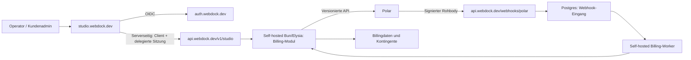

# Webdock × Polar: Architektur und Produktmodell

Stand: 13.10.2026. Recherchierter Entwurf, keine bereits implementierte Integration. Der Auftrag umfasst Recherche und einen vollständigen Plan. **Aktualisierte Nutzervorgabe: Das gesamte Backend von Studio und Auth wird als selbst gehostete API mit Bun, Elysia-FSR, Drizzle v1 und eigenem Dragonfly-Cache geplant.** Die zuvor erwogene Vercel-Backendvariante ist verworfen. [API-Rewrite und Agentenübergabe](#file-01-api-rewrite-plan-md), [Polar-Umsetzungsplan](#file-03-polar-implementation-plan-md).

## 1. Ziel und Zuständigkeiten

Webdock verwaltet seine eigenen Produkte, Kundenvereinbarungen und Leistungen. Polar übernimmt als Merchant of Record Checkout, Zahlungsabwicklung, wiederkehrende Abrechnung und Zahlungsbelege. Operatoren arbeiten im Studio; Kunden kaufen und verwalten ihre Webdock-Leistungen dort ebenfalls. Karte und Zahlungsdaten bleiben bei Polar.

| Gegenstand | Führendes System | Synchronisation |
|---|---|---|
| Produktnamen, Beschreibung, Sichtbarkeit, Leistungsumfang | Webdock | Freigegebene Version nach Polar veröffentlichen |
| Verkaufspreis, Währung, Intervall und Steuerdarstellung einer neuen Vereinbarung | Webdock | Erst nach bestätigter Polar-Abbildung buchbar |
| Kunden-/Mandantenzugehörigkeit, Rollen, Website-/Projektbindung | Webdock | Stabile Kunden-ID an Polar übergeben |
| Individuelles Angebot und dokumentierte Annahme | Webdock | Zugehörigen Checkout mit festem Preis erzeugen |
| Zahlung, Aboperiode, Kündigung, Zahlungsrückstand, Erstattung | Polar | Webhooks plus regelmäßiger API-Abgleich |
| Kontingente, CMS-Zugriff, technische Bereitstellung | Webdock | Aus bestätigten Vereinbarungen ableiten |
| Manuelle Rechnungen, Entwicklung und persönliche Betreuung | Bestehender separater Prozess | Im Studio als manuell gekennzeichnet |

„Webdock führt“ bedeutet: Webdock steuert die erlaubten Aktionen. Es darf weder Zahlungserfolg erfinden noch den tatsächlichen Polar-Status überschreiben. Eine gewünschte Tarifänderung bleibt bis zur Bestätigung ausstehend.

## 2. Geprüfter Ausgangspunkt

- Ausgangscommit `73733b0`; zahlreiche vorhandene uncommittete Änderungen. Diese Recherche hat sie nicht verändert. Lokaler Code und aktueller Produktionsrelease sind vor Umsetzung abzugleichen.
- [Neuestes Gist](https://gist.github.com/1fe6c0c0da211f06c0784114afef450c): Produktlinien Website, Apps/Bots, Connect/BYOK, Mail-Zusätze; Datenbank und Mailboxen erst nach Betriebsfreigabe. Einrichtung und Entwicklung separat. Preise sind Vorschläge.
- `apps/auth/src/lib/plans.ts`: unveränderliche Vorlagen, eine `tenant_subscription` pro Kunde, manuelle Extras, private Angebote, Revisionen und Audit. Diese „Subscription“ ist heute eine Kontingentzuteilung, kein Zahlungsabo.
- `acceptOffer()` aktiviert heute unmittelbar und meldet ausdrücklich, dass keine Zahlung erhoben wurde. Dieser manuelle Ablauf muss erhalten bleiben; ein bezahltes Angebot braucht einen anderen Abschluss.
- `apps/auth/src/lib/platform.ts`: bestehendes Muster für verschlüsselte Provider-Schlüssel, maskierte Statusanzeigen und Operator-Prüfungen.
- `apps/auth/src/lib/studio-api.ts` und `apps/admin/src/lib/studio-client.ts`: authentifizierte Server-zu-Server-Verbindung mit vertraulichem Studio-Client und aktueller delegierter Benutzersitzung. Keine beliebige Übernahme von Browser-Cookies.
- `apps/auth/src/lib/authorization.ts`: zentrale aktuelle CMS-Berechtigungen. Studio-Zugang ist separat und darf bei Zahlungsproblemen nicht verloren gehen.
- `apps/auth/src/lib/hosting/allowances.ts`: Hosting liest bisher `base`, `extras`, `revision` aus der lokalen Zuteilung. Diesen Vertrag vorerst erhalten.
- `apps/auth/vercel.json`: Frankfurt und bestehender geschützter Cron. `next@16.3.8`, Node `24.x`, `pg@8.16.3` sind installiert.
- CMS-Speicher-, Editor- und Website-Limits sind nach vorhandener Architektur nicht überall hart durchgesetzt. Polar führt keine solche technische Begrenzung ein. Verkaufstexte müssen das aktuelle Betriebsmodell wiedergeben.

### DNS- und TLS-Stichprobe

Öffentliche Abfragen am 13.10.2026:

| Name | Beobachtung |
|---|---|
| `api.webdock.dev` | A `178.104.141.95`, kein CNAME/AAAA in der Abfrage; TLS liefert `TRAEFIK DEFAULT CERT`, reguläre Zertifikatsprüfung schlägt fehl |
| `auth.webdock.dev` | Vercel, HTTPS-HEAD 200 |
| `studio.webdock.dev` | Vercel, HTTPS-HEAD 307 auf `/api/sso/login` |
| `webdock.dev` Nameserver | `ns1.vercel-dns.com`, `ns2.vercel-dns.com` |

Der Nutzer hat bestätigt: **Hinter `api.webdock.dev` liegt noch kein genutzter API-Dienst.** Das bestehende Traefik-Ziel ist deshalb ein Kandidat für das selbst gehostete Backend; Ressourcen, Isolation und TLS müssen vor dem Rollout geprüft werden. Es wird kein Wechsel des API-Hosts zu Vercel geplant. Keine Nameserver-Umstellung oder neue Cloudflare-Zone nötig.

## 3. Entscheidung zur API-Domain

**Live-Webhook: `https://api.webdock.dev/webhooks/polar`**

Sandbox-Webhook: `https://api.webdock.dev/webhooks/polar/sandbox`, ausschließlich für explizite Testmandanten. Lokale Tests verwenden den Polar-CLI-Forwarder; Preview-Deployments haben keine Live-Zugangsdaten. Sandbox darf keine produktiven Kontingente oder Ressourcen verändern.

| Variante | Bewertung |
|---|---|
| Eigenes `apps/api`, Bun/Elysia-FSR, selbst gehostet hinter Traefik | **Gewähltes Ziel:** zentraler API-/Auth-/Billing-Prozess; eigener Worker aus demselben Image |
| Zusätzliche Domain am vorhandenen Vercel-Backend | Früherer Vorschlag, durch Nutzervorgabe ersetzt |
| Zweite neue API auf Vercel | Entspricht nicht dem gewünschten Betrieb |

Die Geschäftslogik wandert nach `apps/api`; `apps/admin` und `apps/auth` behalten Darstellung und notwendige Transportadapter. Frontends haben im Endzustand weder Datenbankzugang noch Provider-Schlüssel. Der API-Rewrite muss die nachfolgend beschriebenen Autorisierungs- und Transaktionsverträge übernehmen. Bestehender OIDC-Issuer und Auth-Cookies bleiben über gezieltes Host-/Pfadrouting erhalten; Backendstandort und öffentlicher Login-Host sind getrennte Entscheidungen.



### Routenvertrag

| Host/Pfad | Zweck und Zugriff |
|---|---|
| API `POST /webhooks/polar` | Live-Signatur; keine Benutzersitzung |
| API `POST /webhooks/polar/sandbox` | Separates Sandbox-Secret und Testmandanten |
| API `POST /v1/studio` | Bestehender privater Studio-Vertrag; Clientauth plus Benutzerautorisierung |
| API `GET /healthz` | Minimale Erreichbarkeit, keine Schlüssel, Kunden oder Infrastrukturdetails |
| Kein öffentlicher Cron-Endpunkt nötig | Eigener Worker/Scheduler mit DB-Leases erledigt Abgleich und Fristen |
| Auth `/api/auth/*`, OIDC-Metadaten | Kanonischer Auth-Host; Ingress routet an den selbst gehosteten API-Prozess |
| Auth Login-/Accountseiten | Auth-Frontend; gleiche Host-only-Cookies |

Die Allowlist enthält zusätzlich die bewusst migrierten API-/Agent-/MCP-Routen aus dem Rewrite-Plan. Loginseiten, `/admin`, statische Frontend-Dateien und unbekannte Pfade antworten auf dem API-Host 404. Auth-Backendrouten werden ausschließlich auf dem kanonischen Auth-Host ausgeführt. Keine Browserweiterleitung des Webhook-POSTs. Traefik-Regeln und API prüfen den Host; das ersetzt keine Signatur-/Clientprüfung. Der API-Port ist nicht direkt öffentlich erreichbar und akzeptiert Proxy-Header nur vom eigenen Ingress.

`WEBDOCK_API_ORIGIN=https://api.webdock.dev` entkoppelt Studio-Backendaufrufe vom unveränderten `WEBDOCK_AUTH_ISSUER`. Während der Migration wird der bestehende Studio-Delegationsvertrag erhalten. Der Rewrite-Plan verlagert auch die Studio-OIDC-Callback-/Sessionarbeit ins API-Backend; verbleibende Next-Server-Actions sind reine UI-/Transportadapter.

Umsetzung als Elysia-Routen. Better Auth und Polar-Webhooks brauchen unveränderte Request-Bodys und explizite Elysia-Parserkonfiguration. Alle Pfad-/Hostregeln werden an einem vollständigen Routingmanifest getestet; keine pauschale Weiterleitung sämtlicher Frontendpfade. Siehe API-Rewrite-Plan für FSR-Startprüfungen und Buildkonzept.

## 4. Polar-Vertrag und SDK

- Recherchierter stabiler SDK-Stand: **`@polar-sh/sdk@1.0.2`**, Paket nennt Node >=22. Im Zielbetrieb unter gepinntem Bun müssen SDK, WebCrypto und Webhook-Verifikation ausdrücklich getestet werden; Node-Kompatibilität wird nicht einfach vorausgesetzt. Das npm-Paket wurde außerhalb des Repositories gelesen, nicht installiert.
- **API-Version `2026-10`** über `@polar-sh/sdk/2026-10`; Webhook-Endpunkt ebenfalls `api_version: "2026-10"`. Paketversion und API-Version getrennt pinnen. Neue Version zuerst mit Sandbox-Regressionen prüfen. [Versionierung](https://polar.sh/docs/api-reference/versioning)
- SDK-API: `createPolar({ accessToken, environment })`; versionierte Typen verwenden `snake_case`. Webhook-Verifikation im untersuchten Paket: `await webhooks.validateEvent(body, headers, secret)` aus dem versionierten Export. Ältere Beispiele mit `new Polar` und `camelCase` nicht ungeprüft übernehmen. [SDK](https://polar.sh/docs/integrate/sdk/typescript)
- OAT gehört genau einer Polar-Organisation. Ein Webdock-Kundenmandant ist ein Polar-Customer, keine eigene Händlerorganisation. Zuordnung: `external_customer_id = "webdock:" + customerID`. Keine Zuordnung über veränderliche E-Mail-Adressen. [Authentifizierung](https://polar.sh/docs/integrate/authentication)
- Direkte SDK-Integration. Der Better-Auth-Adapter bietet inzwischen auch Organisationsfunktionen, aber automatische Nutzerzuordnung und experimentelle Org-Synchronisation passen nicht zum bereits vorhandenen Kundenvertrag. Bestehende Better-Auth-Organisationen und Einladungen bleiben führend. [Adapter](https://polar.sh/docs/integrate/sdk/adapters/better-auth)
- In der geprüften API ist kein allgemeiner Idempotency-Key-Vertrag für alle Schreibendpunkte belegt. Deshalb eigene Operation-ID, kurze DB-Reservierung, anschließender API-Aufruf und explizite Behandlung unbekannter Ergebnisse. Niemals nach Timeout blind erneut Produkte oder Checkouts erzeugen.

## 5. Operator-Einstellungen

Neue Studio-Seite `/admin/billing` mit Tabs **Verbindung**, **Webhooks**, **Betrieb**; Link von `/admin`. Katalog unter `/admin/products`; Kundenabrechnung unter `/tenants/[customerID]/billing`.

### Verbindung

- Zwei feste, getrennte Konfigurationen `sandbox`/`live`; kein globaler Schalter, der vorhandene IDs plötzlich gegen die andere API verwendet.
- OAT setzen/ersetzen, maskierte letzte vier Zeichen, Änderungsdatum, Akteur, Token-Ablauf als dokumentiertes Operatorfeld.
- Erkannte Organisation mit ID und Namen anzeigen. Organisation nach erster Veröffentlichung/Zuordnung fest binden. Ein anderer Organisationstoken wird als eigener Migrationsvorgang abgewiesen, nicht still übernommen.
- „Verbindung prüfen“ liest Organisation und benötigte Lesebereiche. Ein reiner Lesecheck beweist keine Schreibrechte; die tatsächlichen Sandbox-Aktionen liefern diesen Nachweis.
- Anzeige von API-Version, fehlenden Berechtigungen und bereinigten Fehlermeldungen.
- Separate Schalter: `sales_enabled` (neue Käufe), `catalog_publish_enabled` (neue Veröffentlichung), `enforcement_enabled` (lokale Dienstsperre). Empfang, Abgleich und Kündigung bestehender Verträge bleiben bei ausgeschaltetem Verkauf aktiv.

Benötigte Scope-Gruppen: `organizations:read`, `products:read/write`, `customers:read/write`, `checkouts:read/write`, `subscriptions:read/write`, `orders:read`, `customer_sessions:write`, `webhooks:read/write`. Im UI sind das jeweils die tatsächlichen einzelnen Scope-Namen. Optionale spätere Erstattungsaktion braucht zusätzlich `refunds:write`; reine Statusanzeige nicht. Kein OAuth-Partnerflow, keine organisationsweiten Adminrechte als Standard.

### Webhook-Einrichtung

Manuelles Eintragen vorhandener Endpoint-ID/Secret **und** „Webhook in Polar anlegen“ unterstützen. Letzteres erzeugt über `POST /v1/webhooks/endpoints` einen Raw-Endpoint mit festem URL-/Versions-/Eventvertrag und speichert das zurückgegebene Secret verschlüsselt. Bestehende passende Endpoints zuerst lesen und übernehmen; keine Duplikate bei erneutem Klick. [Endpoint API](https://polar.sh/docs/api-reference/2026-10/webhooks/create-webhook-endpoint)

Pflichtevents:

```text
customer.state_changed
subscription.created
subscription.updated
order.paid
order.refunded
checkout.updated
checkout.expired
product.updated
```

`subscription.updated` deckt Statusänderungen ab; `product.updated` erkennt Änderungen außerhalb Webdocks. Keine redundante Zustandsmaschine pro Eventname. Auf Rechnungsstatus bei Renewal nicht allein aus `subscription.cycled` schließen. [Events](https://polar.sh/docs/integrate/webhooks/events)

Anzeigen: URL kopieren, Endpoint aktiv/deaktiviert, API-Version, Eventliste, letzter **verifizierter** Eingang, letzter verarbeiteter Eingang, Warteschlange, ältester Fehler, letzter vollständiger Abgleich. Testempfang ist erst nach echter signierter Zustellung grün; ein API-200 genügt nicht.

Secrets verschlüsselt mit eigener Zweckbindung `billing:<env>:<credential-kind>:<version>` nach dem vorhandenen Muster. Der bestehende Verschlüsselungsstamm bleibt erhalten; nicht versehentlich Mail-/Hosting-Secrets unlesbar machen. Keine Rohwerte in Props, HTML, MCP, Logs oder Audit. Rollenprüfung bei jeder Mutation, aktuelle MFA, kein Zugriff aus der Kundenansicht. Rotation erlaubt alten und neuen Webhook-Schlüssel für eine begrenzte, angezeigte Übergangszeit von 24 Stunden.

## 6. Katalog und Preise

Ein Webdock-Produkt hat stabile Identität und versionierte Verkaufsbedingungen. Monat/Jahr werden als verschiedene Polar-Produkte abgebildet; Intervall und Preistyp sind dort bei Erstellung festgelegt. Preisänderungen betreffen neue Käufe; laufende Verträge behalten ihre vereinbarte Version. [Polar-Produkte](https://polar.sh/docs/features/products)

Erste Freigabe: feste Website-Jahresabos, EUR, keine Trials und keine frei eingebbaren Rabattcodes. Mengen aus dem Gist:

| SKU | Jahresziel inkl. Steuer | Websites | Editoren | Medien, dezimal | Mail/Monat |
|---|---:|---:|---:|---:|---:|
| `website-mini-year-v1` | 5.880 Cent | 1 | 1 | 500.000.000 Bytes | 100 |
| `website-basic-year-v1` | 11.880 Cent | 1 | 3 | 2.000.000.000 Bytes | 1.000 |
| `website-plus-year-v1` | 23.880 Cent | 1 | 5 | 5.000.000.000 Bytes | 3.000 |

Das sind **unveröffentlichte Zielpreise**, keine bereits bestätigte Kalkulation. Für diese Endkundenpreise `tax_behavior: inclusive` ausdrücklich setzen; nicht auf den ortsabhängigen Standard vertrauen. Andere Nettoangebote brauchen eine eigene Preisversion mit `exclusive`. CHF wird getrennt kalkuliert. [Steuerdarstellung](https://polar.sh/docs/features/tax-inclusive-pricing)

Status: `draft → publishing → ready → archived`; Fehler `failed` oder `needs_review`. Nur `ready` und betrieblich freigegebene Versionen dürfen verkauft werden. Veröffentlichung: exakter gewünschter Datensatz mit Hash, API-Write, Readback, IDs speichern. Bei unbekanntem Ergebnis über Metadaten `webdock_sku`, `webdock_version_id`, `webdock_operation_id` abgleichen. Zwei Treffer sind ein Konflikt, keine Einladung zum dritten Create.

Neue kommerzielle Versionen erzeugen bewusst neue Polar-Produkte. Das vereinfacht feste Preis-/Leistungssnapshots; reine Tippfehler können nach Vorschau synchronisiert werden. Alte Produkte archivieren statt löschen; laufende Abos weiter verarbeiten. Fremde Polar-Produkte werden nicht automatisch zu Webdock-Produkten. Abweichungen in verwalteten Produkten sperren neue Käufe der betroffenen Version und zeigen einen Abgleich an, ohne bestehende Leistungen zu löschen.

### Individuelle Angebote

Ein privater Kundenplan bleibt eine kundenspezifische Vereinbarung, keine wiederverwendbare Vorlage. Für gleichartige Softwareleistung/Intervall kann der Checkout einen festen Ad-hoc-Preis verwenden. Er ist kein vom Käufer frei wählbarer Preis. Die API unterstützt solche Preise; Fortbestand bei Renewal muss im Sandbox-Abnahmelauf mit der resultierenden Subscription nachgewiesen werden. [Checkout](https://polar.sh/docs/features/checkout/session)

Wenn Leistungsbeschreibung/Intervall vom Trägerprodukt abweichen oder der Nachweis fehlschlägt, erhält das Angebot ein eigenes nicht öffentlich angebotenes Polar-Produkt. „Nicht im Webdock-Katalog“ ist keine Polar-Zugriffssperre: Freischaltung verlangt immer einen autorisierten Webdock-Vertrag und eine dazugehörige Checkout-ID. Direkte unzugeordnete Polar-Käufe erzeugen einen Prüffall.

Ein Software-Abo und einmalige menschliche Einrichtung nicht in einen Polar-Checkout mischen. `products: [...]` ist eine Auswahl zwischen Produkten, kein Warenkorb mit mehreren gleichzeitigen Käufen.

## 7. Datenmodell

Additive Tabellen in `webdock_auth`, keine Zugriffe von Studio direkt auf Billingtabellen. Snowflake-IDs intern als Strings; Polar-IDs als UUID-Werte. Euro-/CHF-Beträge als ganze Untereinheiten, niemals Float.

| Tabelle | Wesentliche Daten und Invarianten |
|---|---|
| `billing_connection` | PK Umgebung; gebundene Organisation, verschlüsselte Secrets mit Schlüsselversion, Endpoint-ID, drei Schalter, Revision, Prüfzeitpunkte |
| `billing_product` | Stabile ID/SKU, Familie, Sichtbarkeit `public/private/internal`, Betriebsfreigabe, archiviert |
| `billing_product_version` | Produkt + eindeutige Version; Betrag/Währung/Steuer/Intervall, Beschreibung, Leistungssnapshot, Bedingungenhash; nach Veröffentlichung unveränderlich |
| `billing_product_mapping` | UNIQUE Umgebung + Version; UNIQUE Umgebung + Polar-Produkt-ID; Preis-IDs, Synchronisationshash/-status |
| `billing_customer` | UNIQUE Umgebung + Webdock-Kunde und Umgebung + Polar-Kunde; externe ID, Rechnungs-E-Mail, Testmandantstatus |
| `billing_contract` | Kunde, Produktversion oder privater Snapshot, `service_key`, Website-/Projektbindung, Angebot-ID optional, Annahmeakteur/-zeit, Modus `polar/manual/sponsored`, alter Basis-Snapshot beim expliziten Wechsel |
| `billing_checkout` | Lokaler Versuch/Operation-ID, Vertrag, erwartete Kunden-/Produkt-/Preiswerte, Polar-Checkout-ID UNIQUE pro Umgebung, verschlüsselte Checkout-URL, Ablauf aus Polar, Zustand |
| `billing_subscription` | Polar-ID UNIQUE pro Umgebung, Vertrag, tatsächlicher Status/Preise/Periode/Kündigung/pending_update, `past_due_at`, letzter erfolgreicher Abgleich, Generation |
| `billing_order` | Polar-Order-ID UNIQUE pro Umgebung; Kunde/Vertrag, Status, Netto/Steuer/Gesamt/Währung, Erstattungssumme; keine Kartendaten |
| `billing_webhook_event` | UNIQUE Umgebung + `webhook-id`; Bodyhash, verschlüsselter Rohbody, API-Version, Typ, Eingang/Verarbeitung/Fehlerstatus |
| `billing_job` | Dauerhafte ausgehende Operationen und Abgleichaufträge; eindeutiger Dedupe-Key, Status, Versuche, Fälligkeit, Lease, Generation, bereinigter Fehler |

FKs von Geld-/Vertragsdaten `ON DELETE RESTRICT`. Historie statt kaskadierender Löschung. Einbindung in vorhandene Kundenlöschung liefert „Abrechnung/Vereinbarung zuerst beenden“, löscht keine Polar-Historie.

### Kompatibilität zu vorhandenen Plänen

Erster Release: höchstens **ein bezahltes Website-Basisabo je Kunde**, gebunden an genau eine vorhandene Website. Die DB kann mehrere Verträge speichern, aber weitere Produktfamilien werden erst mit ihren unten beschriebenen Regeln freigegeben.

- Ohne explizite Billing-Migration bleibt die vorhandene `tenant_subscription` vollständig führend; kein automatischer Import in Polar.
- Beim bestätigten Kauf ersetzt ein Vertrags-Basis-Snapshot die zugehörige manuelle Basis atomar; alte Basis im Vertrag als Migrationsbeleg speichern. Vorhandene Extras bleiben unverändert.
- Die Projektion schreibt absolute Werte, keine `+=`-Operationen. Sie erhöht die vorhandene Revision nur bei tatsächlicher Änderung der wirksamen Leistung, nicht bei jedem Webhook.
- Hintergrundaktionen verwenden den expliziten Audit-Akteur `system:polar:<env>`; die vorhandenen Audit-/History-Spalten sind Text, keine erfundenen Benutzerkonten nötig.
- Nach Vertragsende den alten manuellen Plan nicht automatisch reaktivieren. Kontingente können zur Anzeige erhalten bleiben; der separate Leistungsstatus sperrt die gekaufte Nutzung. Manuelle Freigabe ist ein neuer dokumentierter Vorgang.
- Sandbox schreibt nur Sandbox-Billingdaten und simulierte Projektionen, niemals `tenant_subscription`, CMS-Claims, Providerquoten oder Hostingreservierungen.

## 8. Kauf, Angebot und Bestandskunden

1. Aktueller Kundenadmin wählt ein freigegebenes Produkt oder öffnet sein privates Angebot. Einladungsmodell bleibt bestehen; kein automatisches Signup durch Kauf.
2. Webdock prüft Mitgliedschaft, Kundenstatus, bestehende Verträge, Revision und Websitebereitschaft. Eine noch nicht eingerichtete Website wird nicht als sofort lieferbarer Kauf angeboten.
3. Bedingungen, Zielwebsite, Gesamtpreis, Steuerdarstellung, Rhythmus und Kündigung werden angezeigt. Annahme mit Actor, Zeitpunkt, Hash und Snapshot speichern.
4. Innerhalb kurzer Transaktion Vertrag und Checkout-Operation reservieren. Parallelklicks erhalten denselben Versuch. Netzwerkaufruf außerhalb der DB-Transaktion.
5. Server erstellt Checkout mit genau einem Produkt, festem Preis, externer Kunden-ID, `allow_trial: false`, `allow_discount_codes: false`, kanonischer Success-/Return-URL und internen Metadaten. Keine Preise, Kunden-IDs oder Return-Hosts aus ungeprüften Browserwerten übernehmen.
6. Resultierende Checkout-ID und URL speichern. Der Kunde wird zu Polar weitergeleitet.
7. Nach Rückkehr zeigt Studio „Zahlung wird bestätigt“ und liest nur den lokalen Status; kein Grant durch URL-Parameter. Der erfolgreiche Webhook bzw. serverseitige API-Abgleich bestätigt Zahlung und Abo, dann erfolgt die lokale Projektion.

Unklarer Create-Timeout: `needs_review`, kein zweiter Create. Autorisierte Wiederholung liest Status und vorhandene Checkouts des gebundenen Kunden mit Pagination und Operation-Metadaten. Ein vollständiger API-Abgleich findet Erfolg; bei weiterhin unklarem Ergebnis bleibt die Erstellung gesperrt.

### Fristen und Nebenläufigkeit

- Angebotsfrist gilt für die **Annahme**. Vorher widerrufen/abgelaufen/revisionsveraltet: kein Checkout.
- Nach Annahme werden Konditionen eingefroren. Ein späterer manueller Planwechsel macht die Zahlung nicht unsichtbar. Der Checkout besitzt seine von Polar vorgegebene Laufzeit; die geprüfte Create/Update-API bietet kein frei setzbares `expires_at`-Feld.
- Rückzug eines bereits erzeugten Zahlungslinks kann daher nicht als sofortige technische Ungültigkeit versprochen werden. Neue Versuche stoppen; laufenden Versuch bis Ablauf/Zahlung beobachten. Bezahlt trotz Rückzug: `paid_needs_review`, Originalvereinbarung liefern oder bewusst erstatten. Nie kassieren und das Ereignis ignorieren.
- Nach Erhalt eines gültigen Zahlungsmittels durch Polar erst bezahlte Bestandsmigration aktivieren. Manuelle Alt-Rechnungen nicht automatisch einziehen oder rückwirkend in Polar erzeugen.
- Ein normaler neuer Checkout dient nicht zum Wechsel eines bereits bezahlten Abos: Das würde ein zweites Abo erzeugen. Tarifwechsel verwenden das vorhandene Subscription-Objekt.

## 9. Abozustand und Leistungsstatus

| Polar-/lokaler Zustand | Verhalten in Webdock |
|---|---|
| Noch kein bestätigter Erstkauf / `incomplete` | Keine neue Leistung; bestehende manuelle Leistung bleibt |
| `active`, gültiger zugeordneter Vertrag und bestätigte Erstorder | Vereinbarte Leistung aktiv |
| `active` mit Kündigung zum Periodenende | Aktiv bis bestätigtem Ende; Kündigungsdatum anzeigen |
| `past_due` nach früherer Aktivierung | Warnung und Zahlungsportal; Vorschlag: 7 Tage lokale Schonfrist ab `past_due_at`, keine zusätzlichen Ressourcen |
| Schonfrist überschritten | CMS-Kundenzugriff für die betroffene bezahlte Website sperren; Zahlungsportal/Studio erreichbar lassen |
| Definitiv `canceled`/`unpaid`/widerrufen | Leistung sperren; Daten und bestehende öffentliche Website nicht automatisch löschen/abschalten |
| `paused` | Leistung gesperrt; Pause-Selfservice im ersten Release deaktiviert |
| `trialing` | Für diese Produkte unerwartet: prüfen, keine unbestellte Trial-Freischaltung |
| API-/Webhook-Ausfall | Letzten bestätigten Zustand erhalten; neue Freischaltungen/Upgrades stoppen; kein Entzug allein aufgrund API-Fehler oder fehlender Listenseite |
| Erstattung | Betrag spiegeln und Abo neu lesen; Teil-Erstattung ist keine automatische Kündigung |

Die Schonfrist ist ein Webdock-Produktvorschlag, keine aus Polar abgeleitete Zahlungsbestätigung. Die aktuelle Polar-Doku beschreibt eigene Retries und separat konfigurierbare Benefit-Schonfristen. Webdock benötigt im ersten Release keine Polar-Benefits für seine Kontingente. Ein bloßes Fehlen in `Customer State.active_subscriptions` darf deshalb keine Kündigung auslösen. [Zahlungsausfälle](https://polar.sh/docs/features/subscriptions/failed-payments)

Bei Erstattungen und Kündigungen beide Objekte abgleichen; Polar kann selbst Erstattungen auslösen. Refund und Subscription-Ende sind unterschiedliche Vorgänge. [Erstattungen](https://polar.sh/docs/features/refunds)

Sperren werden in zentralen aktuellen CMS-Claims umgesetzt, auch für bestehenden SSO-Zugriff. Operatorzugriff und globaler Studio-Readerzugriff bleiben erhalten. Kein zentraler Kundenstatuswechsel auf „archiviert“, der andere Produkte ebenfalls ausschalten würde. Öffentliche Websiteabschaltung und Datenlöschung bleiben getrennte Operatorvorgänge mit eigenem Leistungs-/Aufbewahrungsvertrag.

### Tarifwechsel

- Website-Upgrade: innerhalb desselben Kunden/Service und derselben Währung, Verfügbarkeit prüfen, Kosten bestätigen lassen, Polar-Update mit `proration_behavior: invoice`, erst bestätigtes Resultat übernehmen.
- Downgrade: `next_period`; geplante Version anzeigen, alte Leistung bis Wirksamkeit erhalten. Bestehende Daten bei Überschreitung kleinerer Kontingente behalten und Operatorfall erstellen.
- Ohne kompatible bestätigte Zahlungs-/Änderungsmöglichkeit kein zweiter Kauf als versteckter Ersatz. 3DS-/Zahlungsfehler führen zur Zahlungsaktualisierung im Portal und anschließendem erneuten Abgleich.
- Kostenlose Sondervereinbarungen bleiben lokal, finite Ressourcen, Review-Datum. Keine kostenlose Polar-Subscription nötig.

[Polar-Proration](https://polar.sh/docs/features/subscriptions/proration) ist die Quelle für Betrag und Wirksamkeit; Webdock berechnet keine zweite Rechnung.

## 10. Webhook-Eingang und zuverlässige Verarbeitung

Eingangsziel: regulär unter zwei Sekunden antworten. Polar nennt zehn Sekunden Timeout und deaktiviert Endpoints nach zehn aufeinanderfolgenden Fehlzustellungen. Daher einen noch nicht funktionsfähigen Live-Endpoint nicht aktiv mit Ereignissen beschicken. [Zustellung](https://polar.sh/docs/integrate/webhooks/delivery)

1. Host, Methode, JSON-Content-Type und Größenlimit prüfen (1 MiB, Streaming-Limit auch ohne Content-Length).
2. Rohbytes unverändert mit dem jeweiligen Secret und SDK prüfen; Zeitfenster und Original-Header erhalten. Keine JSON-Neuserialisierung vor der Prüfung und kein selbstgebautes HMAC-Schema.
3. Versionsvertrag prüfen. Erst verifizierte Nutzdaten dauerhaft als Eingang plus fälligen Auftrag in **einer** Transaktion speichern.
4. `202` nach Commit; verifizierte identische Duplikate `200`. Gleiche Event-ID mit anderem Hash: Sicherheitsfehler/Prüffall, keine Überschreibung. Ungültige Signatur `403`, zu groß `413`, ungültiges Format `400`, nicht erreichbare Persistenz `503`.
5. Keine Polar-Abfrage und keine Ressourcenbereitstellung im Eingangspfad. Unbekannte signierte Versionen/Typen nur dann quarantänisieren, wenn die SDK-Prüfung tatsächlich erfolgreich war; unbekannt darf niemals unvalidiert „angenommen“ bedeuten.

Worker nutzt die bestehende Postgres-Datenbank über Drizzle und transaktionsgebundenes SQL als dauerhafte Warteschlange, `FOR UPDATE SKIP LOCKED` für Claims, kurze Lease (60 Sekunden), Claim-Token und Compare-and-set beim Abschluss. Keine DB-Verbindung während langsamer Provideraufrufe halten. Ein eigener Bun-Workerprozess aus demselben Image pollt fällige Jobs und übernimmt nach Prozessabbruch abgelaufene Leases. **Dragonfly ist nicht die einzige Ablage für Webhooks, Geldvorgänge oder Jobs.**

Verarbeitung liest den aktuellen Polar-Zustand des eindeutig gebundenen Kunden/Abos/Orders. Events sind Auslöser und Belege, keine garantierte Reihenfolge. Eine serialisierte Kunden-Abgleichgeneration verhindert, dass ein früher gestarteter API-Read einen neueren Status überschreibt. Späte Ereignisse lösen neue Reads aus. Unbekannte Kunden/Produkte, falsche Organisation, falsche Währung/Preisversion oder unzugeordnete Direktkäufe werden nicht automatisch freigeschaltet.

Reads nach 429 gemäß `Retry-After`, sonst mit Backoff 1/5/15/60 Minuten wiederholen; nach acht Fehlversuchen sichtbar eskalieren, manuell wieder anstoßbar. Ungewisse Writes gelangen in `needs_review` und werden nur durch Readback aufgelöst. Maximal zwei externe Reads parallel, passend zum vorhandenen DB-Pool von vier Verbindungen.

Der Worker prüft alle fünf Sekunden fällige Jobs, verarbeitet bis 25 je Batch und bleibt bei maximal zwei gleichzeitigen Provideraufrufen. Periodische Jobs werden mit eindeutigen Slot-Keys reserviert: `past_due`/ausstehende Vorgänge alle 15 Minuten, aktive Verträge spätestens alle sechs Stunden, Katalog täglich, vollständig paginiert. Fristübergänge lokal separat einplanen. Fehlender Eintrag in unvollständigem Ergebnis ist kein Entzugsgrund. Vor zeitbedingter neuer Sperre aktuellen Zustand lesen; bei Providerfehler eine Betriebswarnung statt einer neuen Sperre erzeugen.

Alarme im Operatorbereich: ältester fälliger Job >5 Minuten, zehn neue Verarbeitungsfehler, letzter vollständiger Abgleich >6 Stunden, Token/Endpoint ungültig, Preisabweichung, Zahlung ohne erfüllbaren Vertrag. Kein Schweigen wird als erfolgreicher Test angezeigt. Anbindung an einen externen Alarmkanal ist ein eigener Betriebsschritt; dieser Auftrag sendet keine Nachrichten.

Vorgeschlagene technische Payload-Aufbewahrung: erfolgreich verarbeitete Rohdaten 30 Tage, offene Fehler 90 Tage; anschließend Rohbody löschen, Event-ID/Hash/Status als Dedupe-Beleg erhalten. Finanz-/Vertragsaufbewahrung separat festlegen, nicht aus diesen technischen Fristen ableiten.

## 11. Kundenportal und Bedienung

Webdock zeigt gebuchte Leistung, zugeordnete Website, Zahlungsstatus, Preis/Rhythmus, nächste Fälligkeit, geplanten Tarifwechsel, Kündigungsdatum, Belege und Status der Synchronisation.

„Zahlungsmethode und Rechnungen“ erzeugt erst nach erneuter Kundenadmin-Prüfung eine kurzlebige Polar-Customer-Session für die gespeicherte Kunden-ID. Niemals einen beliebigen Customer-ID-Parameter akzeptieren oder Portal-URLs loggen/cachen. Normale Mitglieder sehen keine Zahlungsdaten; Operator-Kundenansicht darf keine Portal-Session erstellen.

Polar-Portal: Zahlungsdaten und Kündigung nutzen; selbstständige Produktwechsel, Seat-Verwaltung und Pausen zunächst deaktivieren, damit Kapazitätsprüfung/Leistungsbindung in Webdock nicht umgangen werden. Rechnungs-E-Mail in Polar ist nicht die Webdock-Loginidentität. Eine Änderung dort darf keine Auth-Adresse oder Mandantenmitgliedschaft ändern. [Portal-Einstellungen](https://polar.sh/docs/features/customer-portal/settings)

Refund im ersten Release: Operatorlink zum passenden Polar-Auftrag, dort bewusste Erstattung; Webdock synchronisiert Ergebnis. Eine zusätzliche eigene Erstattungsoberfläche bringt zunächst keinen erforderlichen Nutzen.

## 12. Weitere Produkte aus dem Gist

Der Katalog kann sämtliche Linien als Entwurf führen. Öffentliche Buchbarkeit folgt der jeweiligen technischen und kommerziellen Freigabe, nicht allein einem existierenden Polar-Produkt.

| Linie | Anschluss an das Modell und Freigabebedingung |
|---|---|
| Zusätzliche Website | Eigenes Website-Abo mit eigener Binding-ID; vorher Projektion auf mehrere Basisverträge erweitern |
| Medien/Editoren | Add-on-Vertrag mit Parent-Vertrag; additive Menge, eindeutige Beendigung, kein doppeltes manuelles Extra |
| Mail Small/Standard/Plus | Pro Kunde ausdrücklich Ersatz **oder** Zusatzmenge; Poolbudget und Periodensemantik prüfen, Providerquota verifiziert synchronisieren |
| Apps/Bots | Vertrag je Projekt; reale Kapazitätsreservierung vor Checkout, Bindung bis geklärtem Zahlungsversuch, erneute Prüfung vor Provisionierung; Zahlung ohne Kapazität ist ein Erfüllungs-/Erstattungsfall |
| Connect/Connect Team | Softwarezugang und klar gezählte Verbindungen; Providerkosten beim Kunden; menschliche Betreuung separat |
| Managed Connect/Pflege/Einrichtung/Entwicklung | Menschliche Arbeit separat manuell abrechnen, nicht als umbenanntes SaaS über Polar verkaufen |
| PostgreSQL/Mailboxen | Entwurf bis Betriebsabnahme; Abrechnung allein ersetzt keinen Backup-/Restore-/Quota-Nachweis |

Für mehrere Websiteverträge: Website-/Medienmengen addieren, Editorplätze je Site führen; das bestehende tenantweite Editorfeld ist dann höchstens eine Anzeigeprojektion. Ein Editor auf zwei Sites darf nicht durch bloße Summenlogik falsche Rechte erhalten. Familienfremde, nicht enthaltene Dimensionen tragen **0**, nicht `null` (= bisher unbegrenzt), bei. Kostenpflichtige Extras werden aus aktiven Add-on-Verträgen absolut neu berechnet; manuelle Extras bleiben getrennte Quellen. Diese Erweiterung hat eigene Abnahmetests, bevor die zweite Website oder das erste Add-on verkauft wird.

Polars AUP erlaubt Software/SaaS, schließt menschliche Dienstleistungen aus und nennt VPS/VDS als besonders zu prüfende Kategorie. Konkrete Hosting-/Bot-/Mail-Angebote daher vor Freigabe mit Polar qualifizieren; dies ist keine bereits erteilte Händlerfreigabe. Keine Zahlungsverarbeitung für die Shops von Webdock-Kunden über den eigenen Händleraccount. [AUP](https://polar.sh/legal/acceptable-use-policy)

## 13. Wirtschaftlichkeit, Einführung und Abnahme

Jahresabrechnung bleibt für die kleinen Websitepreise sinnvoll, weil die fixe Transaktionsgebühr seltener anfällt. Die recherchierte Gebührenliste unterscheidet Starter, kostenpflichtige Pläne und Early Member. Welcher Tarif für die tatsächliche Organisation gilt, ist nicht geprüft. Keine 50 US-Cent pauschal als 0,50 EUR kalkulieren; echte Gebühren, Steuer, internationale Karten, Auszahlung und Refundkosten aus der Organisation berücksichtigen. [Gebühren](https://polar.sh/docs/merchant-of-record/fees)

Freigabefolge:

1. API-Rewrite-Grundlage, Auth-/Mandanten-/Planparität und Worker abnehmen; additive Billing-Migration mit ausgeschaltetem Verkauf ausrollen.
2. Self-hosted Deployment und API-Host-Allowlist prüfen; Traefik-Routing auf den API-Container, öffentlich gültiges TLS und interne Netzisolation herstellen. Zielmaschine vorab auf Kapazität prüfen.
3. Falls der bestehende Server verwendet wird, API-DNS unverändert lassen; nur bei bewusst anderem Ziel den einzelnen Eintrag nach Export ersetzen. Direkte POST-Zustellung und negative Host-Tests bestätigen.
4. Studio auf API-Transport umstellen; OIDC-Aussteller und Cookiekonfiguration nicht ändern. Alte Backendpfade nur als explizite befristete Ingress-Aliasse führen.
5. Sandbox-Organisation, getrennte Secrets und expliziten Testmandanten einrichten; kompletter Kauf-/Kündigungs-/Fehlerlauf.
6. Live-OAT/Endpoint verbinden; Verkauf bleibt aus. Produktions-Dry-run des Katalogs mit exakten Preisen und Leistungsgrenzen reviewen.
7. Drei genehmigte Website-Versionen veröffentlichen; Pilotkunde erhält nur ein ausdrücklich angenommenes Angebot. Noch keine automatische Bestandskundenmigration.
8. Pilotzahlung und erste Vertrags-/Quota-Projektion abgleichen; danach Verkauf für bereite eingeladene Kunden freigeben.

Rollback: neue Käufe und Veröffentlichungen ausschalten; Webhooks/Worker und bestehende Kündigungen weiterlaufen lassen. Additive Tabellen/Belege erhalten. Voriges kompatibles API-Image und dessen Routing aktivieren; niemals einen alten und neuen Worker dieselben externen Schreiboperationen unkoordiniert ausführen lassen. App-Rollback darf keine neuen Billingtabellen löschen oder alte manuelle Leistungen unkontrolliert wiederherstellen.

Vercel CLI ist laut Sitzungsumgebung nicht installiert. Für Bestandsaufnahme, verbleibende Frontends und Vercel-DNS wird **`npm i -g vercel` empfohlen**; die API selbst wird nicht auf Vercel deployed. Keine Installation oder Anmeldung durch diese Recherche.

### Mindestabnahme

- Operator/MFA, Tenantadmin, normales Mitglied, fremder Tenant, widerrufene Sitzung und Operator-Kundenansicht getrennt getestet.
- Doppelklick, doppelte/verspätete Webhooks, DB-Ausfall, abgestürzter Worker, paralleler Abgleich und unklarer Create-Timeout erzeugen keine doppelte Zahlung oder Kontingentzuteilung.
- Sandbox kann unter keinen Umständen Live-Kontingente/Provider verändern.
- Kündigung zum Laufzeitende, Zahlungsausfall, Wiederherstellung und Teilrefund ergeben die beschriebenen Zustände; Studio-Zahlungszugang bleibt erreichbar.
- Bereits angemeldeter CMS-Kunde verliert gesperrten Servicezugriff über aktuelle Introspection; Operatorzugriff bleibt.
- Keine Verkaufsaussage über automatisches Provisioning, Backups oder harte Quoten ohne zugehörigen technischen Nachweis.
- Auth- und Studio-Tests, Typecheck, geänderte Dateien linten, Builds und Browserabläufe auf Desktop/Mobil bestehen. Vorhandene Fehler aus dem Gist separat reproduzieren, nicht als Billing-Regressionsfreiheit weginterpretieren.

## 14. Quellen und Grenzen der Recherche

Offizielle Polar-Seiten sind jeweils an der betreffenden Entscheidung verlinkt, Abruf 13.10.2026. Zusätzlich wurden die OpenAPI-Ausschnitte für `2026-10` und das veröffentlichte npm-Paket `@polar-sh/sdk@1.0.2` gelesen. Manche Fließtextbeispiele zeigen ältere SDK-Aufrufe; der versionierte Typvertrag ist maßgeblich.

Lokale Frameworkquellen: `node_modules/next/dist/docs/01-app/03-api-reference/03-file-conventions/proxy.md`, `.../route.md`, `.../05-config/01-next-config-js/rewrites.md`. Projektquellen: `docs/architecture/plans-and-storage.md`, `platform-mail.md`, `studio-integrations.md` und die oben benannten Dateien.

Nicht durchgeführt: Polar-Accountzugriff, reale Sandbox-Transaktion, Live-Tokenprüfung, DNS-/TLS-Änderung, Deployment, Softwareimplementierung oder Tests der künftigen Integration. Produktfreigabe, konkrete Händlergebühren und tatsächliche Vercel-Projektzuordnung werden bei der Umsetzung mit den realen Konten verifiziert.
