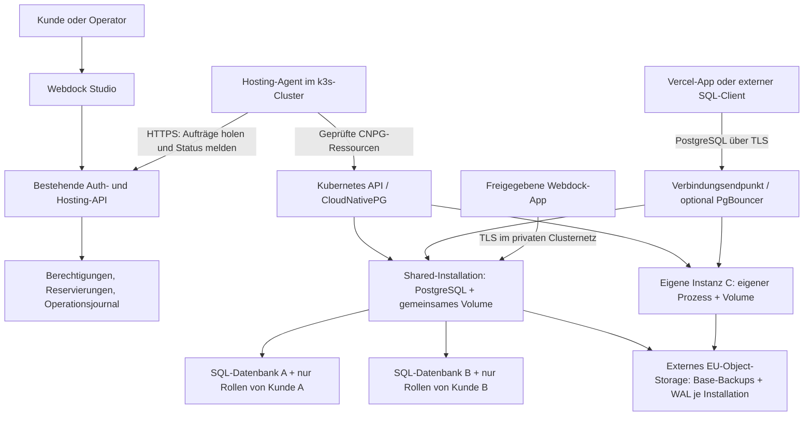

# Webdock Managed PostgreSQL — Entwurf

Stand: 12. Oktober 2026. Auftrag: vollständiger Plan, bestätigt für den vorhandenen k3s-Cluster mit drei VPS. Ergänzung des Nutzers: Kunden-Selbstbedienung direkt zur ersten Freigabe; zwei bezahlte Varianten, Shared und eigene Instanz; Datenbanken nur bei Bestellung oder als ausdrücklich vereinbarter Bestandteil eines Produkts. Dieser Entwurf installiert nichts und bestellt keine Infrastruktur. Preise und technische Größen sind Vorschläge; vorhandene Produktionskonfiguration und andere laufende Arbeiten bleiben maßgeblich.

## Ziel und Ausgangspunkt

Webdock soll zentral verwaltete PostgreSQL-Datenbanken als günstiges Shared-Angebot und als eigene PostgreSQL-Instanz anbieten. Beide sind kostenpflichtig, dauerhaft aktiv und ab der ersten Kundenfreigabe selbst buchbar. Kunden erhalten eigene Datenbanken, Zugangsdaten und einen TLS-Endpunkt; Webdock übernimmt Provisionierung, Wartung, Überwachung und Wiederherstellung. Registrierung oder Projektanlage erzeugen keine Datenbank und keine Kosten. Eine automatische Anlage für ein anderes Produkt ist nur erlaubt, wenn dessen angenommener Auftrag die Datenbank samt Preis oder Inklusivleistung ausdrücklich enthält.

Vom Nutzer bestätigt: drei vorhandene VPS im k3s-Cluster. Laut Projektunterlagen sind das drei Contabo-EU-Knoten mit je 6 vCPU und 12 GB gebuchtem RAM. Diese Werte wurden für diesen Plan nicht live nachgemessen. Die letzte dokumentierte Webdock-Freigabe beträgt insgesamt 13 CPU-Kerne, 24 GB RAM, 100 GB lokalen persistenten Speicher und 24 GB temporären Speicher. Das ist bereits gemeinsame App-Kapazität, kein zusätzlicher DB-Pool. Belegung, Reservierungen und tatsächlicher freier Speicher müssen vor Umsetzung neu geprüft werden.

Vorhanden: Auth/Studio auf Vercel, Kunden-/Projektzuordnung, Berechtigungen, Snowflake-IDs, Tarifvorlagen und manuelle Angebote, verschlüsselte Umgebungswerte, Ressourcenreservierungen, ein dauerhaftes Operationsjournal und ein ausgehend verbundener Python-Hosting-Agent. Der Agent sowie der bisherige begrenzte App-Speicher hängen an Knoten 02. Drei etcd-Mitglieder sind dokumentiert; replizierte App-Volumes, automatische Agentenübernahme und gesundheitsabhängiger öffentlicher Failover sind ausdrücklich vertagt.

Lokale Nachweise: [Shared Cluster](../../architecture/shared-container-cluster.md), [Kapazitätsstand](../../verification/2026-10-12-performance-first-cluster.md), [HA-Backlog](../../architecture/cluster-ha-todo.md), [App-Speicher](../../architecture/persistent-app-storage.md), [Tarife](../../architecture/plans-and-storage.md).

## Architekturentscheidung

Zwei Angebote auf demselben technischen Unterbau. **Shared** bedeutet eine eigene logische PostgreSQL-Datenbank je Bestellung mit eigenen Rollen in einer gemeinsam genutzten PostgreSQL-Installation. Kunden teilen weder Tabellen noch einen gemeinsamen Datenbankbenutzer. **Eigene Instanz** bedeutet einen eigenen CNPG-Cluster samt Namespace, PostgreSQL-Prozess, CPU/RAM-Budget und Volume. Auch diese Variante teilt den VPS und dessen Disk-I/O mit anderen Workloads; sie ist kein eigener Server.

Eine Bestellung gehört zu einem Kundenprojekt; ein Kunde kann keine, eine oder mehrere DB-Ressourcen buchen. Webdock trennt die verkaufte logische Datenbank von der PostgreSQL-Installation, die sie betreibt. Eine Installation bedient entweder einen Plattform-Shared-Pool oder eine eigene Kundeninstanz. Initial je Installation ein PostgreSQL-Pod. Ein CNPG-Cluster ist eine PostgreSQL-Installation, kein weiterer Kubernetes-Cluster.

Produktentscheidung:

| Modell | Vorteil | Nachteil | Entscheidung |
| --- | --- | --- | --- |
| Shared: getrennte SQL-Datenbanken in einer PostgreSQL-Installation | Geringerer Grundverbrauch und niedriger Preis | Gemeinsame CPU/RAM/I/O und Wartung; keine harte Ressourcenquote je SQL-Datenbank | Günstige Option ab v1 |
| Eigene PostgreSQL-Instanz je Bestellung | Getrennte Limits, Wartung, Restore und Pause | Mehr Grundverbrauch; Host und Disk-I/O bleiben geteilt | Wahlmöglichkeit ab v1 |
| Je Instanz Primary plus Standbys | Kürzere Unterbrechung bei geeignet abgesichertem Failover | Mehr RAM/SSD; benötigt geprüfte Ausfall-, Quorum- und Zugangsstrategie | Späterer HA-Tarif |

Bestehende Webdock-Identitäts- und Verwaltungsdatenbanken bleiben zunächst extern. Ein Ausfall des Kunden-DB-Clusters soll nicht gleichzeitig Login und Wiederherstellungsoberfläche ausschalten. Anwendungen sprechen direkt PostgreSQL; SQL-Abfragen laufen nicht durch Auth, Studio oder das Operationsjournal.

## Produktumfang

| Funktion | Erste bezahlte Version | Erweiterung |
| --- | --- | --- |
| Buchung, Erstellen, Status, Verbindungsdaten | Kundenselbstbedienung für Shared und eigene Instanz ab erster Freigabe | Zusätzliche Pakete |
| Dauerbetrieb | Standard | Unverändert |
| Benutzer-/Passwortverwaltung | Eigene Migrations- und App-Zugänge ohne Superuser; Rotation durch Kundenadmin | Zusätzliche Rollen und Read-only-Zugänge |
| Backups, Zeitpunktauswahl, Restore | Geplante Backups, WAL, operatorgeführter Restore in neue Instanz | Selbstbedienung nach erfolgreicher Pilotphase |
| Pausieren/Fortsetzen | Eigene Instanz: Hibernation; Shared: nur eigenen Zugang sperren/freigeben, Pool bleibt aktiv | Zeitplan für eigene Dev/Test-Instanzen |
| CPU/RAM ändern | Nur eigene Instanz: kontrolliertes Paket-Upgrade mit Wartungshinweis | Empfehlungen anhand gemessener Last |
| Shared → eigene Instanz | Kunde bestellt Upgrade; kontrollierter Datenumzug mit abgestimmtem Schreibfenster | Kürzeres Unterbrechungsfenster bei Bedarf |
| Storage vergrößern | Shared: Kontingent im geeigneten Pool ändern; eigene Instanz: Migration auf größeres Volume | Online-Vergrößerung erst mit geeignetem Storage-Unterbau |
| Klonen | Operatorgeführte Kopie in neue Instanz, getrennt reserviert | Kundenfunktion für Staging |
| Pooling | PgBouncer für Vercel-Verbindungen; direkter Endpoint für Migrationen | Zusätzliche Poolprofile nach Bedarf |
| Erweiterungen | Getestete Positivliste, initial für den Pilot benötigte Extensions | pgvector/PostGIS bei Nachfrage und passenden Images |
| HA/Read Replicas | Nicht im Starter enthalten | PostgreSQL-Replikation auf verschiedenen VPS |
| Automatisches Schlafen/Aufwachen | Nicht v1 | Eigenes Gateway/Controller-Projekt, nur bei belegtem Nutzen |
| SQL-Webeditor, beliebige YAML/Shell, automatische VPS-Bestellung | Nicht enthalten | Separater Produktauftrag |

Pausierte eigene Instanzen behalten Volume, Backups und ihre zugesagte Wiederanlaufkapazität. Shared-Pausen sperren neue Verbindungen der eigenen Rollen und beenden nach bestätigter Unterbrechung deren bestehende Sessions; sie hibernieren oder starten niemals den Pool neu. Der Festpreis bleibt bei beiden gleich. Physisch freier RAM wird nicht erneut als garantierte Kapazität verkauft. Bereits gelöschte, aufbewahrte Daten belegen weiterhin Storage; bei Shared sind logische Löschung und tatsächlich zurückgewonnener Filesystem-/Backup-Speicher getrennte Größen.

## Kundenbuchung und Abrechnung

Im Projektbereich gibt es standardmäßig nur die Aktion „Datenbank hinzufügen“. Der Kunde wählt Shared oder eigene Instanz, sieht Monatspreis, enthaltene Leistung, Grenzen und Wiederherstellungsbedingungen und bestätigt als berechtigter Kundenadmin eine versionierte Bestellung. Vorhandene Angebotsannahme und manuelle Rechnungsstellung werden wiederverwendet; Selfservice setzt keine neue Zahlungsanbieterintegration voraus. Buchung bedeutet keinen kostenlosen Tarif.

Erst nach Annahme und atomarer Kapazitätsprüfung werden Auftrag und Provisionierung angelegt. Es ist keine manuelle Operatorfreigabe für jede Standardbestellung vorgesehen. Fehlt Kapazität, gibt es eine klare Nichtverfügbarkeitsmeldung vor der verbindlichen Annahme; kein stiller Wechsel von Shared zu einer teureren Instanz. Der abrechenbare Zeitraum beginnt erst nach bestätigter Bereitstellung. Doppelklick, wiederholtes API-Kommando oder Retry erzeugen weder doppelte Ressourcen noch doppelte Abrechnung. Eine vorherige Paketfreigabe durch den Betreiber ist Konfiguration des Angebots, keine Wartephase pro Kunde.

Optionales DB-Add-on bei Hostingbuchung ist explizit ausgewählt. Falls ein Produkt technisch eine DB benötigt, werden Art und Preis/Inklusivleistung schon im Angebot angegeben. Keine Provisionierung aufgrund eines fehlenden `DATABASE_URL`, eines Webseitenbesuchs oder einer bloßen Registrierung. Plattformbetreiber dürfen weiterhin unterstützen; der erste öffentliche Flow muss ohne solche Unterstützung vollständig funktionieren.

## Infrastruktur und Isolation

CloudNativePG, Barman Cloud Plugin, PostgreSQL, PgBouncer und cert-manager werden als kompatible, unterstützte Releases und Images mit festen Digests ausgewählt. Referenz für die Planung ist die CNPG-1.30-Dokumentation; die installierte k3s-Version und die tatsächlich verfügbaren Releases entscheiden bei der Ausführung. Initial PostgreSQL 18, sofern Quellversion und benötigte Extensions kompatibel sind; kein Downgrade einer neueren Quelle.

CNPG benötigt eigene RBAC-/ServiceAccount-Rechte, die dem bestehenden App-Verbot für Kubernetes-API-Tokens widersprechen können. Deshalb eine abgegrenzte, ausschließlich vom Operator beschreibbare DB-Namespace-Klasse einführen. Nur benötigte Infrastruktur-Ausnahmen zulassen. Kunden erhalten weder Kubernetes-Zugriff noch Schreibrechte auf CNPG-CRDs, freie Images, Bootstrap-SQL als Superuser oder beliebige PostgreSQL-Parameter. Nicht als normalen HTTP-`AppSpec` tarnen.

Je PostgreSQL-Installation: Namespace-Isolation, NetworkPolicy mit standardmäßig gesperrtem Verkehr, feste Ressourcen und Secrets. Shared-Kunden sind innerhalb des Pool-Namespace durch PostgreSQL-Berechtigungen getrennt, nicht durch eigene Pods oder NetworkPolicies. Freigaben nur für zugeordnete Anwendungen, DB-Zugang, DNS, notwendige Kubernetes-API- und Backup-Verbindungen. PostgreSQL darf keine beliebigen externen Ziele kontaktieren. Hostzugriff und privilegierte Kunden-Pods bleiben gesperrt. Kein Verkaufsversprechen einer dedizierten physischen CPU, SSD oder gegen alle Seitenkanäle isolierten VM.

Für Shared pro Bestellung generierte opaque DB-/Rollennamen verwenden. Datenbankeigentümer bleibt eine geschützte NOLOGIN-Plattformrolle; die Kunden-Migrationsrolle darf ihr Anwendungsschema und dessen Objekte verwalten, jedoch keine fremden Datenbanken oder Rollen. `PUBLIC`-CONNECT/TEMP sowie unerwünschte Schema-Rechte explizit entfernen; Authentisierung auf erlaubte Datenbank-/Rollenpaare beschränken. Kein SUPERUSER, CREATEDB, CREATEROLE, REPLICATION, BYPASSRLS oder Mitgliedschaft in privilegierten vordefinierten Rollen. Extensions/FDW/dblink/Serverdatei-/Programmfunktionen sind keine frei aktivierbaren Kundeneinstellungen. Rollen bleiben bis zum geprüften Abschluss der Rechtevergabe nicht anmeldbar. Keine gemeinsame Backendrolle im Pooler, die Datenbank-/Kundengrenzen verwischt.

Shared ist keine vollständige Ressourcen- oder Metadatenisolation: einzelne Systemkataloge können Objektnamen sichtbar machen, deshalb keine Kundennamen/Geheimnisse in Pool-Metadaten. Schwere SQL-Last kann Nachbarn beeinträchtigen. Kleine Connection-/Pool-Limits, kontrollierte Defaults und Messungen begrenzen normale Last, ersetzen aber keine harte CPU/RAM-Quote pro Kunde. `work_mem` und viele Session-Timeouts sind keine unveränderbaren Sicherheitsgrenzen; Änderung per Session sowie mehrere parallele Operationen müssen im Missbrauchstest berücksichtigt werden. Wer garantierte Prozessressourcen braucht, bucht eine eigene Instanz. Nicht nur API-Isolation, sondern echte SQL-Isolation vor Shared-Verkauf testen.

## Lokaler Speicher

Für v1 lokale Volumes mit tatsächlicher Größenbegrenzung und `Retain` verwenden. Die bestehende Vorallokation/Journal-/Mount-Prüfung des App-Speicherhelpers ist die bevorzugte Basis, aber CNPG braucht einen eigenen, versionierten Adapter für seine PVCs und PostgreSQL-Dateirechte. Der Operator muss seine Pods/PVCs weiterhin selbst verwalten können.

Erster technischer Pilot: ein neues synthetisches DB-Volume auf dem bereits unterstützten Knoten 02. Erst nach Kompatibilitätsnachweis nodegebundene DB-Pools auf weiteren Knoten freigeben. Dort entstehen unabhängige Helper-Identitäten und lokale Journale; keine zweite kopierte zentrale Agentenidentität und kein allgemeiner Remote-Root-Endpunkt. Administrative Poolbereitstellung ist anfangs operatorgeführt. Der tägliche DB-Lebenszyklus bleibt über Webdock steuerbar.

Ein nominell 10 GiB großer Kubernetes-`local-path`-PVC allein ist keine geprüfte Disk-Quota. Der Fülltest muss ENOSPC im DB-Dateisystem auslösen, bevor Hostreserve oder fremde Daten gefährdet sind. Speicherpool-Grenzen zählen vorhandene App-Volumes, retained Volumes, DB-Volumes und Hostreserven gemeinsam. Kein Longhorn/Ceph nur für diese DB-Version; spätere PostgreSQL-Replikation kann Datenkopien auf unabhängigen lokalen Volumes führen.

Bei eigener Instanz bezeichnet Paket-Speicher das gesamte DB-Dateisystem inklusive PostgreSQL-Metadaten, WAL und temporärer Dateien. Nicht 10 GiB reine Tabellendaten versprechen. Bei Shared gibt es ein gemessenes logisches Datenkontingent; PostgreSQL liefert dafür keine mit einer eigenen Filesystem-Quota gleichwertige native harte Grenze. Das Angebot nennt diesen Unterschied. Wachstum wird überwacht, Operator und Kunde werden vor Erschöpfung informiert; neues Kontingent nur nach Zustimmung, keine überraschende Mehrrechnung. Pool-Filesystem und Gesamtreservierung sind weiterhin hart begrenzt. UI zeigt Dateisystembelegung und logische Datenmenge getrennt. Warnungen bei 70/85 Prozent, kritischer Zustand bei 90 Prozent; eine große einzelne Transaktion kann zwischen Messungen wachsen, deshalb Poolreserve und ein kontrollierter Last-/Speicherschutz statt vermeintlich harter SQL-Quota. Keine automatische Löschung von WAL-Dateien.

## Verbindungsweg

Intern: explizit erlaubte Verbindung zum DB-/Pooler-Service mit TLS. Extern, einschließlich Vercel: PostgreSQL-TCP-Endpunkt, kein HTTP-Proxy. Für v1 feste, in Webdock reservierte NodePorts aus einem exklusiven Portbereich und pro PostgreSQL-Installation ein Hostname unter einer freigegebenen DB-Domain. Shared-Kunden teilen Host und Ports, erhalten aber unterschiedliche DB-Namen und Rollen; eigene Instanzen haben eigene Endpunkte. Direkter und gepoolter Port werden getrennt angezeigt. Keine unerprobte Abhängigkeit von TLS-SNI beim PostgreSQL-STARTTLS-Aufbau.

Ein bekannter öffentlicher Zugangsknoten ist im Starter ein dokumentierter Ausfallpunkt. DNS-Änderung bei dessen Ausfall ist operatorgeführt; mehrere DNS-Adressen allein werden nicht als HA verkauft. Endpunkte müssen bei interner Pod-Neuerstellung stabil bleiben. Zertifikate kommen über den bestehenden cert-manager, enthalten den veröffentlichten Hostnamen und werden automatisch erneuert. Vor Freigabe `psql`, Node `pg`, Prisma und PgBouncer mit vollständiger Zertifikatsprüfung testen. Öffentliche CA bevorzugt; kein stilles Abschalten der Prüfung.

SCRAM-Passwörter, TLS erzwungen, Verbindungsgrenzen, TCP-Zeitlimits und Brute-force-Abwehr festlegen. Eingeschränkte IP-Freigaben optional; keine statischen Vercel-Egress-IPs voraussetzen. Der HTTP-basierte Neon-Serverless-Treiber ist kein generischer Treiber für diese Instanzen: Vercel-Apps bei Migration auf normales PostgreSQL/PgBouncer umstellen.

## Backups und Wiederherstellung

Die bisher vertagten Cluster-Backups bleiben unverändert. Für dieses neue Datenbankprodukt empfiehlt der Plan vor bezahlter Freigabe einen eigenen Backup-Ausbau. Das ist keine Anweisung, jetzt Backup-Dienste zu aktivieren oder Storage zu buchen.

Ziel: Barman Cloud Plugin, tägliches Base-Backup, laufendes WAL-Archiv, zunächst sieben Tage Recovery-Fenster; externes EU-Object-Storage außerhalb der drei VPS. Getrennte Backup-Präfixe und Berechtigungen je PostgreSQL-Installation, Verschlüsselung, getrennt gesicherte Schlüssel sowie getestete Lifecycle-/Retention-Regeln. Ein physisches Shared-Backup enthält mehrere Kundendatenbanken und ist ausschließlich für den Betreiber zugänglich. Kunden bekommen niemals Pool-Backups, Pool-Rollen oder deren Credentials. Keine Providerzusage vor Kompatibilitäts-, Standort- und Kostenprüfung. Aufbewahrung muss Base-Backup plus komplette benötigte WAL-Kette erhalten.

Interne Abnahmeziele für kleine Startpakete: höchstens fünf Minuten Datenverlust gegenüber nachweislich extern archiviertem WAL bei gesunder Archivierung; Wiederherstellung binnen 60 Minuten für eine höchstens 10 GiB große Pilotinstanz. Beides sind Messziele, kein vorhandenes SLA. Wenn Archivierung ausfällt, zeigt das Panel den letzten tatsächlich wiederherstellbaren Zeitpunkt.

Eigene Instanz: Restore erzeugt eine neue, zunächst nur intern erreichbare Instanz mit neuer ID, neuen Volumes/Credentials und eigener Kapazitätsreservierung. Shared: zuerst den ganzen Pool ausschließlich in eine private Recovery-Installation zum gewünschten Zeitpunkt zurückspielen; nur die angeforderte Kundendatenbank logisch exportieren und ohne globale Rollen/alte Owner-/ACL-Zuordnungen unter neu vergebenen Kundenrollen in eine neue Shared-DB oder gebuchte eigene Instanz importieren. Nie den aktiven Shared-Pool zurückdrehen. Recovery-Kapazität richtet sich nach dem gesamten Pool, nicht nur nach der kleinen Kundendatenbank. Fremde Daten und Secrets bleiben in der abgeschotteten Recovery-Installation und werden nach dokumentierter Aufbewahrung entfernt.

Bei beiden Daten prüfen, Anwendungen stoppen/Schreibzugriffe einfrieren und erst dann Verbindungsdaten bzw. freigegebenen Endpoint umschalten. Die alte Kundendatenbank bleibt kontrolliert gesperrt als Rückfall erhalten; andere Shared-Kunden laufen weiter. Shared → eigene Instanz verwendet denselben isolierten logischen Export-/Importpfad mit finalem Schreibfenster. Nach neuen Schreibzugriffen auf dem Ziel ist Rückkehr zum alten Stand kein verlustfreier DNS-Rollback. Für Shared-Recovery gelten erst nach Messung am vollen Pilotpool eigene Zeitziele; die 60-Minuten-Annahme für eine kleine eigene Instanz ist nicht automatisch übertragbar.

Testplan: jede neue Backup-Konfiguration mit realem Restore, danach wöchentlich rotierend mindestens eine Pilot-DB. Base-Backup-Alter, Archivierungsfehler, WAL-Rückstand und Restore-Testalter überwachen. Benachrichtigungsziel wird eingerichtet und geprüft; eine lediglich rote Dashboard-Anzeige zählt nicht als zugestellter Alarm. Keine Nachrichten werden durch das Schreiben des Plans versandt.

## Ressourcen und Preise

Technische Tests und ein interner Pilot gehen der Freigabe voraus, aber die erste öffentliche Version bietet beide Varianten als Selfservice. Initialer Verkaufskorridor zur Prüfung: ein Shared-Pool für höchstens acht kleine Shared-Bestellungen sowie höchstens zwei eigene Starter-Instanzen. Diese Obergrenzen sind keine Leistungszusage. PostgreSQL-Ressourcen je Installation als requests=limits konfigurieren; Pooler/Backup-Sidecar/Jobs zusätzlich rechnen.

| Vorschlag | PostgreSQL-RAM | CPU-Budget | Speicher | Monatspreis netto, Vorschlag |
| --- | ---: | ---: | ---: | ---: |
| Shared | Gemeinsam genutzt, kein eigener garantierter RAM | Gemeinsam genutzt | 1 GiB logisches Kontingent, gemessen | 5,90 EUR |
| Eigene Instanz Starter | 1 GiB | 500m | 10 GiB DB-Dateisystem | 14,90 EUR |
| Eigene Instanz Standard, spätere zusätzliche Größe | 2 GiB | 1000m | 20 GiB DB-Dateisystem | 24,90 EUR |

Dauerbetrieb und sieben Tage Restore-Fenster nach erfolgreicher Abnahme; keine Wachstundenabrechnung und kein kostenloser Tarif. Shared und eigene Starter-Instanz sind ab erster Freigabe gleichwertig auswählbar. Größeres Standard-Profil nach Lastqualifizierung. Backupbedarf und Dauerlast gehören in die Wirtschaftlichkeitsprüfung; kein unbegrenztes Traffic-/Support-/Backupvolumen zusagen. Selfservice-Bestellung und Preisannahme sind v1; neue automatische Zahlungsabwicklung ist nicht nötig, bestehende Angebote und manuelle Rechnungen genügen zunächst.

Vorläufiges Shared-Pool-Profil: 2 GiB RAM, 1 CPU und 30 GiB Dateisystem für maximal acht kleine DBs mit je 1 GiB logischem Kontingent. Die Differenz ist Reserve für Systemdaten, WAL, temporäre Dateien und kontrolliertes Wachstum, nicht zusätzlicher verkaufter Kundenspeicher. Acht DBs sind nur ein Startlimit, kein Benchmark. Ein solcher Pool plus zwei eigene Starter brauchen allein 4 GiB PostgreSQL-RAM, 2 CPU und 50 GiB primären Volumenspeicher. Pooler/Sidecars, Plattformkomponenten sowie temporär mindestens ein kompletter Shared-Pool-Restore kommen hinzu. Shared-Installation physisch nur einmal reservieren, ihre Kundenkontingente getrennt führen. DB-Budget wird aus den vorhandenen gemeinsamen Grenzen abgezweigt, nicht darauf addiert. Byte-Einheiten genau rechnen. Keine RAM-Überbuchung; jeder Knoten/Datenträger muss auch während Restore passen.

Preisprüfung ohne erfundene Providerrechnung: zugeordnete VPS-Kosten + Backup/Traffic + Zahlungsgebühren + Betriebs-/Supportreserve = monatliche Vollkosten. Acht Shared-Buchungen ergeben 47,20 EUR Monatsumsatz; mit zwei eigenen Starter-Instanzen zusammen 77,00 EUR. Diese Einnahmen sind kein Gewinn und kein Kostenvorteilsnachweis. Das Shared-Modell verteilt einen gemeinsamen Grundverbrauch auf mehrere kleine Anwendungen, trägt aber seinen Pool-Grundverbrauch auch bei nur einem Kunden. Benötigte Kundenzahl zur Kostendeckung = aufrunden(fixe Poolkosten / (Preis je Vertrag minus variable Kosten je Vertrag)); Kosten dabei nicht doppelt zählen. Bereits bezahlte VPS sind wirtschaftlich nicht kostenlos; endgültige Preise brauchen tatsächliche Rechnungen und Pilotmessung.

Erweiterung zuerst durch Verteilung auf vorhandene geeignete Knoten. Bei anhaltend knappen Reservierungen, kritischem Disk-Wachstum oder schlechter p95-Latenz neue Zusagen stoppen und Kapazität prüfen. Ein neuer VPS wird erst nach konkretem Bedarf und Bestellung durch den Betreiber hinzugefügt. Bestehende DBs ziehen kontrolliert um; zusätzlicher RAM auf einem anderen Knoten vergrößert keine laufende PostgreSQL-Instanz.

## Betriebsgrenzen und spätere HA

Shared-Pool und eigene Starter-Instanz haben jeweils eine laufende Datenkopie. Ein verlorener DB-Knoten bedeutet Unterbrechung bis Rückkehr oder Restore; Pool-Ausfall oder -Wartung betrifft alle zugeordneten Shared-DBs. Kundenaktionen dürfen keinen Pool-Neustart, keine Hibernation und keine globale Konfigurationsänderung auslösen. Ein unbekannt erreichbarer alter Primary wird vor Ersatzbetrieb sicher gestoppt/abgeschottet; kein zweiter Schreiber nach bloßem Timeout. Updates mit Testkopie, Wartungsfenster und Rückfallplan; keine automatischen Major-Upgrades.

HA erst als separater Ausbau: Primary und passende Anzahl Standbys auf unterschiedlichen VPS, getestete synchrone/asynchrone Replikationspolitik und definierte Datenverlustgrenze. Control Plane, DB-Failover, Agent und öffentlicher Zugang jeweils prüfen. N+1-Platzierung und Wiederaufbaukapazität berechnen. Drei vorhandene VPS sind keine Garantie für DB-HA und kein Schutz gegen Standort-/Provider-Ausfall.

## Erfolgskriterien

Kunde kann Shared oder eigene Instanz ohne Operator buchen; ohne Auftrag wird nichts angelegt oder abgerechnet. Kunde sieht in Webdock nur eigene Ressourcen; echte SQL-Verbindungen erreichen keine fremden Kundendaten. Provisionierung und Retries erzeugen keine Duplikate oder doppelte Rechnung; Daten überleben Pod-/Knoten-Neustart mit vorhandenem Datenträger; ein verlorener Mount erzeugt keine leere Ersatz-DB; externe TLS-Verbindung funktioniert; Backups sind real zurückgespielt. Shared-Restore/Upgrade/Pause/Löschung verändern keine fremde DB. 24-Stunden-Pilot einschließlich Konkurrenzlast, Archivierung und vollständigem Pool-Restore bleibt innerhalb gemessener Budgets. Kapazitäts- und Diskfehler blockieren neue Zusagen; kein bestehender Lunares-/Auth-/Studio-Betrieb wird still verändert. Angebotsgrenzen entsprechen dem getesteten Verhalten.

## Quellen

- [CNPG Sicherheit und Trust Model](https://cloudnative-pg.io/docs/1.30/security/)
- [CNPG Storage](https://github.com/cloudnative-pg/cloudnative-pg/blob/release-1.30/docs/src/storage.md)
- [Barman Cloud Plugin](https://cloudnative-pg.io/plugin-barman-cloud/docs/intro/)
- [CNPG Hibernation](https://cloudnative-pg.io/docs/1.30/declarative_hibernation/)
- [CNPG Ressourcen und Autoscaler-Grenzen](https://cloudnative-pg.io/docs/1.28/resource_management/)
- [CNPG Connection Pooling](https://cloudnative-pg.io/docs/1.30/connection_pooling/)
- [CNPG unterstützte Releases](https://cloudnative-pg.io/docs/1.30/supported_releases/)
- [K3s etcd-HA](https://docs.k3s.io/datastore/ha-embedded)
- [PostgreSQL Privilegien und PUBLIC-Defaults](https://www.postgresql.org/docs/current/ddl-priv.html)
- [PostgreSQL Ressourcenparameter und Grenzen](https://www.postgresql.org/docs/current/runtime-config-resource.html)
- [CNPG logische Datenbanken](https://github.com/cloudnative-pg/cloudnative-pg/blob/main/docs/src/declarative_database_management.md)
