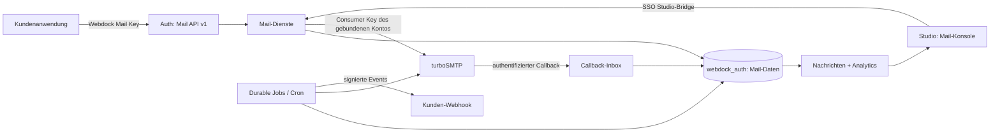

# Webdock Mail: vollständige Relaykit-Integration

Stand: 12.10.2026. Status: ausgearbeiteter Zielentwurf; keine Produktänderung oder Produktionsfreigabe.

## 1. Auftrag und Abgrenzung

Webdock Mail erhält den vollständigen **implementierten** Funktionsumfang von Relaykit, integriert in Webdock Studio und dessen Mandantenmodell, **mit der ausdrücklich gewünschten Ausnahme der Cloudflare-Integration**. Maßstab sind der Produktbericht vom 26.09.2026 und der lokal vorhandene Relaykit-Stand `dfaa885`. Hinzu kommen die bereits vorhandenen Webdock-Funktionen für Unterkonten, Kontingente, eigene Anbieter-Konten und Custom Tracking.

Die Planung ist vom Benutzer ausdrücklich beauftragt. Sie enthält Architektur und Ausführungsschritte zusammen; eine Umsetzung, ein Versand, ein DNS-Schreibzugriff oder eine Migration wurde damit noch nicht durchgeführt. Die folgenden Defaults sind Entwurfsentscheidungen, keine behaupteten bestehenden Produkteigenschaften.

Nicht Teil dieses Auftrags sind Cloudflare-OAuth, automatische DNS-Schreibzugriffe, die in Relaykit selbst zurückgestellten KI-Funktionen, Newsletter-/Marketingkampagnen, eingehende Postfächer/IMAP, ein eigener SMTP-Server und ein proprietäres SDK. DNS-Records werden manuell beim beliebigen DNS-Hoster gesetzt und in Webdock geprüft. Native `fetch`-/cURL-Beispiele und die vorhandene direkte SMTP-Anbindung gehören zum Umfang.

### Quellen und überprüfter Ausgangspunkt

- Referenz-PDF: `/home/newt/Schreibtisch/relaykit-product-report-2026-09-26.pdf`.
- Referenzcode: `/home/newt/Projekte/Personal/turboSMTP/relaykit`, Commit `dfaa885`, bei Prüfung sauber.
- Webdock: Commit `73733b0` plus vorhandene lokale Änderungen; diese gehören nicht zu diesem Plan und dürfen bei Umsetzung nicht überschrieben werden.
- `docs/architecture/platform-mail.md`; `apps/auth/src/lib/{tenant-mail,mail-domains,mail-dns,mail-keys,mail-tracking,turbosmtp,turbo-domains,turbo-tracking,platform}.ts`.
- `apps/auth/src/lib/hosting/byok-mail.ts`, `studio-api.ts`, `tenant-preview.ts`, `tenants.ts`, `tenant-policy.ts` und `plans.ts`.
- `apps/admin/src/lib/studio-client.ts` und die bestehenden Mail-Seiten.
- Installierte Next.js-Dokumentation: `node_modules/next/dist/docs/01-app/03-api-reference/03-file-conventions/route.md` und `04-functions/after.md`.
- Live geprüfte Primärquellen: [turboSMTP OpenAPI](https://serversmtp.com/turbo-api/turbo-smtp.yaml), [Event Webhooks](https://serversmtp.com/event-webhook-reference/), [Vercel Cron-Limits](https://vercel.com/docs/cron-jobs/usage-and-pricing), [Function-Limits](https://vercel.com/docs/functions/limitations).

Die vorangegangene Prüfung ergab 21 bestandene Adapter-/DNS-Tests. Datenbanktests waren wegen `ECONNREFUSED 127.0.0.1:5438` nicht ausführbar. Produktiver Versand und Callback-Konfiguration wurden nicht geprüft. Der Plan behandelt diese Punkte als nachzuweisende Voraussetzungen.

## 2. Global Constraints

- Node.js 24.x, Next.js 16.3.8, React 19.2.8 und die vorhandenen npm-Workspaces bleiben die Basis.
- Better Auth, Webdock-SSO, customer_id, organization_id und Snowflake-IDs bleiben maßgeblich; keine zweite Benutzerverwaltung.
- Geschäftslogik und Mail-Daten liegen in apps/auth; Studio in apps/admin verwendet die authentifizierte Studio-Bridge.
- turboSMTP bleibt der Provider; Versand verwendet kontogebundene Consumer-Key/Secret-Paare, niemals Master-Credentials als Kunden-Versandkonto.
- Neue Versandverbindungen verwenden EU-Endpunkte; bestehende explizite Global-Verbindungen werden als solche erhalten und angezeigt.
- Alle Mandantendaten werden über customer_id und connection_id abgegrenzt; fremde Ressourcen liefern 404.
- Eine unklare Provider-Annahme wird niemals automatisch erneut gesendet.
- Produktionsdaten, bestehende DNS-Einträge, Anbieter-Callbacks und fremde lokale Änderungen bleiben bis zum jeweils geplanten Cutover unangetastet.
- Authentifizierungs- und Einladungsmails bleiben auf dem vorhandenen sendAuthMail-Pfad; ein Mail-Produkt-Kill-Switch darf den Login nicht sperren.
- Vorschauumgebungen erhalten isolierte Datenbanken und Provider-Zugangsdaten; Tests senden keine echten E-Mails.
- Webdock-i18n, vorhandene UI-Komponenten, Tastaturbedienung sowie helle und dunkle Darstellung gelten für jede neue Seite.
- Es werden keine Neon-Auth-/Drizzle-Parallelimplementierung und kein zusätzlicher Queue-Dienst eingeführt.
- Cloudflare-Integration, Cloudflare-OAuth und automatische DNS-Schreibzugriffe sind ausdrücklich außerhalb dieses Plans.

## 3. Architekturentscheidung

| Variante | Vorteil | Nachteil | Entscheidung |
| --- | --- | --- | --- |
| Relaykit-Fachlogik in Webdock übernehmen und an dessen Grenzen anpassen | Ein Mandant, eine Anmeldung, ein Produkt; vorhandene Provider-Verwaltung bleibt nutzbar | Datenmodell und Provider-Zuordnung müssen bewusst angepasst werden | Gewählt |
| Relaykit als separaten Dienst hinter Studio betreiben | Weniger unmittelbare Portierungsarbeit | Zweite Auth-/Datenwelt, gemeinsame Provider-Credentials, zusätzliche Betriebs- und Migrationsgrenzen | Verworfen |
| Nur Relaykit-Oberfläche nachbauen und direkt Provider-Daten anzeigen | Schneller erster Bildschirm | Keine verlässliche eigene Versandhistorie, keine vollständige API-Parität | Verworfen |

`apps/auth/src/lib/mail-product/` enthält die neuen Mail-Dienste. Die bewährten vorhandenen Domain-/Tracking-/Account-Adapter werden erweitert und weiterverwendet. `packages/mail-contracts` enthält ausschließlich gemeinsame DTOs, Validierung, Ereignisnamen, Grenzen und öffentliche Fehlerverträge.

Öffentliche API: `https://auth.webdock.dev/api/mail/v1`; Dokumentation: `/mail/docs` und `/api/mail/v1/openapi.json` auf demselben Ursprung. Ein neuer Hostname ist nicht nötig. Studio bleibt unter seinem vorhandenen Ursprung. Seine Server-Komponenten/-Actions delegieren mit der existierenden SSO-Verbindung; keine Browser-Cookies wandern zur Kundenanwendung.

`after()` darf durable Arbeit anstoßen oder Telemetrie ergänzen. Es ist keine Warteschlange. Jede notwendige Versand-, Callback- oder Webhook-Arbeit wird zuerst dauerhaft gespeichert.

### Drei voneinander getrennte Geheimnisse

1. **Webdock Mail API Key:** `wdm_` plus mindestens 32 zufällige Bytes, nur SHA-256-Hash gespeichert, einmalige Ausgabe, kunden-/verbindungsgebunden.
2. **Interner Provider-Sendekey:** verschlüsseltes Consumer-Key/Secret-Paar; serverseitig zur Zustellung, nie in einer Kundenantwort.
3. **Bestehende direkte SMTP/API-Zugangsdaten:** bleiben für Bestandsanwendungen verfügbar. Sie sind keine Webdock-Keys. Direkter Versand umgeht Webdock-Historie, lokale Sperrlisten und lokale Budgets.

Die aktuelle turboSMTP-Spezifikation verlangt für `/mail/send` ein Consumer-Paar; ein Child-Authorization-Token genügt nicht. Deshalb muss Webdock für ein verwaltetes Unterkonto einen eigenen `SEND_API`-Key anlegen und sicher persistieren. Bei verloren gegangener Einmalantwort oder fehlgeschlagenem DB-Write folgt `needs_review` mit Abgleich/Widerruf des verwaisten Keys, kein blindes erneutes Anlegen. Quelle: [Providervertrag](https://serversmtp.com/turbo-api/turbo-smtp.yaml).

BYOK kann das bereits verschlüsselte Paar verwenden, wenn dessen Versandberechtigung und tatsächliche Kontozuordnung bestätigt sind. Reine Management-Credentials reichen nicht. Derselbe reale Provider-Account darf nicht durch zwei verschiedene Schlüsselpaare versehentlich an unterschiedliche Kunden gebunden werden: Provider-Account-ID prüfen, nicht nur Credential-Hash.

## 4. Vollständige Feature-Matrix

| ID | Ziel | Bestehende Basis / Ergänzung | Plan |
| --- | --- | --- | --- |
| F01 | Webdock- und BYOK-Verbindungen, Status, Pause, Kontingente | Account-/BYOK-Code übernehmen; internes Versandpaar, Verbindungsauswahl | T04, T07 |
| F02 | Domain hinzufügen, TXT-Eigentum, SPF/DKIM/DMARC, Details, entfernen | Vorhandenen DNS-Plan erhalten; API und verbindungsspezifische Zuordnung | T05 |
| F03 | Manuelles DNS-Onboarding mit Copy-Actions und Konfliktschutz | Vorhandene SPF-/DMARC-Regeln erhalten; keine Cloudflare-Integration | T05, T16 |
| F04 | Tracking-Domain, DNS, Verifizierung, Standard, Rotation; Öffnungen/Klicks | Webdock kann mehr als der Bericht; erhalten und für BYOK erweitern | T05, T16 |
| F05 | Sending-/Full-API-Keys, Domainbeschränkung, Widerruf | Eigene Webdock-Keys zusätzlich zu direkten Provider-Keys | T03 |
| F06 | Sofortversand, Text/HTML, To/Cc/Bcc, Reply-To, Header, Tags | Relaykit-Vertrag; robuste Webdock-Zuordnung | T08 |
| F07 | Anhänge und CID-Bilder | Base64, klare Größenlimits, sichere Speicherung und Bereinigung | T08 |
| F08 | Batch bis 100 | Vorabprüfung aller Elemente, stabile Teilresultate, keine Doppelzustellung | T10 |
| F09 | Scheduling bis 30 Tage, verschieben und abbrechen | Durable Worker und konkurrierende Änderungen absichern | T09, T18 |
| F10 | Idempotenz 24 Stunden | SQL-Reservierung, exakte Replay-Antwort, unklare Ausgänge schützen | T07 |
| F11 | Simulator: delivered/bounced/complained | Keine Provider-Aufrufe, getrennte Statistiken, keine echten Sperren | T08 |
| F12 | Nachrichtenliste, Details, sichere Vorschau, Event-Timeline | Neue Konsole und Abfragen | T06, T15 |
| F13 | Provider-Callbacks und Statusabgleich | Kontozuordnung, 64-Bit-IDs, Duplikate, falsche Reihenfolge | T11 |
| F14 | Analytics 7/30/90 Tage, Domain-/Verbindungsfilter, Chart und Tabelle | Ausschließlich kanonische lokale Zustände | T13 |
| F15 | Kunden-Webhooks, Ereignisauswahl, Signatur, Retry, Replay, Rotation | Relaykit-Verträge + verschlüsselte Secrets und Outbox | T12 |
| F16 | Sperrlisten: manuell, Bounce, Beschwerde, Abmeldung | Mandantenbezogen; Provider-Sperren separat darstellen | T06, T16 |
| F17 | API-Logs mit Redaktion, Details, 30 Tagen Aufbewahrung | Authentifizierte Request-Logs, Audit-Logs getrennt | T07, T16, T18 |
| F18 | Quickstart, Codebeispiele, OpenAPI/Scalar, Signaturbeispiel | Keine eingebetteten echten Keys; Dokumentation vertragstreu | T14, T16 |
| F19 | Team, Einladung, Rollen, letzter Owner | Bestehenden Tenant-Service kontrolliert erweitern | T17 |
| F20 | Navigation, Mandantenwechsel, Seitensuche, Copy-Actions, Themes, responsive UI | Studio integrieren, kein zweites Shell-/Theme-System | T15, T16 |
| F21 | Migration, Betrieb, Retention, Rollback, Live-Abnahme | Eigene Arbeitspakete; nicht mit Funktionsfertigstellung verwechseln | T18–T20 |

## 5. Mandanten, Verbindungen, Rechte

Ein Kunde kann gleichzeitig eine Plattform- und eine BYOK-Verbindung haben. Jede Verbindung besitzt eine unveränderliche ID und einen festen Provider-Account. Schlüssel, Nachrichten, Schedules und Domainregistrierungen sind an diese ID gebunden. Die Auswahl in Studio ist eine Präferenz, keine Zugriffsberechtigung.

Ein Credential-Wechsel für **denselben** Provider-Account erhält die Verbindung. Ein anderer Account erzeugt eine neue Verbindung. Alte Schedules werden nie stillschweigend auf sie umgeleitet. Trennen/Pausieren verhindert neuen Versand; Historie und Callback-Zuordnung bleiben lesbar. Laufende HTTP-Handoffs lassen sich nicht zurückrufen.

| Akteur | Lesen | Senden/Simulator | Mail-Ressourcen verwalten | Provider/Quota verwalten | Team |
| --- | --- | --- | --- | --- | --- |
| Aktives Mitglied | Nachrichten, Analytics, Domains, Quickstart | Ja | Nein | Nein | Eigene Einladungen |
| Tenant Admin | Ja, einschließlich Request-Logs | Ja | Domains, Keys, Webhooks, Sperren, Tracking | BYOK innerhalb freigegebener Policy | Member/Admin einladen; Members verwalten |
| Tenant Owner | Wie Admin | Ja | Wie Admin | Wie Admin | Auch Admins/Owners verwalten; letzter aktiver Owner bleibt |
| Plattformoperator mit erfüllten Sicherheitsvorgaben | Ja, Zugriff auditiert | Explizite Aktion | Ja | Plattformkonten, Limits, Reconciliation | Eskalationsweg |
| Kundenansicht/Preview | Nur bereits erlaubte redigierte Übersicht | Nein | Nein | Nein | Nein |
| Sending-Key | Keine Listen oder vertraulichen Details | Eigene Verbindung, optional eine Domain | Nein | Nein | Nein |
| Full-Key | Mail-Ressourcen der eigenen Verbindung | Ja | Mail-API-Ressourcen; kein Provider-Geheimnis | Nein | Nein |

Ein Full-Key ist vollständiger **Mail-API-Zugriff**, kein Tenant-/Plattformadministrator. Neue Keys über die API dürfen keine höhere Autorität oder weitere Verbindung als der aufrufende Key erhalten. Ein gelöschter Domain-Eintrag darf einen eingeschränkten Key nicht unbeschränkt machen.

Mitgliederentzug sperrt menschlichen Zugriff sofort. Bereits ausgegebene Tenant-Keys und akzeptierte Schedules gehören dem Tenant und überleben den Austritt ihres Erstellers. Ein archivierter/gesperrter Tenant stoppt Keys, neue und geplante Sends sowie ausgehende Webhooks. Provider-Callbacks werden weiter angenommen, damit Historie und Sperrlisten nicht verloren gehen.

**Bewusste Rechteänderung:** Heute sind Rollenänderungen/Entfernungen operator-only, und der Schutz betrifft den letzten Admin. Relaykit-Parität verlangt die obige Owner-/Admin-Policy. T17 ändert deshalb gezielt den gemeinsamen Tenant-Service samt Projektgrant-Widerruf und Regressionstests. Keine separate Mail-Mitgliederliste. Bestehende Tenants bekommen nicht automatisch einen willkürlich gewählten Owner; ein Operator bestätigt die initiale Owner-Zuordnung.

## 6. Datenmodell und Speicherung

Alle neuen Tabellen liegen in `webdock_auth`. Entitäts-IDs: vorhandene Snowflake-Defaults als Dezimalstrings; Provider-IDs und importierte Relaykit-UUIDs bleiben Strings. UTC-`timestamptz` für Zeitpunkte. SQL ist parametrisiert, Runtime-Rollen erhalten keine DDL-Berechtigung.

| Tabelle | Zweck und wesentliche Felder/Constraints |
| --- | --- |
| `mail_connection` | `id,customer_id,kind,provider_account_id,region,state,revision`; aktive Quelle je Tenant eindeutig; reale Provider-Account-ID tenantübergreifend eindeutig; alte Verbindungen bleiben tombstoned |
| `mail_connection_secret` | interne Provider-Paare, verschlüsselt mit Purpose aus Kunde+Verbindung+Version; aktive/abzulösende Version, keine clientseitige Lesefunktion |
| `mail_provider_operation` | Reservierung für Key-Erzeugung/Rotation, eindeutiges Operation-Label, `pending/needs_review/succeeded`; keine Secrets im Audit |
| `mail_connection_domain` | Registrierung des bestehenden lokalen `mail_sender_domain` auf einer Verbindung; Provider-ID/Flags/Operation; Unique pro Verbindung+Domain |
| `mail_api_key` | Kunde, Verbindung, Name, Präfix, Hash, Permission, optionale Domain-ID, `revoked_at,last_used_at`; kein Klartext |
| `mail_message` | Kunde, Verbindung, Domain, Principal-Audit, From/Betreff, Dispatch-Status, geplante Zeit, Provider-MID, zufällige `provider_reference`, Revision, Idempotenzoperation |
| `mail_message_content` | Text/HTML, freigegebene Header/Tags, Attachment-Metadaten und getrennte verschlüsselte ausstehende Attachment-Inhalte; Löschfrist |
| `mail_recipient` | Nachricht, normalisierte Adresse, To/Cc/Bcc-Typ, Unterdrückungsgrund und getrennte Delivery-/Engagement-Zustände; eindeutiger normalisierter Empfänger pro Nachricht |
| `mail_event` | Nachricht+Empfänger, Typ, Provider-/Empfangszeit, Quelle, bereinigte Details, Dedupe-Key; unveränderliches Ereignis |
| `mail_callback_source` | verifizierte Provider-Callback-Quelle und Secret-Hash; ein Account oder bestätigte Parent-Gruppe |
| `mail_callback_source_connection` | explizite Zuordnung einer Callback-Quelle zu erlaubten Verbindungen |
| `mail_callback_inbox` | authentifiziert angenommene, begrenzte Ereignisse, Verarbeitungsstatus/Versuche; keine unbereinigten Header/Secrets |
| `mail_suppression` | `customer_id,email,reason,source,created_at`; PK Kunde+Adresse, wirkt auf dessen beide Verbindungen |
| `mail_webhook` | Kunde, Verbindung, URL, Event-Abos, verschlüsseltes Signatursecret, aktiviert/gelöscht, Version |
| `mail_webhook_delivery` | Outbox, Ereignis-ID, Endpoint, unveränderliche Body-Bytes, Status, nächste Zeit, Lease-Token/-Ende; Unique Endpoint+Event |
| `mail_webhook_attempt` | Versuch, HTTP-Code, gekürzte/redigierte Antwort, Fehlercode, Dauer; keine Secrets |
| `mail_idempotency` | Kunde+Verbindung+Key eindeutig, Methode/Pfad/Body-Hash, Status/Antwort, Message-/Batch-ID; TTL erst für abgeschlossene Operationen |
| `mail_batch` / `mail_batch_item` | langlebige Batch-Annahme, Reihenfolge, je Element Ergebnis/Message-ID, erster Fehler |
| `mail_usage_period` / `mail_usage_reservation` | UTC-Monat, Budget, reservierte/verbrauchte Empfänger; jede Nachricht höchstens einmal belastet |
| `mail_rate_window` | kundenbezogene atomare Minuten-/Stunden-Zähler, kurzlebig |
| `mail_request_log` | Kunde/Verbindung/Key, Route, HTTP-Status, Dauer, Request-ID und begrenzte redigierte Bodies |
| `mail_job_lease` / `mail_job_run` | gegenseitiger Ausschluss, Heartbeat, letzte erfolgreiche Ausführung, Backlog-/Fehlerzahlen |
| `mail_import_map` | Quellsystem+Typ+Legacy-ID auf neue ID; wiederholbarer kontrollierter Import |

Kombinierte Unique-/Foreign-Key-Constraints verhindern z. B. eine Message des Kunden A mit Connection des Kunden B. Indexe: `(customer_id,connection_id,created_at DESC,id DESC)` für Listen; partielle Indexe für fällige Schedules/Inbox/Outbox; `(connection_id,provider_mid)` eindeutig, wenn MID gesetzt; zufällige Provider-Referenz global eindeutig. Keine globalen Joins allein über MID.

Die vorhandenen Provider-Spalten in `mail_sender_domain` bleiben während der additiven Migration lesbar. Alte und neue Mutationen werden danach über denselben Dienst geführt. `mail_tracking_domain` erhält eine Connection-Zuordnung; vorhandene Sender-/Tracking-Reservierungen bleiben wirksam. Kein zweites unabhängiges Domainverwaltungssystem.

Domain-Tombstones erhalten `deleted_at`. Sowohl die bisherige eindeutige Kunden-/Domain-Kombination als auch der globale Verified-Domain-Index werden zu partiellen Unique-Indizes über lebende Claims. Eine erneute Registrierung bekommt eine neue Domain-ID und einen neuen Proof; sie reaktiviert keine an die alte ID gebundenen Keys. Alle bestehenden Ownership-/Konfliktabfragen müssen Tombstones bewusst berücksichtigen.

## 7. Versandvertrag und harte Grenzen

Die API übernimmt Relaykits Feldnamen: `from,to,cc,bcc,reply_to,subject,text,html,headers,tags,attachments,scheduled_at`. String oder Array für Adresslisten; Anzeigename erlaubt. Empfänger werden normalisiert und zwischen To/Cc/Bcc dedupliziert; erste Kategorie gewinnt. Unterschiedliche Reihenfolgen bleiben für den Idempotenz-Hash relevant.

| Grenze | Zielwert |
| --- | --- |
| Empfänger pro Nachricht | 50 nach To/Cc/Bcc-Normalisierung; Eingabelisten ebenfalls begrenzt |
| Batch | 1–100 Nachrichten; keine Anhänge und keine Schedules |
| Scheduling | In Zukunft, maximal 30×24 Stunden; ISO-Zeit mit expliziter Zone |
| Öffentlicher JSON-Body | 4.000.000 Bytes, während des Streamlesens geprüft |
| Text+HTML einer Nachricht | 512 KiB UTF-8 zusammen |
| Anhänge | Höchstens 10; zusammen höchstens 2 MiB dekodiert; nur Base64, keine URL/Dateipfade |
| Betreff | 998 UTF-8-Bytes, keine CR/LF |
| Tags / eigene Header | Je 50; Tags wie Relaykit ASCII `[A-Za-z0-9_-]`, je Teil 256 Zeichen; Header zusammen 16 KiB |
| Callback-Body | Höchstens 1 MiB und 500 Events; Quelle zusätzlich ratenbegrenzt |
| Studio-Bridge | Bestehende 128-KiB-Requestgrenze bleibt; UI-Testversand ohne Anhänge; Inhaltsabruf max. 512 KiB |
| Listen | Standard 20, höchstens 100; stabile Cursor aus Zeit+ID |
| Initiale Rate-Limits | 120 API-Requests/Minute/Kunde; 1.000 neu angenommene Empfänger/Minute/Kunde; 10 neue Keys/Stunde/Kunde |
| Ausstehende Schedules | 1.000 Nachrichten/Kunde; weitere Annahme 429, kein stilles Verwerfen |

Diese Grenzen sind explizite Produktdefaults. Größere Dateien über direkten Object-Storage-Upload sind eine spätere API-Erweiterung, keine Voraussetzung für Relaykits Base64-Funktion. Der Vercel-Request-/Response-Rahmen beträgt derzeit 4,5 MB; eine größere Provider-Grenze hebt ihn nicht auf. Quelle: [Function-Limits](https://vercel.com/docs/functions/limitations).

Reservierte Header einschließlich `Bcc`, Envelope-/Content-Header und interner Referenzheader können nicht über `headers` überschrieben werden. Keine Remote-Anhänge; keine Header-Injection. HTML-Vorschau: sandboxed iframe ohne Scripts/Same-Origin/Formulare, restriktive CSP, externe Bilder standardmäßig blockiert; keine unbeabsichtigten Tracking-Aufrufe beim Öffnen der Vorschau.

### Verbindlicher Ablauf

1. Principal und aktuelle Tenant-/Connection-Berechtigung prüfen; Request begrenzt lesen/validieren.
2. Bei vorhandenem Idempotenz-Key den Replay-/Konfliktfall **vor** erneuter zeitabhängiger Schedule-Validierung beantworten. Rechte und Connection-Zugriff werden auch beim Replay geprüft.
3. Verifizierte lokale Domain und zugehörige Providerregistrierung verlangen; veraltete Providerbeobachtung vor Dispatch aktualisieren. Cache höchstens fünf Minuten, fehlgeschlagene Prüfung erlaubt keinen Versand.
4. Message, Empfänger, Payload und Idempotenz-Zuordnung vor jedem Netzwerk-Handoff committen.
5. Lokale Sperren anwenden, Tenantbudget atomar reservieren, aktuellen aktiven Zustand erneut prüfen.
6. Dispatch-Versuch mit eindeutiger Zufallsreferenz dauerhaft markieren, kurze DB-Transaktion beenden, dann Provider aufrufen.
7. Positive Annahme: MID speichern, akzeptierte Empfänger und `email.sent`-Event verbuchen, Reservation belasten, Attachment-Inhalt löschen. Das ist keine Zustellbestätigung.
8. Definitive Ablehnung: `failed`, Reservierung freigeben, Payload auf bereinigte Metadaten reduzieren.
9. Timeout, Verbindungsabbruch oder erfolgreicher Provideraufruf mit fehlgeschlagenem DB-Commit: `outcome_unknown` bzw. veraltetes `dispatching`. Keine automatische Wiederholung; Callback/Abgleich kann auflösen.

Kommt ein bestätigender Callback vor dem Ende des Sendrequests, kann er Dispatchannahme, Quoten-Settlement und Attachmentbereinigung bereits abschließen. Ein späterer Requesttimeout darf diesen bestätigten Zustand nicht wieder auf `outcome_unknown` setzen; Abschlussupdates sind zustands-/versuchstokengebunden.

Eine Lease verhindert parallele Arbeit, garantiert jedoch kein exactly-once beim externen Provider. Ein abgelaufener Dispatch wird deshalb nicht wie eine Webhook-Zustellung wiederholt.

### Sperren und Kontingente

Manuelle Sperren, terminale Bounces, Beschwerden und Abmeldungen gelten für alle Verbindungen desselben Tenants. Temporäres `DEFERRED` sperrt nicht. Eine lokale Entsperrung löscht niemals eine unabhängige Provider-Sperre.

Sind alle To-Empfänger gesperrt, wird die ganze Nachricht ohne Provideraufruf unterdrückt; Cc/Bcc erhalten den expliziten Grund `no_primary_recipient`. Dies entspricht Relaykits Versandgrenze und wird sichtbar dokumentiert. Sonst werden nur gesperrte Empfänger ausgelassen.

`mailMessages` wird für den neuen Webdock-Versand als **Empfängerzustellungen pro UTC-Kalendermonat** ausgelegt. Fehlende Subscription nutzt den ausdrücklich übernommenen Plattform-Default; `0` sperrt und `null` bedeutet kein lokales Monatslimit. BYOK hat getrennt ausgewiesene Webdock-Verarbeitungslimits; Providerkosten bleiben beim Kunden. Providerlimit/-verbrauch werden zusätzlich angezeigt und sind die externe Instanz auch für Direkt-SMTP. Ein lokales Budget verspricht keine Begrenzung von Direkt-SMTP.

Schedules reservieren ihr Budget erst beim tatsächlichen Dispatch. Bei dann fehlendem Budget: sichtbarer terminaler Fehler `quota_exceeded`, kein heimliches Verschieben in den nächsten Monat. Unklar angenommene Empfänger halten eine Reservation; eine Bereinigung darf sie nicht als ungesendet erstatten.

### Simulator

`delivered@test.mail.webdock.dev`, `bounced@test.mail.webdock.dev` und `complained@test.mail.webdock.dev` werden intern abgefangen. Kein DNS-/SMTP-Ziel muss dafür eingerichtet werden. Gemischte echte/Testempfänger werden abgelehnt. Die Senderdomain muss trotzdem verifiziert sein. Simulierte Nachrichten/Events sind markiert, aus produktiven Quoten/Analytics standardmäßig ausgeschlossen und erzeugen keine echten Suppressions.

## 8. Zustände, Callbacks und Analytics

Dispatch und Zustellung werden getrennt modelliert:

- Dispatch: `scheduled → dispatching → accepted | failed | outcome_unknown`; `scheduled → canceled`; `suppressed` bei vollständiger Unterdrückung.
- Pro Empfänger: `pending/deferred/delivered/bounced/failed/suppressed`; Beschwerde/Abmeldung sowie first/last-open/click separat.
- Ein spätes `sent/processed` darf `delivered` nicht zurücksetzen. Ein Klick ist Engagement; ohne Zustellereignis wird keine bestätigte Zustellung erfunden.
- Multi-Recipient-Nachrichten können gemischte Ergebnisse haben; UI zeigt Gesamtzusammenfassung und Empfängerzahlen, nicht nur einen verlustbehafteten Rang.

Der Eingang prüft die Callback-Quelle, bevor er Events persistent annimmt. Eine Quelle ist entweder ein einzelner bestätigter Provider-Account oder eine ausdrücklich bestätigte Parent-Gruppe. Zuordnung über zufällige Referenz und erlaubte Connection oder über `(connection_id,mid)`; zusätzlich muss der Empfänger zur gespeicherten Envelope gehören. Frei übermittelte `customer_id`, Domainnamen oder allein global gesuchte MIDs autorisieren nichts.

Eine Parent-Quelle ohne eindeutige Referenz/Accountkennung kann einen MID-only-Callback nur zuordnen, wenn unter ihren erlaubten Verbindungen genau ein bereits gespeicherter passender MID-/Empfänger-Datensatz existiert. Bei mehreren Kandidaten bleibt das Event in Quarantäne; es darf keinen beliebigen Treffer wählen.

`mid` und Provider-Event-IDs werden verlustfrei aus JSON gelesen; numerische Werte jenseits `Number.MAX_SAFE_INTEGER` bleiben Strings. Flat-/Array-Payload, `timestamp/Timestamp` und nachgewiesene Aliasnamen werden normalisiert. Die offizielle Referenz nennt u. a. `REPORT` und `UNSUBSCRIBED`; Relaykits vorhandene `SPAM`-Zuordnung wird daher nicht unverändert als vollständig angenommen.

Authentifizierte valide Events werden zuerst in die Inbox geschrieben und schnell mit 200 bestätigt. Projektion ist transaktional und idempotent: Event + Empfängerzustand + Suppression + Webhook-Outbox. Unbekannte Messages bleiben begrenzt in Quarantäne, fremde Accounts werden nicht sichtbar. Callback vor der Providerantwort muss eine noch nicht gespeicherte MID sicher ergänzen können.

Provider-Event-ID bevorzugen; ansonsten Hash aus Quelle, Verbindung, MID/Referenz, Typ, Empfänger, Zeitpunkt und relevanten Details. Identische Open-/Click-Events ohne eindeutige ID bei gleicher Zeitauflösung sind nicht unterscheidbar; diese Grenze steht in der Dokumentation.

**Analytics-Datenquelle ist dieselbe lokale Projektion wie die Nachrichtenliste.** Read-only Provider-Abgleich darf fehlende Beobachtungen als Events mit Quelle `reconciliation` ergänzen; kein separater direkt gerenderter Providerzähler für die Zustellrate.

7/30/90-Tage-Zeiträume: UTC-Tage, Endgrenze exklusiv, Kohorte nach Versandannahmezeit. Nachrichten und Empfänger werden getrennt gezählt. Zustell-/Bounce-Rate bezieht sich auf angenommene, nicht lokal unterdrückte Empfänger; Öffnungs-/Klickrate auf bestätigte Zustellungen. Nulldenominator zeigt „—“. Simulatordaten sind explizit zuschaltbar. Filter: Verbindung, Domain, Zeitraum; Volumenchart mit tabellarischer Alternative.

## 9. Öffentliche API

Alle Pfade relativ zu `/api/mail/v1`. `Authorization: Bearer wdm_…`; keine Kundenauswahl aus einem ungesicherten Header. `sending_access` nur für die beiden Versandendpunkte; alle übrigen Kundenressourcen benötigen `full_access`.

| Methode | Pfad | Verhalten |
| --- | --- | --- |
| POST / GET | `/emails` | Senden/Schedule annehmen / Liste |
| POST | `/emails/batch` | Batch mit Ergebnis oder dauerhaft abrufbarem Fortschritt |
| GET / PATCH | `/emails/{id}` | Details inkl. Timeline / Schedule-Zeit ändern |
| POST | `/emails/{id}/cancel` | Nur noch nicht beanspruchten Schedule abbrechen |
| GET | `/batches/{id}` | Batchstatus und Ergebnisse, Full-Key |
| GET / POST | `/domains` | Liste / lokalen Domainclaim erstellen |
| GET / DELETE | `/domains/{id}` | Details / Claim deaktivieren; kein pauschales Provider-/DNS-Löschen |
| POST | `/domains/{id}/verify` | Ownership und Provider-DNS prüfen |
| GET / POST | `/api-keys` | Metadaten / Key erstellen |
| DELETE | `/api-keys/{id}` | Sofortiger Widerruf |
| GET / POST | `/webhooks` | Liste / Endpoint erstellen |
| GET / PATCH / DELETE | `/webhooks/{id}` | Details / ändern / deaktivieren und löschen |
| GET | `/webhooks/{id}/deliveries` | Eigene Versuche, cursorpaginiert |
| POST | `/webhooks/{id}/rotate` | Neues einmaliges Secret |
| POST | `/webhooks/{id}/deliveries/{deliveryID}/replay` | Eigenen, nicht aktiv geleasten Versuch neu einplanen |
| GET / POST | `/suppressions` | Liste / lokalen Block setzen |
| DELETE | `/suppressions/{email}` | Nur lokalen Block entfernen |
| GET | `/logs`, `/logs/{id}` | Redaktionierte Request-Logs |
| GET | `/analytics` | Gleiche Kennzahlen wie Studio |
| GET | `/openapi.json` | Öffentlicher maschinenlesbarer Vertrag, ohne Auth |

Regulärer Einzelsend antwortet 200 mit `{id}`; Schedule ebenfalls 200, aber als `scheduled` gespeichert. Unklare Annahme: 502 `send_outcome_unknown` mit `email_id`. Fehlervertrag: `{statusCode,name,message,request_id}` plus dokumentierte Ergebnis-IDs.

Batch: alle Daten/Sender vor dem ersten Handoff validieren, gesamte Arbeitsliste persistieren, danach in Reihenfolge abarbeiten. Bis maximal 20 Sekunden inline; wenn noch nicht fertig, 202 `{id,status:"processing",data}`. Ein fertiger Batch liefert 200 `{id,data}`. Ein Providerfehler liefert/ergibt 502 `batch_send_failed` mit akzeptiertem Präfix, `failed_index` und `failed_email_id`; Folgeelemente bleiben `not_sent`. Die 202-Erweiterung vermeidet 100×Provider-Timeout im einzelnen Request. Wiederholung desselben Keys reproduziert die ursprüngliche HTTP-Antwort; aktualisierten Fortschritt liefert der dokumentierte Statusendpunkt mit Full-Key bzw. Studio.

Idempotenz gilt 24 Stunden für abgeschlossene Vorgänge, jeweils pro Tenant+Verbindung+Key. Methode, kanonischer Pfad und kanonisiertes JSON werden gehasht. Ein anderer Body/Pfad gibt 409, laufender Vorgang 409. Ungeklärte Vorgänge werden nicht nach 24 Stunden entsperrt; nach Reconciliation beginnt die begrenzte Replay-Aufbewahrung. Domain-/Rollenänderungen dürfen Replays nicht erneut senden lassen.

## 10. Webhooks, Logs und Hintergrundarbeit

Ausgehende Events: Relaykits `email.scheduled/sent/delivered/delivery_delayed/opened/clicked/bounced/complained/failed/suppressed` sowie `domain.created/updated/deleted`. Ergänzungen: `email.canceled` und `email.unsubscribed`. Bodyversion `1`; `email.sent` bezeichnet Provider-Annahme. Bcc und Nachrichtentext werden nicht in allgemeine Webhook-Payloads übernommen.

Signaturvertrag: `webhook-id`, `webhook-timestamp`, `webhook-signature`; HMAC-SHA256 über `id.timestamp.body`, Secret aus `whsec_`-Base64. Gleiches Delivery-ID bei Retries; neuer Zeitstempel und neue Signatur. Signatursecret verschlüsselt, Ausgabe nur bei Anlage/Rotation. Sofortige Rotation gilt auch für ausstehende Versuche; keine unbezeichnete Überlappungsphase.

Nur öffentliche HTTPS-Hostnamen auf Port 443, keine URL-Credentials, keine Redirects. Alle DNS-Antworten auf öffentliche IPv4/IPv6 prüfen, Ziel-IP beim TLS-Request fest binden, SNI/Zertifikatsprüfung erhalten. Timeout 15 Sekunden einschließlich DNS/Body; max. 2 KiB lesen und 500 redigierte Zeichen speichern. Transitive `ipaddr.js` nicht stillschweigend importieren; falls wiederverwendet, als direkte geprüfte Dependency deklarieren.

Initialer Versuch plus Retries nach 1, 5, 30, 120, 300 und 600 Minuten relativ zum vorigen Fehlschlag. Zwei-Minuten-Lease mit Zufallstoken und gefencetem Update. Deaktivierung pausiert anstehende Versuche; Reaktivierung setzt sie fort. Löschen stoppt sie terminal. Bereits gestartete Netzwerkanfragen sind ausgenommen. Manueller Replay nur ohne aktive Lease; gleiche Eventidentität zur Empfängerdeduplizierung.

Request-Logs und Audit-Logs sind verschieden: Request-Logs beschreiben Kunden-API-Aufrufe, Audit-Logs privilegierte Verwaltung. JSON wird einmal begrenzt gelesen, daraus redigiert; keine ungeprüften Request-Clones. Secrets/Token/Authorization/Cookies/Attachment-Base64 werden entfernt, freie Mailtexte im Request-Log durch Länge/Hash ersetzt; Bodies werden nur in der autorisierten Nachrichtendetailansicht gelesen. DB-/Providerfehler werden nicht roh geloggt.

Eigene Jobs für `dispatch`, `events`, `webhooks` und `maintenance`, damit langsame Webhookziele Schedules nicht blockieren. Minütlicher Tick für die ersten drei, stündlich Maintenance. PostgreSQL-Reservierungen/Leases und feste Arbeitsbudgets; keine offene DB-Transaktion während Netzwerkarbeit. Ein Tick nimmt höchstens 100 Sendekandidaten, 500 Inbox-Events bzw. 100 Webhookdeliveries, verarbeitet sie mit höchstens vier Netzwerkoperationen parallel und einem Gesamtbudget von 45 Sekunden. Lease-Tokens verhindern Updates alter Worker. Noch nicht begonnene Arbeit bleibt fällig.

Vercel-Cron benötigt für minütliche Ausführung laut aktueller Dokumentation Pro/Enterprise. Falls die reale Bereitstellung das nicht erlaubt, übernimmt ein Kubernetes CronJob den authentifizierten Tick; genau ein Scheduler wird aktiviert. Das ist eine Betriebswahl, keine zweite Jobimplementierung. Quelle: [Cron-Limits](https://vercel.com/docs/cron-jobs/usage-and-pricing).

### Aufbewahrung als Produktdefault

| Daten | Frist / Verhalten |
| --- | --- |
| Nachrichtentext/HTML | 30 Tage ab terminaler Annahme/Fehler/Abbruch; UI zeigt danach „Inhalt abgelaufen“ |
| Noch benötigte Schedule-Payloads | Bis Ausführung/Abbruch; danach obige Frist |
| Attachment-Inhalte | Sofort nach bestätigter Annahme/Abbruch/definitivem Fehler löschen |
| Unklare Versandpayloads | Max. 7 Tage; danach sensible Inhalte löschen, unbekannten Ausgang und Dedupe-Tombstone erhalten |
| Metadaten und Events | 90 Tage; junge/aktive Vorgänge nicht allein nach Erstelldatum löschen |
| Request-Logs und fertige Webhook-Versuche | 30 Tage; aktive Leases/ausstehende Zustellungen ausnehmen |
| Erfolgreich verarbeitete Callback-Inbox | 7 Tage; Quarantäne höchstens 7 Tage und mit Zähler sichtbar |
| Abgeschlossene Idempotenz | 24 Stunden; ungeklärte Reservierungen erhalten |
| Suppressions | Bis ausdrücklicher Entsperrung/Tenant-Datenlöschung |
| Schlüsselmetadaten/Audit | Bestehende Auditpolitik; keine Provider-/Webhook-Secrets darin |

Retention erfolgt in begrenzten Batches und berücksichtigt Fremdschlüssel, laufende Jobs und zugehörige Outbox-Daten. Keine Nachricht wird durch Payloadlöschung erneut versendbar.

## 11. Studio und Team

Mail wird ein eigener Bereich unter `/tenants/{customerID}/mail`:

- Übersicht mit Verbindungsauswahl, Setup-Fortschritt, Verbrauch und Warnungen für Callback-/Worker-Ausfall.
- `emails` und `emails/{id}`: Suche, Status-/Domainfilter, Cursor, Timeline, Empfängerstatus, Text/HTML, Schedule verschieben/abbrechen.
- `domains` und `domains/{id}`: manuelles DNS-Onboarding, Einklappen bestätigter Records, Copy-Actions, DNS-Recheck, Testmail; keine Cloudflare-Anbindung.
- `api-keys`: Webdock-Keys. `keys` bleibt vorhandene direkte SMTP/Provider-Key-Verwaltung und wird deutlich benannt.
- `tracking`, `analytics`, `webhooks`/Details/Versuche, `suppressions`, `logs`/Details, `quickstart`, `settings`.
- `team` zeigt/verwaltet dieselben Tenant-Mitglieder und Einladungen wie der bestehende Tenant-Bereich.
- Seitensuche/Cmd-K nur über für den Akteur zugängliche Seiten; keine implizite Volltextsuche über fremde Mailinhalte.

Testmail nutzt die gleiche Sendelogik und einen vom Formular über Wiederholungen stabilen Idempotenz-Key. „Ausgang unklar“ zeigt Message-Link und blockiert automatisches Retry. Leere Zustände erklären den nächsten konkreten Schritt. Ein externer Providerzähler ist als solcher bezeichnet. Keine erdachten Lieferquoten bei fehlenden Callbacks.

Team-Mutationen laufen über den Tenant-Service; native Better-Auth-Organisation-Endpunkte behalten ihre Guards. Letzter aktiver verifizierter Owner ist transaktional geschützt. Wechsel/Entfernung entfernt bei Bedarf Projektgrants; alte Sessions dürfen sofort keine Tenantdaten mehr lesen. Einladungsmails verwenden den vorhandenen Mailpfad, inklusive Fehlerzustand und sicherem erneuten Versenden.

## 12. Migration, offene Nachweise und Abnahme

### Migration bestehender Webdock-Konten

Additive Schema-Migration mit eigener Migrationskennung und Checksumme, expliziter Zieldatenbankprüfung. Bestehende Plattform-/BYOK-Zuordnungen lokal backfillen; keine Keys/Domains/Accounts beim Provider im Migrationsskript erzeugen. Direktzugänge weiterlaufen lassen. Pro Pilotverbindung internen Sendekey bereitstellen, Callbacks nachweisen und erst dann neue Versand-API freigeben.

Provider-Callback-Granularität (Parent versus Child), Account-ID-Prüfung für BYOK, Referenz-Echo und Credential-Permissions müssen in T01 mit Testkonten nachgewiesen werden. Bei einem belegten gemeinsamen Callback wird dessen aktueller Empfänger zunächst inventarisiert. Ein kontrollierter dauerhafter Fan-out muss den bisherigen Empfänger weiter bedienen, bevor die Provider-URL umgestellt wird. Keine unbelegte Annahme unabhängiger Child-Callbacks.

### Optionaler Import vorhandener Relaykit-Daten

Funktionsintegration verlangt keinen ungefragten Zugriff auf produktive Relaykit-Inhalte. Der vollständige Plan enthält einen separat aktivierbaren Import: explizite Zuordnung `legacy user_id/organization_id → customer_id/connection_id`, Dry-run mit Summen/Hashes, dann transaktionale Batches.

Messages/Events/Suppressions/Logs/Domains/Webhooks importieren, IDs in `mail_import_map` bewahren, fremde Shared-Account-Messages ausschließen. Importierte Historie bleibt mit dem tatsächlichen alten Provider-Account verbunden; kein Umschreiben auf ein neues Unterkonto. Noch geplante Nachrichten und ausstehende Webhooks erhalten genau einen aktiven Executor nach kontrolliertem Freeze.

Der Standardimport bindet einen ursprünglichen Relaykit-Ressourcenaccount an einen bestätigten Webdock-Tenant. Sollen mehrere Ressourcenaccounts desselben geteilten Providerkontos auf unterschiedliche Tenants verteilt werden, stoppt der Dry-run mit `shared_provider_split_required`. Erst eine gesondert bestätigte historische Accountaufteilung erlaubt dies; der Import umgeht nicht die eindeutige reale Accountbindung. Bis dahin bleiben Alt-Schedules im alten, einzigen Executor oder werden ausdrücklich storniert. Der bisher beobachtete einzelne Relaykit-Workspace erfordert keine automatische Mehrmandantenaufteilung.

Keys standardmäßig neu ausgeben und Anwendungen auf die neue Basis-URL umstellen. Eine Übernahme alter `rk_`-Hashes ist kein stiller Standard. Domainproofs werden neu verlangt oder anhand explizit bestätigter Legacy-Tokens zeitlich begrenzt übernommen. Importierte Webhook-Secrets sofort verschlüsseln. Offene Idempotenz-/Unknown-Vorgänge bleiben blockiert; kein Resend beim Import.

### Ungeprüfte Betriebsannahmen mit konkretem Nachweis

| Frage | Nachweis | Konsequenz bei fehlendem Nachweis |
| --- | --- | --- |
| Welche Account-ID hat ein BYOK-Paar? | Read-only Provider-Profil/Accountantwort mit dokumentierter Zuordnung | Neue Sending-Verbindung bleibt nicht freigegeben |
| Welche Callback-Ebene gilt? | Zwei isolierte Accounts, unterschiedliche Referenzen und Empfänger, authentifizierte Callbacks | Parent-Fan-out oder Account-spezifisches Onboarding; keine pauschale Freigabe |
| Werden große MIDs/Referenzen unverändert zurückgegeben? | Sanitized Fixture aus kontrolliertem Test und parsergenaue Assertions | Versandpilot bleibt blockiert |
| Ist Minute-Cron möglich? | Tatsächlicher Vercel-Plan oder bereitgestellter K8s-Tick | Scheduling/Webhook-Retry nicht als betriebsbereit kennzeichnen |
| Stimmen Providerzählung und lokales Empfängerbudget? | Ein/Multi-Recipient-Test, Doppeladressen und Suppression | UI weist unterschiedliche Zähler aus; kein falsches Billingversprechen |
| Sind Restore und Env-Trennung vorhanden? | Restore-Probe der Testkopie; getrennte Preview-Secrets | Kein Produktions-Cutover |

### Releasekriterien

Alle F01–F21 sind nachgewiesen, nicht nur sichtbar. Unit-, SQL-Integrations-, API-Vertrags-, Berechtigungs-, Race- und Browsertests sind grün. Live-Abnahme dokumentiert einen kontrollierten Versand, dessen tatsächliche Zustellung, passende Provider-Events, identische Konsole/Analytics, einen signaturprüfenden Webhookempfänger und einen zweiten Tenantnutzer. Keine breite Kundenfreigabe auf Basis eines einzigen angenommenen Providerrequests.

Rolloutfolge: Schema → Backend mit Feature-Gates aus → Pilotverbindung → Callback/Worker → API/Studio → schrittweise Tenantfreigabe. Rollback stoppt Annahme/Dispatch, erhält Inbox/History/Keys und sendet keine Unklarfälle erneut. Rollback niemals auf eine Version, die bereits eingeführte Tenant-/Owner-Grenzen ignoriert.

Die Vercel CLI ist in dieser Sitzung nicht installiert. Für die spätere Bereitstellung ist `npm i -g vercel` ausdrücklich empfohlen; danach stehen u. a. `vercel env pull`, `vercel deploy` und `vercel logs` für die dokumentierten Prüfungen bereit. Planerstellung installiert oder provisioniert keine externen Dienste.
