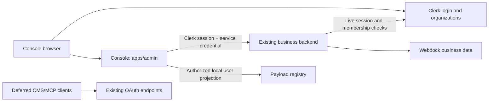

# Clerk for Webdock Console: design and migration scope

> Release stand: the native-team-policy amendment at the end of this document
> supersedes earlier strict team invariants. Current architecture is API-owned
> Drizzle/RLS, not Payload. Use the preflight adjustment and
> [release guide](../../architecture/clerk-console-release.md) for execution.

Status: proposed, awaiting implementation approval. Date: 2026-10-15.

## Goal and decisions

Use Clerk Free for Console authentication and customer teams. Keep Webdock customer/project records and business permissions. The existing Clerk application is `app_3KjGKUGb7dYUMgkjKC0eCWghnOB`; never create a replacement/accountless application.

The user confirmed **four separate accounts**: Dominik's operator account, Andrea's Tabularis account, Dominik's Tabularis account, and the Schattenclan account. Migration is a one-time operation for these accounts and their existing customer memberships. It does not need a general migration framework.

The user explicitly allows email/password login for operators on Free. The existing MFA requirement and passkey login will not be reproduced. Passwords may be newly set in Clerk; sessions will be newly established. No password-hash conversion, credential proxy, dual-password sync, or MFA-secret import is planned.

Global constraints:

- Clerk application: `app_3KjGKUGb7dYUMgkjKC0eCWghnOB`.
- Clerk plan: Free; no paid add-ons, MFA, passkeys, custom roles, satellite domains or Billing.
- Runtime: Node.js 24.x; preserve Next.js 16.3.8 and React 19.2.8.
- Package manager: npm workspaces with root `package-lock.json`.
- Console origin: `https://console.webdock.dev`; preserve Studio/OAuth/MCP compatibility URLs.
- Preserve decimal Snowflake IDs as strings; store Clerk IDs separately.
- Do not read or print existing environment files or credentials.
- No live migration, test-user creation, invitation email, deployment or auth replacement during planning.
- Customer Payload CMS login is deferred; Console's internal Payload registry remains in use.
- Four separate users; never merge the operator and Dominik/Tabularis identities.

## Current architecture and implication

`apps/auth` contains Better Auth **and** customer, offer, mail, storage, platform and hosting services. `apps/admin` is the Console and calls those services through `studio-client.ts` and `hosting-client.ts`. The backend currently reconstructs a Better Auth session from the delegated OAuth token.

Operator registry pages and GitHub/Vercel integrations also call `payload.auth()` internally. Customer preview references a Better Auth session row. Therefore replacing only the login screen would break existing features.

Recommended approach: replace Console identity and its backend authorization, retaining the existing business deployment. Keep deferred CMS/MCP OAuth entrypoints separate. Moving all services to another app or translating Clerk sessions back into Better Auth would add unnecessary work and preserve the wrong dependencies.

**Release boundary:** Console no longer needs a self-hosted login/session provider. `apps/auth` remains deployed for business APIs and legacy CMS/MCP consumers. Complete shutdown of the legacy provider is a later migration, not a claim made by this release.

## Target architecture

Use new backend entrypoints `/api/console`, `/api/console/hosting`, `/api/console/lifecycle`. Console sends a Clerk session token as Bearer plus `X-Webdock-Service-Key`, a dedicated server-only credential. The latter protects confidential hosting/provider context from direct browser callers. Use `WEBDOCK_ACCOUNT_SERVICE_ORIGIN` for this backend, independent of the legacy OAuth issuer.

Existing `/api/studio`, hosting bridge, lifecycle and OAuth endpoints keep their existing token contract. Never try one provider and fall back to another. No Clerk-to-Better-Auth cookie conversion or new local session issuance.

The backend uses Clerk SDK verification, pins issuer/token type/authorized party, and checks the current session, verified email, local identity mapping and suspension. Customer requests check live Clerk membership plus the local active customer and resource relationship. Request-scoped memoization avoids repeated lookups; no cross-request authorization cache initially. Provider timeouts/429 return availability errors and never reopen legacy access.

Business methods consume an authenticated principal instead of reading Better Auth cookies themselves. Legacy callers resolve their existing identity separately. Keep operator capability and provider identity explicit; never fake `twoFactorEnabled` to satisfy old SQL.

## Ownership and minimal data changes

| Data | Owner |
| --- | --- |
| Login, password/reset, sessions, profile | Clerk |
| Organizations, invitations, membership and Admin/Member role | Clerk |
| Customer, projects, hosting, mail, storage and offers | Webdock |
| Global operator permission, local suspension, per-project grants | Webdock |

Add only:

1. `webdock_auth.clerk_identity`: issuer + Clerk user ID mapped uniquely to an existing local user ID, with enabled state. Existing user/audit references remain intact.
2. `webdock_auth.clerk_organization`: issuer + Clerk organization ID mapped uniquely to the existing local organization. Existing `tenant_customer` links remain intact.
3. `webdock_auth.console_tenant_preview`: issuer/session ID, local actor/customer/organization, expiry and expired state. No foreign key to a Better Auth session.

No webhook mirror, event pipeline, general importer, background sync job or new queue is needed for four users. Read current Clerk identity/membership data directly. Deleted users/organizations fail live checks; local business history is retained. Keep current local organization rows as business/legacy references, not as a second membership authority for migrated customers.

For future invited members, create only a local identity projection after a verified Clerk membership in a mapped customer is established. Never attach an unknown Clerk user to an existing local user by email. Email collisions require an explicit mapping decision.

## Teams and permissions

Map the existing Tabularis and Schattenclan customers to Clerk Organizations. Confirm their exact local IDs during the authorized inventory. Do not create one organization per project and do not automatically add the operator to every customer team.

| Identity | Access |
| --- | --- |
| Local Webdock operator | Global administration through separately verified local permission |
| `org:admin` | Own team administration and existing customer-management permissions |
| `org:member` | Own customer access and existing per-project grants |
| No mapped membership | Account and access-pending page only |
| Disabled user/customer or removed membership | No customer data/actions |

Keep the four users' existing privileges. Map customer owner/admin to `org:admin`, member to `org:member`; preserve project-level restrictions. `org:admin` never implies platform operator. Do not guess Andrea's or Schattenclan's current role from their name.

Disable self-service organization creation in Clerk settings. Operators create/link a team when creating a customer. For the initial two teams, create/link them once and verify the mapping manually. Future provisioning stays a synchronous operator action: after a partial failure show an incomplete state and reconcile the existing provider object before retrying creation. Never call Clerk from the database trigger or report a customer as ready before its link exists.

Use Clerk `OrganizationSwitcher` and `UserButton`. Reuse Webdock's team forms for invite/resend/cancel, role change and removal; call Clerk through the backend. Invitations default to Member. Preserve the current last-customer-admin rule and blocked-customer rule. Serialize concurrent membership changes per team and recheck current membership.

Configure Clerk management System Permissions so direct Frontend API calls cannot bypass those Webdock invariants. Verify this in the Free-equivalent configuration; hiding controls is insufficient. If that configuration cannot enforce the boundary, keep team mutations operator-managed until a revised design is approved. Provider dashboard administrators remain trusted operators.

No nested teams or custom Clerk roles. Account self-deletion must not remove the last customer administrator or an operator without controlled recovery; use Clerk's account-deletion configuration and test the actual API path.

## Console flow and route protection

- `/login/[[...login]]`: Clerk sign-in in the existing layout.
- `/sign-up/[[...sign-up]]`: invitation completion, not customer creation.
- `/account/[[...account]]`: Clerk profile, password and session controls.
- Existing customer/team routes remain; add organization switching to desktop and mobile navigation.
- A user without mapped access sees a useful pending-access screen, not a redirect loop.
- Password and email-code login enabled; Google is optional and does not block launch. No phone or username login.
- Proxy handles routing checks; all Server Actions, route handlers and backend services enforce authorization independently.
- API/webhook/provider-callback/MCP/CMS routes retain their own verification and must not receive blanket browser login redirects.
- The selected customer must match both the verified organization context and target resource. A stale form or a second browser tab must not write into the newly selected organization.
- Preview is read-only for the whole session and remains restrictive after expiry until explicit exit. Organization switching cannot escape it.
- Preserve translations, mobile navigation and current theme. No shadcn dependency is needed; none was found in the inspected project.

Console's registry guard will validate Clerk/local operator permission and resolve the existing Payload user by immutable local `authSubject`. Continue passing that user to Local API calls with `overrideAccess:false`. Missing or ambiguous mappings deny access. No native Payload JWT, new Payload login strategy, or external CMS migration is required.

GitHub/Vercel callbacks must use the same operator guard and stable actor IDs. Existing integration credentials remain separate from Clerk social login. In-flight authorization flows restart after cutover. Console project deletion/lifecycle calls use the new Clerk-aware backend endpoint, not a Clerk token forwarded to an opaque-token endpoint.

## Four-account migration runbook

| Account | Preserve | Clerk destination |
| --- | --- | --- |
| Dominik operator | Existing local operator ID and Payload projection | Separate Clerk user; local global operator permission |
| Andrea / Tabularis | Existing local ID and customer/project roles | Separate Clerk user in Tabularis |
| Dominik / Tabularis | Existing local ID and customer/project roles | Separate Clerk user in Tabularis |
| Schattenclan account | Existing local ID and customer/project roles | Separate Clerk user in Schattenclan |

1. After approval, inspect only these users and associated memberships through an authorized database/administrative connection. Record exact IDs and role mappings in a private working manifest; never put passwords, hashes or email inventories into the plan or public docs.
2. Check the selected Clerk instance for existing mappings/conflicts. The application is already selected; do not list/select another app. `externalId` can carry each old user ID; the local mapping remains authoritative at runtime.
3. Create/link the two existing customer organizations and four users through the Backend API. Preserve email verification status explicitly; default API behavior must not accidentally mark an unverified address verified. Duplicate email/external-ID conflicts stop the affected account for manual resolution.
4. Keep all four identities separate. If two really share one email address, do not invent an alias or merge them: obtain the user's chosen distinct login identifiers before provisioning those accounts.
5. Import no existing passwords, sessions, MFA secrets or passkeys. New login uses verified email code and password setup in Clerk. Email/password remains available to the operator. The installed Better Auth hash format and normalization differ from Clerk's documented formats; conversion is intentionally excluded for this small migration.
6. Import only the reviewed memberships/roles. Do not create legacy password accounts for new Clerk-only users. Pending invitations, if any, are individually reviewed and replaced; old invitation links expire for migrated teams.
7. Check each account manually: login, correct team, correct rights, profile/password, logout. Check the operator cannot accidentally use the customer's identity and vice versa.
8. Actual activation/invitation emails and extra test users require explicit approval under the supplied setup prompt. Migration preparation itself must not send messages. Prefer the user signing in to their own account for the initial check.

For this small batch, one short rerunnable migration script plus a dry-run/report is enough. On a repeat run, look up exact mapping/external ID and refuse contradictions; never recreate all users. New development fixtures must not be confused with production identities. Production keys/IDs are not copied from development.

## Legacy clients and immediate removal

Deferred CMS/MCP/hosting-OAuth clients still validate their old sessions, audiences, scopes and MFA rules. New Clerk sessions do not authenticate those protocols.

For mapped users/teams, the shared central authorization resolver reads current Clerk membership and local enabled state instead of stale Better Auth membership. Disable legacy membership mutation for migrated organizations. This keeps a removed team member from retaining CMS/MCP access, without changing the external clients' protocol. Unmigrated clients retain legacy rules.

This is a narrow central compatibility change, not a Payload migration. If omitted, team removal would have inconsistent effects, so it is an acceptance requirement. New Clerk-only accounts have no automatic legacy CMS login. Console logout ends Clerk/Console preview; it does not claim to end separate CMS sessions. A Webdock account suspension blocks both paths.

## Free-tier and domain checks

Current Free limits: 50,000 monthly retained users, 100 monthly retained organizations, 20 members per organization. Standard Admin/Member roles, custom permissions and invitations suffice here. Sessions are fixed at seven days rather than the existing eight hours; branding remains. Confirm actual production entitlements because development can expose paid features.

Configure invite-only access and disable organization self-creation. A valid Clerk identity alone still grants no Webdock customer access. Keep local account/customer suspension because provider-wide user bans are not a Free assumption.

Clerk cookie scope differs from the current host-only cookies. Configure an appropriately isolated Console application domain, exact FAPI allowed origins and exact `authorizedParties`. Inspect actual cookie Domain in the browser. Do not allow customer-controlled sibling subdomains or arbitrary previews. If cookies cross a customer-controlled domain boundary, resolve the domain configuration before production; `azp` checks alone do not prevent replay of an already leaked token.

## Deployment, rollback and completion

1. User approves the migration plan and setup checklist; host terminal runs Clerk CLI login.
2. Set up Clerk in the Console workspace, targeting the exact app and its development instance. Preserve unrelated working-tree changes. Do not scaffold the monorepo root.
3. Apply additive development schema, implement identity/permissions/UI, and test approved fixtures. Existing production remains unchanged.
4. Configure the exact production instance, domain/DNS, origins, secrets and optional Google credentials. Verify Free entitlements and actual cookie isolation. Provision the reviewed four-user/two-team mappings.
5. Briefly freeze account/team edits, back up affected records and deploy the new backend before Console. Verify legacy clients. Switch Console as one coordinated release; old cookies do not automatically migrate. Users sign in again.
6. Verify the four accounts and the negative-access tests. Old Console-specific OAuth grants may be revoked without broadly revoking deferred CMS sessions. Monitor login failures, provider errors and unexpected permission denials.

Rollback: freeze writes, keep all local suspensions, reconcile any membership removals/role changes made in Clerk into legacy authorization, then deploy the known old Console. Users reauthenticate with old credentials; new Clerk passwords are not old passwords. Do not restore the whole database over current business data. If safe identity reconciliation is unavailable, stay in maintenance mode rather than reopening stale permissions. Keeping the one-time migration window short minimizes this work.

Completion means the four users can use Console with Clerk and correct team/operator access, with no Console-created Better Auth session. It does not mean the legacy provider is deleted. Remove that provider only after CMS/MCP/hosting OAuth are migrated or explicitly retired and no remaining caller needs it. Webdock still hosts its own business logic.

## Evidence and validation limits

Read-only source inspection found no Clerk dependency. No existing environment file, live database user inventory or selected Clerk application settings were read. Existing project changes were not modified. The source-backed hot spots are `studio-client.ts`, `studio-api.ts`, `server.ts`, tenant/hosting authorization, preview session storage, and provider callback guards.

Official references checked 2026-10-15: [CLI](https://clerk.com/docs/cli), [Next.js setup](https://clerk.com/docs/nextjs/getting-started/quickstart), [migration](https://clerk.com/docs/guides/development/migrating/overview), [createUser](https://clerk.com/docs/reference/backend/user/create-user), [organizations](https://clerk.com/docs/guides/organizations/overview), [organization configuration](https://clerk.com/docs/guides/organizations/configure), [roles/permissions](https://clerk.com/docs/guides/organizations/control-access/roles-and-permissions), [session verification](https://clerk.com/docs/reference/backend/authenticate-request), [production setup](https://clerk.com/docs/guides/development/deployment/production), [pricing](https://clerk.com/pricing).

Local guides inspected: Next.js `16-proxy.md` and `authentication.md`; Better Auth's installed `password.node.mjs`. Exact live account IDs, production domain configuration and Clerk settings are execution preflight facts, not guessed values in this plan.

## Verbindlicher Nachtrag vom 2026-10-15: native Teamregeln

Der Betreiber hat ausdrücklich „Clerk-Standardregeln übernehmen“ gewählt.
Kundenteams verwenden Clerks native Admin-/Member-Regeln. Webdock-Datensperren
bleiben bestehen. Frühere Forderungen in diesem Dokument nach global garantierter
Einladungssperre bei lokal gesperrten Kunden oder mindestens einem lokal aktiven
Admin gelten damit nicht mehr gegenüber direkten Clerk-Aufrufen. Keine zusätzlichen
Custom Roles oder kostenpflichtigen Rollenfunktionen sind vorgesehen.

Organisations-Slugs sind ausdrücklich gewünscht und in der Entwicklungsinstanz
aktiviert. Vier temporäre Testkonten und zwei Testorganisationen mit eindeutigen
`+clerk_test@example.com`-Adressen sind separat freigegeben, ohne Einladungsmails
und ohne Produktionsdaten. Diese Freigabe umfasst keinen Produktions-Cutover.
